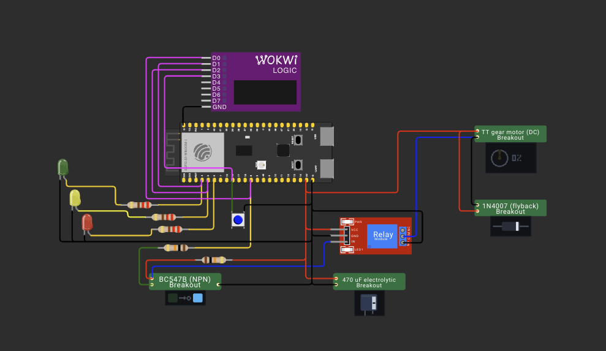
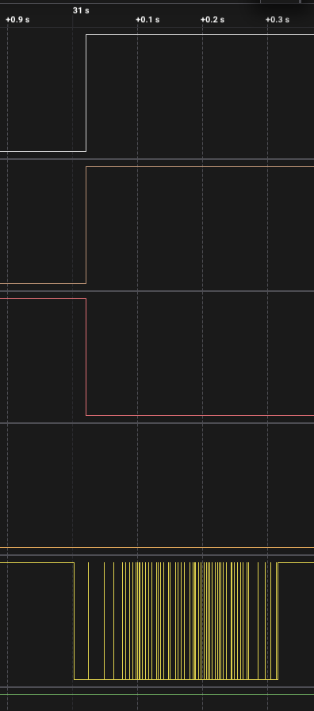
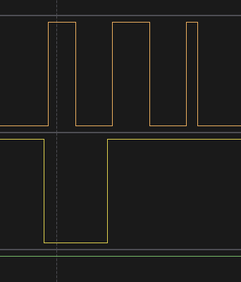
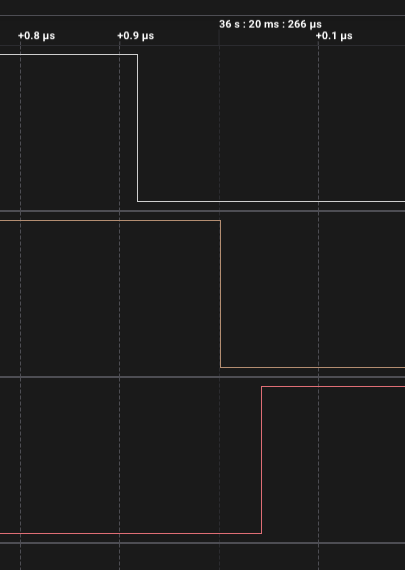

# ДЗ 2.5 — повна версія: watchdog, кнопка, стан через ребут (TIMERS)

Та сама витяжка на **ESP32-S3-DevKitC-1** на двох апаратних таймерах, плюс усе опційне з умови ДЗ.

| Опційне з умови | Як зроблено | Зміряно |
|---|---|---|
| Watchdog | Task WDT із власним таймаутом, `loopTask` підписано явно; команда `h` вішає `loop()` навмисно | ні, [див. нижче](#чого-в-цьому-записі-немає) |
| Логування станів | причина ребуту, кожна подія з міткою часу, затримки ISR, статистика по команді `s` | — |
| Захист від повторного запуску | три рівні | **так, 6 натискань: 5 відхилено, 1 прийнято** |
| ЛЕД індикатори | зелений — робота, другий — пауза, третій — увага | **так, блимання на кожну відмову** |

Плюс те, чого в умові немає: фаза і залишок часу переживають перезавантаження.

## Схема



| Компонент | Пін ESP32-S3 | Примітка |
|---|---|---|
| Керування реле | GPIO 8 | → 10 кΩ → база BC547B, колектор на `IN` модуля реле |
| LED «робота» | GPIO 4 | через 220 Ω — зелений, вентилятор працює |
| LED «пауза» | GPIO 5 | через 220 Ω |
| LED «увага» | GPIO 6 | через 220 Ω |
| Кнопка ручного пуску | GPIO 16 | другий контакт → GND, `INPUT_PULLUP` |

Силова частина — як у решті варіантів, розбір у [README ДЗ](../#схема). Кнопка на GPIO 16 — та сама, що в [ДЗ 1.5](../../dz1.5%20%28BUTTON%20BOUNCE%29/) і [ДЗ 2.4](../../dz2.4%20%28BUTTON%20DEBOUNCE%29/), тож її брязкіт уже зміряний раніше.

Аналізатор на п'яти каналах: D0 — реле, D1 — «робота», D2 — «пауза», D3 — «увага», D4 — кнопка.

## Як працює код

Файл: [`main.cpp`](main.cpp)

Основа — два таймери з [`two_timers`](../two_timers/): періодичний задає ритм і вмикає вентилятор, одноразовий через 15 хвилин вимикає. Далі тільки те, що додано.

### Watchdog

У arduino-esp32 Task WDT **уже ввімкнений**: таймаут 5 с, режим panic. Але підписані на нього тільки idle-задачі ядра 0, а `loop()` Arduino живе на ядрі 1:

```
CONFIG_ESP_TASK_WDT=y                           CONFIG_ARDUINO_RUNNING_CORE=1
CONFIG_ESP_TASK_WDT_PANIC=y
CONFIG_ESP_TASK_WDT_TIMEOUT_S=5
CONFIG_ESP_TASK_WDT_CHECK_IDLE_TASK_CPU0=y
# CONFIG_ESP_TASK_WDT_CHECK_IDLE_TASK_CPU1 is not set
```

Тобто з коробки зависання `loop()` не перезавантажує нічого. Щоб watchdog справді стежив за програмою:

```cpp
esp_task_wdt_init(Config::WDT_TIMEOUT_S, true);  // переставити таймаут, panic = перезавантаження
esp_task_wdt_add(nullptr);                       // підписати поточну задачу, тобто loopTask
```

далі `esp_task_wdt_reset()` першим рядком `loop()` — рівно те, що в уроці робить `Watchdog.reset()`. `GyverWDT.h` з уроку тут бути не може: ця бібліотека під AVR. Доступних таймаутів «16 мс, 32 мс… 2 с» теж немає — це значення AVR-івського WDT, а на ESP32 таймаут задається в секундах.

Команда `h` у моніторі вішає `loop()` назавжди:

```cpp
volatile uint32_t spin = 0;
while (true) ++spin;
```

`volatile` тут не випадково: порожній `while (true) {}` компілятор має право прибрати.

### Захист від повторного запуску

Три рівні, кожен закриває свій випадок.

**1. Кнопка не діє, поки вентилятор працює.**

**2. Після зупинки ручний пуск заблокований на `MIN_OFF_S`** (8 с у налагоджувальному масштабі, 10 хв у справжньому). Це захист не від подвійного натискання, а від самого режиму «увімкнув-вимкнув-увімкнув»: реле й двигун такого не люблять, а часті пускові струми нікому не корисні.

**3. Періодичний таймер не перезаводить тривалість, якщо вентилятор уже крутиться.** Інакше ручний пуск за секунду до автоматичного продовжився б на повні 15 хвилин від моменту автоматичного:

```cpp
portENTER_CRITICAL_ISR(&stateMux);
already = fanRunning;
if (!already) { ... }
portEXIT_CRITICAL_ISR(&stateMux);
if (already) return;
```

І навпаки: прийнятий ручний пуск скидає лічильник періодичного таймера, щоб наступний автоматичний стояв за цілий період від цього моменту.

Четверте, формально не з цього списку: **перша фаза після старту завжди пауза**. Якщо плата потрапить у петлю ребутів, вентилятор не буде крутитися без перерви.

Кнопка фільтрується машиною станів на чотирьох вимірах із кроком 5 мс, як у [ДЗ 2.4](../../dz2.4%20%28BUTTON%20DEBOUNCE%29/polling_debounce/).

### Стан через ребут

Будь-який ребут посеред циклу без збереження стану почав би відлік години з нуля, а вентилятор — із повних 15 хвилин. Найочевидніше джерело таких ребутів тут — сам watchdog, заради якого все це й робиться: спрацював, перезавантажив, і без RTC-пам'яті вийшло б, що він вилікував зависання ціною зіпсованого розкладу. Другий кандидат — brownout: на цій збірці силова частина живиться окремо, тож моторчик його не спричинить, але в [ДЗ 2.2](../../dz2.2%20%28POWER%20LOAD%29/motor_pwm/) на спільній шині 5 В це траплялося регулярно.

Фаза і залишок часу раз на секунду лягають у RTC-пам'ять:

```cpp
static constexpr uint32_t RTC_MAGIC = 0x2E35FA11;
RTC_NOINIT_ATTR static uint32_t rtcMagic;
RTC_NOINIT_ATTR static uint8_t  rtcPhaseRunning;
RTC_NOINIT_ATTR static uint32_t rtcPhaseLeftS;
```

`RTC_NOINIT_ATTR` не ініціалізується ні при якому старті — тому після подачі живлення там сміття, і єдиний спосіб відрізнити збережений стан від сміття — контрольне слово. Межі залишку все одно перевіряються окремо: запис міг застати ребут на півдорозі.

Запис іде раз на секунду, тому звичайний ребут втрачає не більше секунди фази. А от із перезавантаженням по watchdog є нюанс, який випливає з самої конструкції: поки `loop()` висить, він не оновлює ні стан, ні watchdog. Останній запис у RTC-пам'ять лягає за мить до зависання, а між ним і ребутом проходить увесь таймаут — 8 секунд. Тому після такого старту фаза продовжиться з моменту зависання, і вентилятор відпрацює на ці 8 секунд довше, ніж мав би. Виправити це нічим: програма, яка вже не виконується, нічого записати не може. На годинному циклі 8 секунд — 0,2 %, тож лишаю як є.

### Запис у GPIO через регістр

Це єдиний варіант, у якому обробники не викликають **нічого** з flash:

```cpp
static void IRAM_ATTR writePin(uint8_t pin, bool high) {
  *Reg::at(high ? Reg::OUT_W1TS : Reg::OUT_W1TC) = 1u << pin;
}
```

`digitalWrite` не підходить, бо в цій збірці він у flash. Повний розбір — у [README ДЗ](../#iram_attr-на-обробнику--ще-не-iram-обробник). Після цього переривання реєструється з `ESP_INTR_FLAG_IRAM`, а `setup()` перевіряє результат у runtime: коротко заводить таймер на 20 мс і дивиться, чи прийшло переривання; якщо ні — відкочується на стандартне підключення.

## Що показали заміри

Запис логічним аналізатором на 24 MS/s, 36,7 с. Експорт: [`digital.csv`](digital.csv).

### Цикл

| Подія | Час | Тривалість |
|---|---:|---:|
| автоматичний пуск | 16,488165 с | |
| стоп | 21,488429 с | **5,000264 с** роботи |
| ручний пуск | 31,019988 с | 9,531560 с паузи замість 15 — її обірвала кнопка |
| стоп | 36,020266 с | **5,000278 с** роботи |

Обидві робочі фази вклалися в ті самі +53 ppm, що й у решти варіантів ДЗ. Друга з них запущена кнопкою, і одноразовий таймер відміряв її так само точно, як і той, що завів періодичний, — значить `manualStart()` заводить компаратор правильно.

### Захист від повторного запуску: 6 натискань, 5 відмов

Вентилятор зупинився о 21,488429 с, `MIN_OFF_S` = 8 с, отже ручний пуск дозволений з 29,488429 с.

| # | Контакт | Від стопу | Утримання | Результат |
|---:|---:|---:|---:|---|
| 1 | 22,947391 | 1,459 с | 256 мс | відхилено |
| 2 | 24,537879 | 3,049 с | 268 мс | відхилено |
| 3 | 26,204086 | 4,716 с | 302 мс | відхилено |
| 4 | 27,867542 | 6,379 с | 318 мс | відхилено |
| 5 | 29,440310 | **7,952 с** | 317 мс | **відхилено** |
| 6 | 31,001922 | 9,513 с | 314 мс | **прийнято**, реле через 18,1 мс |

П'яте натискання — найцінніше в цій серії. Воно прийшло за **48 мс до того, як блокування мало зніматися**, і прошивка його відхилила. Поріг спрацював не «приблизно через вісім секунд», а точно.

Шосте пройшло, і реле замкнулося через 18,1 мс після першого торкання контакту — рівно стільки, скільки займає фільтр із чотирьох вимірів по 5 мс. Та сама цифра, що зміряна в [ДЗ 2.4](../../dz2.4%20%28BUTTON%20DEBOUNCE%29/polling_debounce/) (15,08–19,82 мс).



Між стопом о 21,488 і ручним пуском о 31,020 лінія реле **не ворухнулась жодного разу**, хоча кнопку за цей час натиснули п'ять разів.

### Брязкіт, який нікуди не дійшов

Шосте натискання брязкотіло так, що це варто винести окремо: **224 фронти за 314 мс**. За всю серію на кнопці 236 фронтів — і рівно **одне** перемикання реле.

| | Значення |
|---|---:|
| фронтів на кнопці за серію | 236 |
| з них на прийнятому натисканні | 224 |
| перемикань реле | **1** |

Фільтр із [ДЗ 2.4](../../dz2.4%20%28BUTTON%20DEBOUNCE%29/) тут працює не на синтетичній серії, а на кнопці, яка брязкотить третину секунди поспіль, і не пропускає жодної зайвої події.

### Світлодіод «увага» на кожну відмову

| Натискання | «Увага» засвітився | Затримка | Блимання тривало |
|---:|---:|---:|---:|
| 1 | 22,964675 | 17,3 мс | 605 мс |
| 2 | 24,554742 | 16,9 мс | 605 мс |
| 3 | 26,224733 | 20,6 мс | 450 мс |
| 4 | 28,024826 | **157,3 мс** | 450 мс |
| 5 | 29,524905 | 84,6 мс | 450 мс |



Період блимання — **150,008 мс** при заданих 150, тобто ті самі 53 ppm.

А от затримка до першого спалаху плаває від 17 до 157 мс, і це **недолік мого коду, а не вимірювання**. `updateWarnLed()` блимає по сітці абсолютного часу:

```cpp
const bool on = ((now / 1000) / Config::WARN_BLINK_MS) % 2 == 0;
```

Тож якщо відмова припала на «темну» половину сітки, перший спалах чекає до наступної — до 150 мс. Те саме пояснює, чому блимання триває то 605, то 450 мс при заданих `warn(600)`: видимий малюнок обрізається сіткою з обох боків. Правильно було б прив'язувати сітку до моменту самої відмови, а не до часу роботи плати.

### Три записи в GPIO через регістр

| Перемикання | реле → «робота» | реле → «пауза» | Звідки викликано |
|---:|---:|---:|---|
| 16,488165 | 83 нс | 125 нс | ISR |
| 21,488429 | 84 нс | 125 нс | ISR |
| 31,019988 | 166 нс | 458 нс | `loop()`, ручний пуск |
| 36,020266 | 83 нс | 125 нс | ISR |



83 нс — це два семпли аналізатора на 24 MS/s, тобто **замір упирається в роздільність приладу**, і справжня цифра може бути меншою. Для порівняння, ті самі три записи через `digitalWrite` у [`timer_tick`](../timer_tick/#три-digitalwrite-видно-на-око) дали 334 і 1792 нс. Різниця щонайменше вчетверо.

Третій рядок випадає: 166 і 458 нс. Це єдине перемикання, зроблене не з переривання, а з `loop()` — ручний пуск. Код той самий, але в `loop()` його можуть витіснити переривання, а в обробнику — ні.

### Старт плати видно на око

З 1,2173 до 1,4159 с на всіх каналах сидять сотні фронтів по 41 нс. Найчистіше це видно на каналах «робота» і «увага»: обидва показують рівний високий рівень з 1,212959 до 1,415845 с, а потім падають. Це не прошивка — до того, як `setup()` виконає `pinMode(OUTPUT)`, піни нічим не керуються. Щойно `applyOutputs(false)` виставив рівні, лінії стали чистими до кінця запису. Розбір — у [README ДЗ](../#чому-на-старті-запису-сотні-фронтів).

### Чого в цьому записі немає

**Перезавантаження по watchdog.** Команду `h` у цьому запуску я не подавав, у 36,7 с запису єдиний старт плати — той, що о 1,2 с. Тобто механізм написаний і пояснений, але не знятий. Щоб його зафіксувати: запустити запис, дочекатися робочої фази, надіслати `h` у монітор і тримати запис ще 10 с. На аналізаторі має бути видно, що реле продовжує перемикатися за розкладом, поки програма вже мертва, а потім — пачка завантаження; у моніторі — `причина старту: Task WDT` і відновлений залишок фази.

**Текстовий лог.** Серійного виводу з цього запуску я не зберіг, усі цифри вище — з аналізатора.

## Команди в монітор

| Команда | Що робить |
|---|---|
| `s` | стан і повна статистика |
| `m` | ручний пуск — те саме, що кнопка |
| `h` | повісити `loop()` назавжди, демонстрація watchdog |
| `z` | стерти збережений стан: наступний старт почнеться з чистої паузи |
| `?` | довідка |

Банер зі старту:

```
=== ДЗ 2.5, варіант 5: витяжка з watchdog, кнопкою і збереженням стану ===
причина старту: подача живлення
період 20 с, робота 5 с, пауза 15 с, блокування ручного пуску 8 с
збереженого стану немає, починаю з паузи
таймер періоду: індекс 0 -> TIMERG0.0, аларм 20000000 мкс, авто-перезавантаження
таймер тривалості: індекс 1 -> TIMERG1.0, компаратор +5000000 мкс, одноразовий
переривання таймера перевірено (в IRAM, працює й при вимкненому кеші flash)
Task WDT: таймаут 8 с, режим перезавантаження, loopTask підписано
цикл запущено
```

## Запуск

### На залізі (PlatformIO)

1. У [`platformio.ini`](../../platformio.ini) розкоментуй рядок цього варіанту:
   ```ini
   build_src_filter = +<../dz2.5 (TIMERS)/fan_full/main.cpp>
   ```
2. ```sh
   ./tools/compiledb.sh
   pio run -t upload && pio device monitor
   ```

Для справжніх 15 хвилин на годину — `#define FAST_DEMO 0` на початку [`main.cpp`](main.cpp). Тоді ж `MIN_OFF_S` стає 10 хвилинами.

### У симуляторі (Wokwi for VS Code)

1. `make -C "dz2.5 (TIMERS)/chips" install`
2. `pio run`
3. `Wokwi: Select Config File` → [`wokwi.toml`](wokwi.toml)
4. відкрити [`diagram.json`](diagram.json) і запустити `Wokwi: Start Simulator`

RTC-пам'ять у Wokwi поводиться як на залізі при програмному ребуті, тож команду `h` і відновлення стану можна перевірити й там. Brownout у симуляторі не трапляється — Wokwi рахує логічні рівні, а не струми.

## Файли

| Файл | Опис |
|---|---|
| [`main.cpp`](main.cpp) | прошивка |
| [`diagram.json`](diagram.json) | схема для Wokwi |
| [`wokwi.toml`](wokwi.toml) | конфіг симулятора |
| [`chips/`](chips/) | зібрані кастомні чипи; джерела в [`../chips/`](../chips/) |
| [`schema.png`](schema.png) | схема у Wokwi |
| [`digital.csv`](digital.csv) | експорт із Logic 2, 5 каналів, 24 MS/s |
| [`capture-manual-start.png`](capture-manual-start.png) | прийнятий ручний пуск і брязкіт після нього |
| [`capture-reject-1.png`](capture-reject-1.png) … [`capture-reject-5.png`](capture-reject-5.png) | п'ять відхилених натискань |
| [`capture-switch-on.png`](capture-switch-on.png), [`capture-switch-off.png`](capture-switch-off.png) | межі фази крупно, запис через регістр |

Інші варіанти цього ДЗ: [**timer_tick**](../timer_tick/) — тік 1 с; [**timer_phase**](../timer_phase/) — аларм під довжину фази; [**two_timers**](../two_timers/) — два таймери; [**millis_vs_timer**](../millis_vs_timer/) — замір проти `millis()`.
