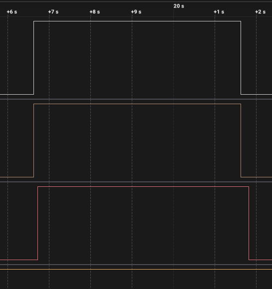
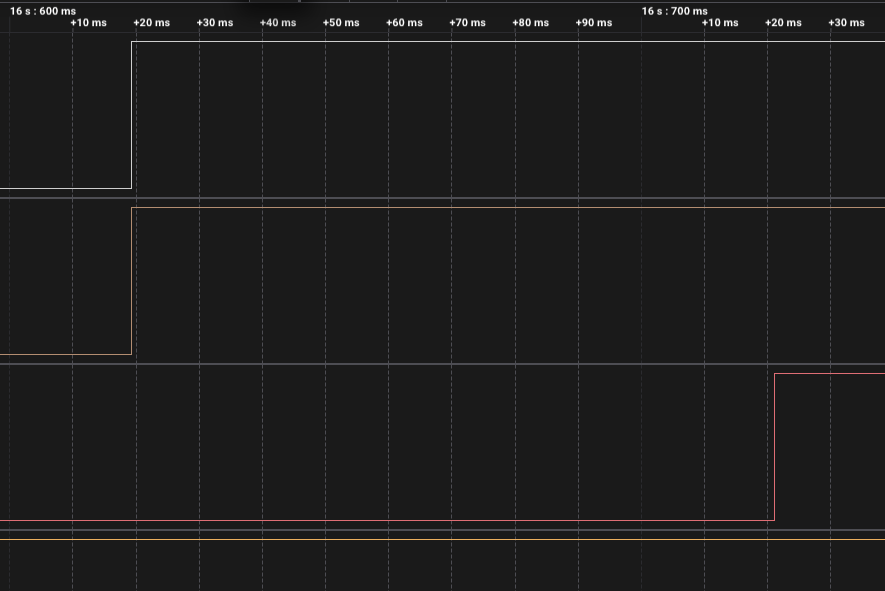
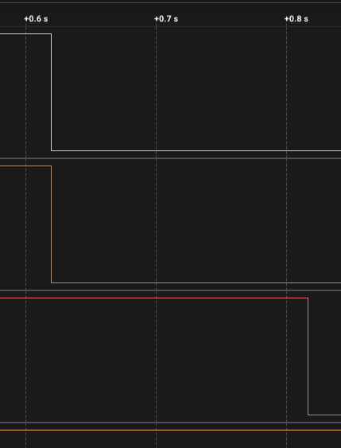

# ДЗ 2.5 — апаратний таймер проти millis() (TIMERS)

Та сама витяжка на **ESP32-S3-DevKitC-1**, але цикл порахований трьома способами одночасно. Прошивка нічим не керує по-новому — вона міряє, скільки коштує відмовитися від апаратного таймера.

| Вихід | Пін | Хто веде фазу | Як написаний |
|---|---|---|---|
| HW | GPIO 4 | апаратний таймер | аларм у обробнику переривання |
| FIXED | GPIO 5 | `millis()` у `loop()` | `next += крок` — наступний момент накопичується |
| NAIVE | GPIO 6 | `millis()` у `loop()` | `last = millis()` — мітка перезаписується поточним часом |
| RELAY | GPIO 8 | апаратний таймер | власне реле |

`loop()` при цьому навмисно завантажений: кожна ітерація зайнята роботою на 50–350 мс.

## Схема

Схема й силова частина ті самі, що в [`timer_tick`](../timer_tick/#схема-та-плата), плюс третій світлодіод на GPIO 6. Повний розбір — у [README ДЗ](../#схема).

Аналізатором знімав три канали: **D0 — GPIO 8 (реле), D1 — GPIO 4 (апаратний), D2 — GPIO 5 (`millis += крок`)**. Четвертий вихід, наївний `millis`, у цьому записі не знятий — на перших двох перемиканнях він збігається з правильним до десятих мілісекунди, а далі розходження видно в логу прошивки.

## Як працює код

Файл: [`main.cpp`](main.cpp)

Три автомати фаз стартують з одного моменту:

```cpp
const uint32_t nowMs = millis();
fixedTimer.start(nowMs);
naiveTimer.start(nowMs);
timerWrite(phaseTimer, 0);
startUs = esp_timer_get_time();
timerAlarmEnable(phaseTimer);
```

**`FixedTimer`** — правильний програмний таймер. Наступний момент накопичується кроками, тому помилка не переноситься в наступний крок:

```cpp
bool update(uint32_t nowMs) {
  if (static_cast<int32_t>(nowMs - dueMs) < 0) return false;
  running = !running;
  dueMs += (running ? Config::RUN_S : Config::IDLE_S) * 1000UL;
  return true;
}
```

**`NaiveTimer`** — те, що пишуть у більшості прикладів. У момент спрацювання мітка перезаписується поточним `millis()`, і те запізнення, з яким `loop()` доїхав до перевірки, стає новою точкою відліку:

```cpp
if (nowMs - lastMs < interval) return false;
running = !running;
lastMs  = nowMs;        // <- тут і народжується накопичена помилка
```

Різниця в одному рядку, і саме її міряє остання колонка таблиці.

### Навантаження замість delay()

```cpp
static uint32_t busyWork(uint32_t ms) {
  const int64_t until = esp_timer_get_time() + static_cast<int64_t>(ms) * 1000;
  volatile uint32_t sink = 0;
  while (esp_timer_get_time() < until) ++sink;
  return sink;
}
```

Зайнятий цикл, а не `delay()`, і не тільки через умову ДЗ: `delay()` віддає ядро планувальнику, тож це була б слабша перешкода. Тривалість плаває 50–350 мс через xorshift, щоб запізнення не було однаковою константою, яку легко переплутати з постійним зсувом.

### Еталон — арифметика, а не апаратний таймер

Щоб порівняння було чесним, ідеальний момент n-го перемикання рахується з періоду, а не беруться показання одного з трьох способів:

```cpp
static int64_t idealUs(uint16_t n) {
  const uint64_t idles = (n + 1) / 2;
  const uint64_t runs  = n / 2;
  return static_cast<int64_t>(idles * Config::IDLE_US + runs * Config::RUN_US);
}
```

## Що показали заміри

### Таблиця з прошивки

Повний лог: [`serial.log`](serial.log). Десять перемикань поспіль, тобто 100 секунд модельного часу:

```
  # | фаза   | апаратний | millis += крок | millis = now | накопичено
 ---+--------+-----------+----------------+--------------+-----------
   1 | РОБОТА |    +0.0 мс |     +101.8 мс |   +101.8 мс |    +0.0 мс
   2 | ПАУЗА  |    +0.0 мс |     +197.4 мс |   +197.4 мс |    +0.0 мс
   3 | РОБОТА |    +0.0 мс |      +32.8 мс |   +328.8 мс |  +296.0 мс
   4 | ПАУЗА  |    +0.0 мс |     +105.1 мс |   +526.1 мс |  +421.0 мс
   5 | РОБОТА |    +0.0 мс |     +179.6 мс |   +678.6 мс |  +499.0 мс
   6 | ПАУЗА  |    +0.0 мс |     +217.8 мс |   +705.8 мс |  +488.0 мс
   7 | РОБОТА |    +0.0 мс |     +235.2 мс |   +721.2 мс |  +486.0 мс
   8 | ПАУЗА  |    +0.0 мс |     +115.5 мс |   +900.5 мс |  +785.0 мс
   9 | РОБОТА |    +0.0 мс |      +81.9 мс |   +911.0 мс |  +829.0 мс
  10 | ПАУЗА  |    +0.0 мс |     +103.2 мс |  +1170.2 мс | +1067.0 мс
```

| Спосіб | Найменша похибка | Найбільша | Середня | Чи росте |
|---|---:|---:|---:|---|
| апаратний таймер | +0,0 мс | +0,0 мс | +0,0 мс | ні |
| `millis() += крок` | +32,8 мс | +235,2 мс | +137,0 мс | **ні** |
| `millis() = now` | +101,8 мс | +1170,2 мс | — | **так, лінійно** |

Наївний за 100 секунд відстав на **1,17 с, тобто на 1,17 %**. Приріст після другого перемикання — у середньому 122 мс на кожне, що збігається з половиною середньої ітерації `loop()` (50–350 мс, середина 200 мс). Накопичується рівно те, на скільки `loop()` спізнився минулого разу.

Правильний за ті самі 100 секунд не відстав **узагалі**: його остання похибка (103,2 мс) така сама, як перша (101,8 мс). Він щоразу спізнюється, але щоразу на свіжу випадкову величину, а не на суму попередніх.

Перші два рядки варто прочитати окремо: там обидва програмні способи дали однакове число і різниця нульова. Накопичення не з'являється миттєво — поки зсув наївного менший за одну ітерацію `loop()`, обидва спрацьовують у тій самій ітерації й виглядають однаково. Розходження стає видно з третього перемикання.

### Той самий замір аналізатором

Запис на 24 MS/s, 23,0 с. Експорт: [`digital.csv`](digital.csv).



| | Апаратний (D0, D1) | Програмний (D2) | Розбіжність |
|---|---:|---:|---:|
| перемикання 1, пуск | 16,619273 с | 16,721048 с | **101,775 мс** |
| перемикання 2, стоп | 21,619539 с | 21,816913 с | **197,374 мс** |

| Пуск крупно | Стоп крупно |
|---|---|
|  |  |
| 101,8 мс | 197,4 мс |

**Два незалежні прилади дали те саме.** Прошивка надрукувала +101,8 і +197,4 мс, аналізатор зміряв 101,775 і 197,374 мс — розбіжність 25 і 26 мкс, тобто менша за роздільність друку. Один із них рахує час своїм `esp_timer`, другий — власним кварцом і не знає про програму нічого.

Тривалість робочої фази на апаратному каналі — **5,000265 с**, у межах тих самих 53 ppm, що й у решти варіантів ДЗ.

### Чому «+0,0 мс» у апаратного таймера не означає «ідеально»

Цю колонку легко перехвалити. Прошивка рахує ідеальний момент із констант, а поточний бере з `esp_timer_get_time()` — і апаратний таймер, і `esp_timer` ростуть з одного й того самого APB-такту. Тобто рядок «+0,0 мс» каже: **таймер узгоджений із власним годинником чипа до 0,1 мс за 100 секунд**, а не «за 100 секунд не помилився ні на мікросекунду».

Помилку самого кварцу цим способом не побачити в принципі — для цього потрібен зовнішній годинник. Його роль зіграв аналізатор, і він показав розходження в 53 ppm, тобто ~5,3 мс на ті самі 100 секунд. Для витяжки це 0,2 секунди на годину.

### Пачка на старті запису

З 1,3695 до 1,5974 с на всіх каналах сидять сотні фронтів по 41 нс — завантаження плати. Кінець пачки плюс 15 с дає 16,597 с, апаратний канал піднявся о 16,619 — різниця 22 мс на ініціалізацію. Розбір — у [README ДЗ](../#чому-на-старті-запису-сотні-фронтів).

## Що з цього випливає

**Правильний програмний таймер не дрейфує.** Це головне, що варто забрати з таблиці, і це суперечить звичному «millis() накопичує помилку». `next += крок` накопичувати нічого не може: кожна фаза відмірюється від розрахункового моменту попередньої. За 100 секунд — нуль дрейфу.

**Накопичує не `millis()`, а один конкретний рядок.** `last = millis()` бере момент власного запізнення за нову точку відліку. Той самий `millis()`, та сама плата, та сама перешкода — і 1,17 % за півтори хвилини.

**Чого програмний таймер не може дати ніколи — це моменту.** Навіть правильний спізнюється на 33–235 мс, бо він спрацьовує не раніше, ніж `loop()` до нього доїде. Апаратний не спізнюється, бо `loop()` у його циклі не бере участі зовсім.

**І окремо — де ця різниця не важить.** 235 мс із 15 хвилин це 0,026 %. Для витяжки обидва підходи однаково придатні, і писати тут апаратний таймер заради точності не треба. Цей варіант існує, щоб видно було, де межа: при періоді в секунди програмний таймер з'їдає відчутну частку, а наївний ламає розклад за десяток циклів.

## Запуск

### На залізі (PlatformIO)

1. У [`platformio.ini`](../../platformio.ini) розкоментуй рядок цього варіанту:
   ```ini
   build_src_filter = +<../dz2.5 (TIMERS)/millis_vs_timer/main.cpp>
   ```
2. ```sh
   ./tools/compiledb.sh
   pio run -t upload && pio device monitor
   ```

Навантаження `loop()` регулюється `WORK_MIN_MS` і `WORK_MAX_MS` у `Config`. `static_assert` не дасть зробити одну ітерацію довшою за робочу фазу — інакше порівнювати було б нічого.

### У симуляторі (Wokwi for VS Code)

1. `make -C "dz2.5 (TIMERS)/chips" install`
2. `pio run`
3. `Wokwi: Select Config File` → [`wokwi.toml`](wokwi.toml)
4. відкрити [`diagram.json`](diagram.json) і запустити `Wokwi: Start Simulator`

У схемі для симулятора аналізатор має всі чотири канали, разом із наївним на GPIO 6, тож розходження всіх трьох способів видно і без заліза.

## Файли

| Файл | Опис |
|---|---|
| [`main.cpp`](main.cpp) | прошивка |
| [`diagram.json`](diagram.json) | схема для Wokwi |
| [`wokwi.toml`](wokwi.toml) | конфіг симулятора |
| [`chips/`](chips/) | зібрані кастомні чипи; джерела в [`../chips/`](../chips/) |
| [`serial.log`](serial.log) | таблиця похибок із прошивки, 10 перемикань |
| [`digital.csv`](digital.csv) | експорт із Logic 2, 24 MS/s |
| [`capture-overview.png`](capture-overview.png) | уся фаза, видно зсув програмного каналу |
| [`capture-start-gap.png`](capture-start-gap.png), [`capture-stop-gap.png`](capture-stop-gap.png) | межі фази крупно |

Інші варіанти цього ДЗ: [**timer_tick**](../timer_tick/) — тік 1 с; [**timer_phase**](../timer_phase/) — аларм під довжину фази; [**two_timers**](../two_timers/) — два таймери; [**fan_full**](../fan_full/) — повна версія.
