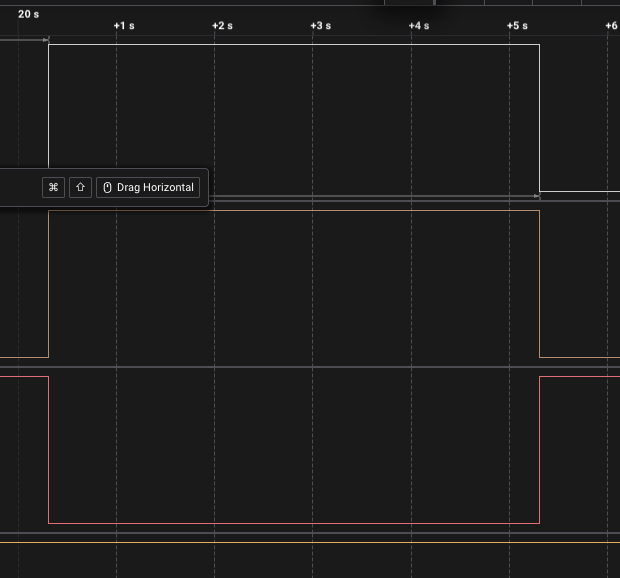
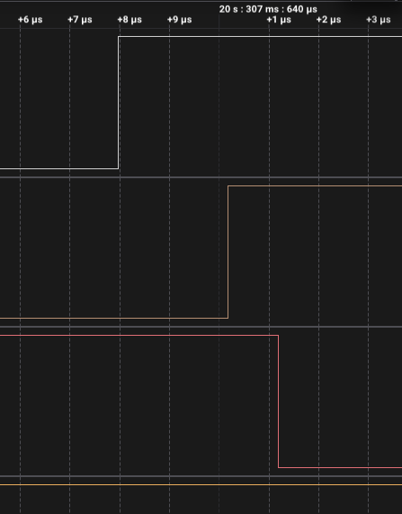
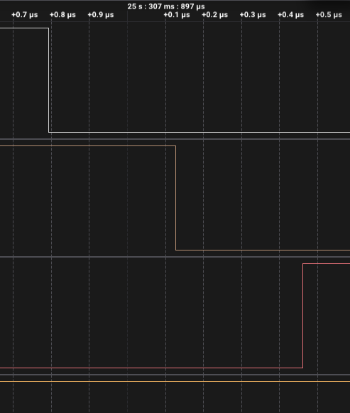

# ДЗ 2.5 — аларм дорівнює довжині фази (TIMERS)

Та сама витяжка на **ESP32-S3-DevKitC-1**, але таймер будить процесор не раз на секунду, а рівно двічі за цикл — на кожній межі фази. Обробник перекидає реле і тут же переписує аларм під довжину наступної фази.

| Фаза | Аларм | Вихід |
|---|---|---|
| ПАУЗА | 15 000 000 мкс (`FAST_DEMO 1`) / 2 700 000 000 мкс | реле розімкнуте, червоний LED |
| РОБОТА | 5 000 000 мкс / 900 000 000 мкс | реле замкнуте, зелений LED, моторчик крутиться |

## Схема

Схема, розпіновка й підключення аналізатора ті самі, що в [`timer_tick`](../timer_tick/#схема-та-плата) — відрізняється тільки прошивка. Повний розбір — у [README ДЗ](../#схема).

## Як працює код

Файл: [`main.cpp`](main.cpp)

Лічильник ESP32-S3 на частоті 1 МГц переповнюється через **571 рік**, тож година влазить у нього без жодних лічильників секунд. Аларм просто ставиться на потрібне число мікросекунд:

```cpp
static constexpr uint64_t RUN_US  = static_cast<uint64_t>(RUN_S)  * 1000000ULL;
static constexpr uint64_t IDLE_US = static_cast<uint64_t>(IDLE_S) * 1000000ULL;

static_assert(Config::IDLE_US < (1ULL << 54), "фаза задовга для 54-бітного лічильника");
```

`static_assert` перевіряє саму розрядність лічильника, а не тільки `uint64_t`: на S3 вона 54 біти, а не 64, як написано в уроці — [розбір у README ДЗ](../#таймерів-чотири-але-лічильник-54-бітний).

- `onPhaseEnd()` — перемикає фазу, перекидає реле і переписує аларм на довжину наступної фази. Усе.
- `secondsLeft()` — скільки лишилось, читається прямо з лічильника таймера, а не з програмного лічильника.
- `loop()` — друкує лог. У циклі участі не бере.

### Переписування аларму з переривання

Фази різної довжини, тому після кожного спрацювання аларм треба змінити. Очевидний спосіб — `timerAlarmWrite()` — тут не годиться: ця функція лежить у flash (`.text.timer_set_alarm_value`), а не в IRAM. IDF має окрему родину функцій рівно для виклику з переривання, і вся вона складена в секції `.iram1`:

```cpp
timer_group_set_alarm_value_in_isr(TG, TIX, running ? Config::RUN_US : Config::IDLE_US);
timer_group_enable_alarm_in_isr(TG, TIX);
```

Перевірка розкладки по секціях — у [README ДЗ](../#iram_attr-на-обробнику--ще-не-iram-обробник).

Ці функції працюють із номером групи і номером таймера в групі, а не з хендлом `hw_timer_t*`, який віддає Arduino. Відповідність доводиться повторити з `esp32-hal-timer.c`:

```cpp
// timer_dev[4] = {{0,0}, {1,0}, {0,1}, {1,1}}
static constexpr uint8_t GROUP_OF[4] = {0, 1, 0, 1};
static constexpr uint8_t INDEX_OF[4] = {0, 0, 1, 1};
```

Порядок усередині обробника має значення. Аларм із авто-перезавантаженням скидає лічильник у нуль у момент спрацювання, тому коли обробник переписує значення, лічильник стоїть на одиницях мікросекунд — нове значення гарантовано ще попереду.

### Затримка входу в переривання міряється безкоштовно

З того, що лічильник щойно скинувся в нуль, випливає корисна дрібниця: його поточне значення **і є** час, що минув від самої події до входу в обробник.

```cpp
const uint32_t latency = static_cast<uint32_t>(timer_group_get_counter_value_in_isr(TG, TIX));
```

У цю цифру не входить ні `Serial`, ні `loop()` — це чиста затримка диспетчеризації переривання.

## Що показали заміри

Запис логічним аналізатором на 24 MS/s, 27,4 с. Експорт: [`digital.csv`](digital.csv).

| | Значення |
|---|---|
| тривалість робочої фази | **5,000259 с** (треба 5,000000) |
| похибка | +259 мкс, +52 ppm |
| переривань за цикл | 2 замість 20 у [`timer_tick`](../timer_tick/) |
| зайвих перемикань | 0 |



Реле замикається о 20,307638 с і розмикається о 25,307897 с.

**Головне порівняння з першим варіантом.** Переривань на цикл стало вдесятеро менше (у масштабі справжньої години — у 1800 разів), а тривалість фази змінилась на 8 мкс: 5,000259 проти 5,000267 с. Ці 8 мкс — на рівні шуму самого заміру, тобто **ощадність дісталася безкоштовно**. Лічильник секунд у обробнику не давав жодної точності, він лише витрачав переривання.

### Межі фази крупно

| Вмикання (20,307638 с) | Вимикання (25,307897 с) |
|---|---|
|  |  |
| реле → зелений 2209 нс, реле → червоний 3209 нс | реле → зелений 333 нс, реле → червоний 666 нс |

Вимикання виглядає як у [`timer_tick`](../timer_tick/#три-digitalwrite-видно-на-око): по ~333 нс на один `digitalWrite`. А от вмикання дало 2209 і 3209 нс — утричі більше. Обробник переривання витіснити нічим, тож лишається та сама причина, що і в одинарному викиді першого варіанта: `digitalWrite` у цій збірці лежить у flash, і звернення до нього не безкоштовне. У [`fan_full`](../fan_full/), де ті самі три записи зроблені через регістр, таких викидів немає взагалі — там розкид 83…125 нс на всіх чотирьох перемиканнях.

### Пачка на старті запису

На початку запису, з 5,0510 до 5,2755 с, на всіх трьох каналах сидять сотні фронтів по 41 нс. Це не брязкіт і не збій прошивки — це **завантаження плати**: до того, як `setup()` виконає `pinMode(OUTPUT)`, піни нічим не керуються, і аналізатор читає на них шум. Перевірка проста: кінець пачки плюс 15 с паузи дає 20,276 с, а реле замкнулося о 20,308 — різниця 32 мс якраз на `Serial.begin()` і решту ініціалізації. Докладніше — у [README ДЗ](../#чому-на-старті-запису-сотні-фронтів).

Після 5,28 с і до кінця запису — жодного зайвого фронту.

## Вивід у Serial Monitor (115200 бод)

```
=== ДЗ 2.5, варіант 2: аларм дорівнює довжині фази ===
період 20 с, робота 5 с, пауза 15 с
таймер 0 (TIMERG0, таймер 0), дільник 80 -> тік 1000 нс
аларм робочої фази 5000000 мкс, аларм паузи 15000000 мкс
переривань за повний цикл: 2 (у варіанті timer_tick їх було 20)
таймер запущено, далі він перемикає фази сам і сам переписує аларм
```

На межі фази додається рядок із довжиною фази і затримкою входу в обробник:

```
[ <uptime> ] <ФАЗА> лишилось <N> s  цикл <N>  переривань <N>  <- фаза <X> с (треба <Y>), затримка ISR <N> мкс, найгірша <N>
```

Текстового логу з цього запуску я не зберіг, тривалість фази міряв аналізатором.

## Запуск

### На залізі (PlatformIO)

1. У [`platformio.ini`](../../platformio.ini) розкоментуй рядок цього варіанту:
   ```ini
   build_src_filter = +<../dz2.5 (TIMERS)/timer_phase/main.cpp>
   ```
2. ```sh
   ./tools/compiledb.sh
   pio run -t upload && pio device monitor
   ```

Для справжніх 15 хвилин на годину — `#define FAST_DEMO 0` на початку [`main.cpp`](main.cpp).

### У симуляторі (Wokwi for VS Code)

1. `make -C "dz2.5 (TIMERS)/chips" install`
2. `pio run`
3. `Wokwi: Select Config File` → [`wokwi.toml`](wokwi.toml)
4. відкрити [`diagram.json`](diagram.json) і запустити `Wokwi: Start Simulator`

## Файли

| Файл | Опис |
|---|---|
| [`main.cpp`](main.cpp) | прошивка |
| [`diagram.json`](diagram.json) | схема для Wokwi |
| [`wokwi.toml`](wokwi.toml) | конфіг симулятора |
| [`chips/`](chips/) | зібрані кастомні чипи; джерела в [`../chips/`](../chips/) |
| [`digital.csv`](digital.csv) | експорт із Logic 2, 24 MS/s |
| [`capture-overview.png`](capture-overview.png) | уся робоча фаза |
| [`capture-switch-on.png`](capture-switch-on.png), [`capture-switch-off.png`](capture-switch-off.png) | межі фази крупно |

Інші варіанти цього ДЗ: [**timer_tick**](../timer_tick/) — тік 1 с; [**two_timers**](../two_timers/) — два таймери; [**millis_vs_timer**](../millis_vs_timer/) — замір проти `millis()`; [**fan_full**](../fan_full/) — повна версія.
