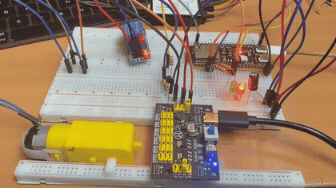
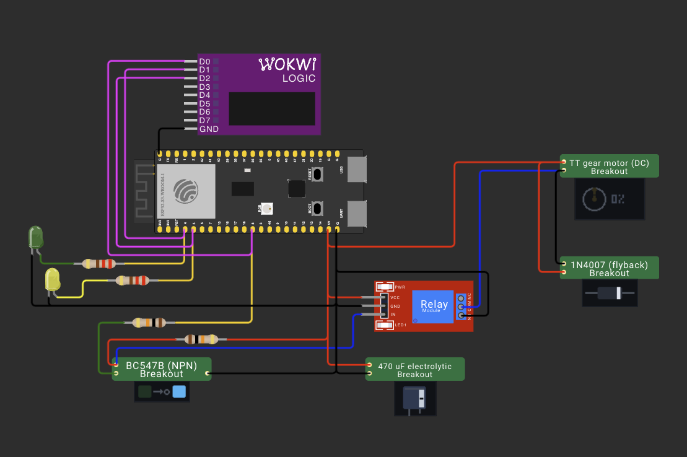
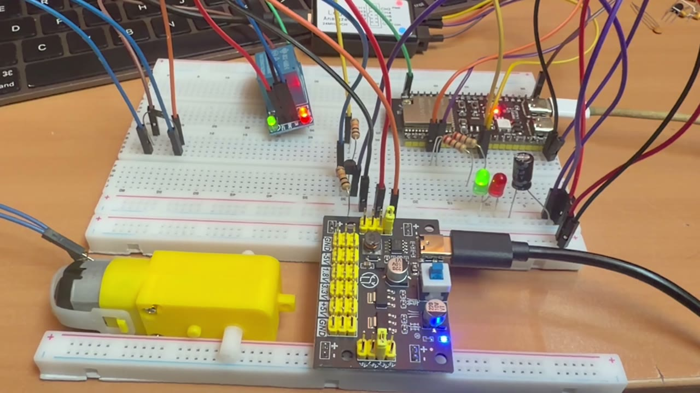
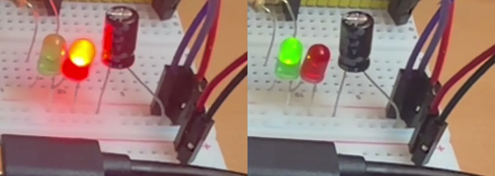
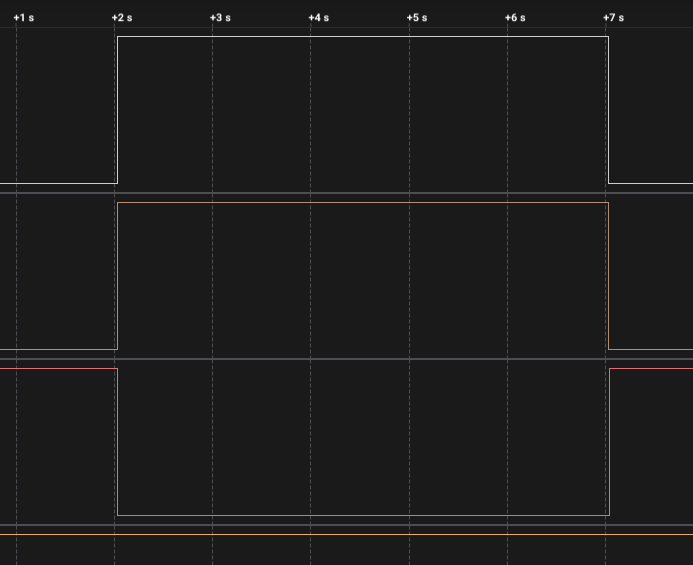
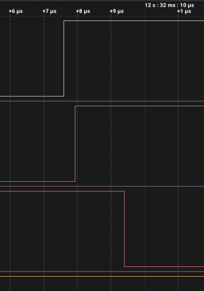
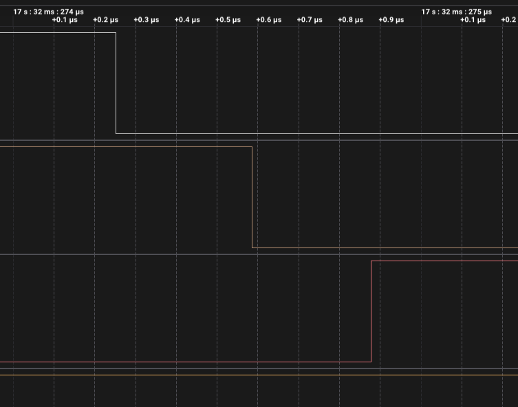

# ДЗ 2.5 — тік одна секунда (TIMERS)

Витяжка, яка раз на «годину» вмикається на «15 хвилин», на **ESP32-S3-DevKitC-1**. Апаратний таймер будить процесор раз на секунду, обробник рахує секунди і сам перекидає реле на межі фази.

Найпростіший із п'яти варіантів і єдиний, у якому обробник не викликає жодної функції з HAL таймера.

| Фаза | Тривалість | Вихід |
|---|---|---|
| ПАУЗА | 15 с (`FAST_DEMO 1`) / 45 хв | реле розімкнуте, червоний LED |
| РОБОТА | 5 с / 15 хв | реле замкнуте, зелений LED, моторчик крутиться |

## Демо

<a href="video.mp4"></a>

▶️ [Відео в повній якості (MP4)](video.mp4) · [оригінал (MOV)](video.MOV)

## Схема та плата

| Схема (Wokwi) | Зібрана плата, робоча фаза |
|---|---|
|  |  |

Обидва фото — кадри з [відео](video.mp4), витягнуті `ffmpeg`.

### Індикація стану

Світлодіоди дублюють фазу, і це видно на одному кадрі з кожної:



Ліворуч пауза — горить червоний, зелений темний. Праворуч робота — навпаки. Одночасно обидва не горять ніколи: `applyOutputs()` виставляє їх протилежно одним викликом.

| Компонент | Пін ESP32-S3 | Примітка |
|---|---|---|
| Керування реле | GPIO 8 | → 10 кΩ → база BC547B, колектор на `IN` модуля реле |
| Підтяжка `IN` | — | 10 кΩ з колектора на 5 В |
| Зелений LED | GPIO 4 | через 220 Ω, катод → GND |
| Червоний LED | GPIO 5 | через 220 Ω, катод → GND |

Силова частина живиться окремо: 5 В на шину макетної плати дає модуль живлення з власним USB-C, ESP32 сидить на своєму USB, землі спільні. Плюс моторчика постійно на цій шині, мінус — на `COM` реле, `NO` — на GND: контакт стоїть у зворотному проводі обмотки. Паралельно моторчику 1N4007 катодом до плюса, по шині електроліт 470 мкФ. Повний розбір схеми — у [README ДЗ](../#схема).

Логічний аналізатор: D0 — GPIO 8 (реле), D1 — GPIO 4 (зелений), D2 — GPIO 5 (червоний).

## Як працює код

Файл: [`main.cpp`](main.cpp)

Таймер налаштований на тік 1 мкс і аларм раз на секунду з авто-перезавантаженням:

```cpp
tickTimer = timerBegin(Config::TIMER_NUM, Config::DIVIDER, true);  // дільник 80 -> 1 МГц
timerAttachInterrupt(tickTimer, &onTick, false);
timerAlarmWrite(tickTimer, Config::TICK_US, true);                 // 1 000 000 мкс
timerWrite(tickTimer, 0);
timerAlarmEnable(tickTimer);
```

- `onTick()` — уся логіка циклу. Інкрементує лічильник секунд, порівнює з довжиною поточної фази і на межі перекидає реле та світлодіоди. Більше ніде фази не змінюються.
- `applyOutputs()` — три `digitalWrite`, винесені з критичної секції.
- `snapshot()` — узгоджене читання стану під спінлоком: лог має показувати фазу, лічильник секунд і номер циклу з одного моменту.
- `loop()` — друкує лог і більше нічого. Жодної участі в циклі.

Три рішення, які варто пояснити.

**Чому стан читається під спінлоком.** `onTick()` пише шість змінних, `loop()` читає їх з іншого ядра — Arduino тримає `loopTask` на ядрі 1. Кожна з них окремо `volatile` і атомарна, але без спінлока лог може зловити лічильник секунд із нової фази разом зі старим номером циклу.

**Чому `digitalWrite` стоїть поза критичною секцією.** Interrupt WDT у цій збірці має таймаут 300 мс, і затягнута критична секція перезавантажує плату.

**Чому `timerWrite(tickTimer, 0)` перед `timerAlarmEnable()`.** `timerBegin()` запускає лічильник одразу, ще до того, як виставлено аларм. Без обнулення перша фаза виявилась би коротшою на час між цими двома викликами — решта фаз точні й без цього, бо аларм сам скидає лічильник.

**Чому `vTaskDelay(10)` у кінці `loop()`, якщо `delay()` заборонений.** `delay()` справді немає — цикл витяжки його не використовує ніде. `vTaskDelay()` тут не відмірює час завдання, а повертає ядро планувальнику, бо `loop()` у цій прошивці тільки друкує лог.

## Що показали заміри

Серія знята логічним аналізатором на 24 MS/s, запис 20,1 с. Експорт: [`digital.csv`](digital.csv).

| | Значення |
|---|---|
| тривалість робочої фази | **5,000267 с** (треба 5,000000) |
| похибка | +267 мкс, тобто +53 ppm |
| розбіжність між трьома виходами | 334 нс і 1792 нс на вмиканні, 333 нс і 625 нс на вимиканні |
| зайвих перемикань | 0 |



Реле замикається о 12,032008 с і розмикається о 17,032274 с. Більше на лінії не відбувається нічого — жодного дрижання, жодного зайвого фронту за весь запис.

### Куди поділися 267 мкс

Це не хиба таймера. Той самий надлишок виміряно в усіх п'яти прошивках ДЗ — від +259 до +278 мкс, — і при цьому код у них різний, а дільник і джерело такту однакові. Систематична похибка в 53 ppm на обох приладах означає рівно одне: **кварц плати і таймбаза аналізатора розходяться на 53 ppm**. Хто з них правий, цей замір сказати не може — для цього потрібен третій, опорний годинник.

Непряма підказка на користь аналізатора як винуватця: у ESP32-S3 кварц на 40 МГц із типовим допуском ±10 ppm, а в клона Saleae на 24 MS/s таймбаза значно вільніша. Але це здогад, а не вимір.

### Три `digitalWrite` видно на око

На межі фази обробник пише три піни підряд, і між ними лягають сотні наносекунд:

| Вмикання (12,032008 с) | Вимикання (17,032274 с) |
|---|---|
|  |  |
| реле → зелений 334 нс, реле → червоний 1792 нс | реле → зелений 333 нс, реле → червоний 625 нс |

Один `digitalWrite` коштує близько 333 нс, тобто ~80 тактів на 240 МГц. Для витяжки це ніщо, але цифру варто запам'ятати: у [`fan_full`](../fan_full/) ті самі три записи зроблені через регістр і займають 83 нс на всі три — вчетверо менше, і там це вже не косметика, а умова IRAM-безпеки.

Один із двох замірів дав 1792 нс замість очікуваних ~666. Це обробник переривання, його ніщо не витісняє, тож пояснення лишається одне — затримка на звернення до flash, де в цій збірці лежить `digitalWrite`.

### Чого в цьому записі немає

Запис почався вже після завантаження плати, тому в ньому немає пачки перехідних процесів, яку видно на старті в решти варіантів — [розбір у README ДЗ](../#чому-на-старті-запису-сотні-фронтів). За 20 с у кадр потрапила одна робоча фаза; період у 20 с цілком не влізає. Повний цикл підтверджено окремо, у [`millis_vs_timer`](../millis_vs_timer/), де прошивка сама звіряє 10 перемикань поспіль протягом 100 с.

### Ціна простоти

3600 переривань на годину, з яких 3598 роблять лише інкремент і порівняння. Для 54-бітного лічильника, який переповнюється через 571 рік, це марна робота: година влазить в один аларм. Так зроблено у [`timer_phase`](../timer_phase/) — там переривань за цикл рівно два, а зміряна тривалість фази та сама з точністю до 8 мкс.

## Вивід у Serial Monitor (115200 бод)

Банер зі старту складається з самих констант `Config`, тому виглядає так само при кожному запуску:

```
=== ДЗ 2.5, варіант 1: тік 1 с на апаратному таймері ===
період 20 с, робота 5 с, пауза 15 с
таймер 0, дільник 80 -> 1000000 Гц, тік 1000 нс
аларм кожні 1000000 мкс, переривань за повний цикл: 20
таймер запущено, loop() у циклі не бере участі
```

Далі `loop()` друкує рядок на кожну секунду і окремий — на межі фази, з довжиною фази, яку заміряв сам таймер:

```
[ <uptime> ] <ФАЗА> <секунд>/<усього> s  цикл <N>  тіків <N>  <- фаза тривала <X> с (треба <Y>)
```

Текстового логу з цього запуску я не зберіг — тривалість фази міряв аналізатором, вона в таблиці вище. Ту саму величину, але з боку самої прошивки, видно в [`millis_vs_timer/serial.log`](../millis_vs_timer/serial.log).

## Запуск

### На залізі (PlatformIO)

1. У [`platformio.ini`](../../platformio.ini) розкоментуй рядок цього варіанту:
   ```ini
   build_src_filter = +<../dz2.5 (TIMERS)/timer_tick/main.cpp>
   ```
2. ```sh
   ./tools/compiledb.sh
   pio run -t upload && pio device monitor
   ```

Для справжніх 15 хвилин на годину постав `#define FAST_DEMO 0` на початку [`main.cpp`](main.cpp).

### У симуляторі (Wokwi for VS Code)

1. `make -C "dz2.5 (TIMERS)/chips" install` — зібрати кастомні чипи (один раз на все ДЗ)
2. `pio run`
3. `Wokwi: Select Config File` → [`wokwi.toml`](wokwi.toml)
4. відкрити [`diagram.json`](diagram.json) і запустити `Wokwi: Start Simulator`

Перша фаза — завжди пауза, тому перші 15 с моторчик стоїть і горить червоний. Це правильна поведінка, а не «не працює».

## Файли

| Файл | Опис |
|---|---|
| [`main.cpp`](main.cpp) | прошивка |
| [`diagram.json`](diagram.json) | схема для Wokwi |
| [`wokwi.toml`](wokwi.toml) | конфіг симулятора |
| [`chips/`](chips/) | зібрані кастомні чипи; джерела в [`../chips/`](../chips/) |
| [`schema.png`](schema.png) | схема у Wokwi |
| [`photo.jpeg`](photo.jpeg), [`photo-idle.jpeg`](photo-idle.jpeg) | плата в робочій фазі та в паузі, кадри з відео |
| [`photo-leds.jpeg`](photo-leds.jpeg) | два світлодіоди крупно, обидві фази поруч |
| [`digital.csv`](digital.csv) | експорт із Logic 2, 24 MS/s |
| [`capture-overview.png`](capture-overview.png) | уся робоча фаза |
| [`capture-switch-on.png`](capture-switch-on.png), [`capture-switch-off.png`](capture-switch-off.png) | межі фази крупно |
| [`demo.gif`](demo.gif), [`video.mp4`](video.mp4), [`video.MOV`](video.MOV) | відео роботи |

Інші варіанти цього ДЗ: [**timer_phase**](../timer_phase/) — аларм під довжину фази; [**two_timers**](../two_timers/) — два таймери; [**millis_vs_timer**](../millis_vs_timer/) — замір проти `millis()`; [**fan_full**](../fan_full/) — повна версія.
