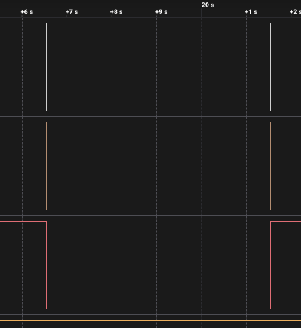
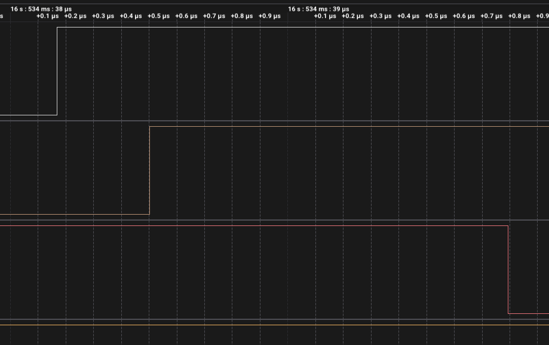
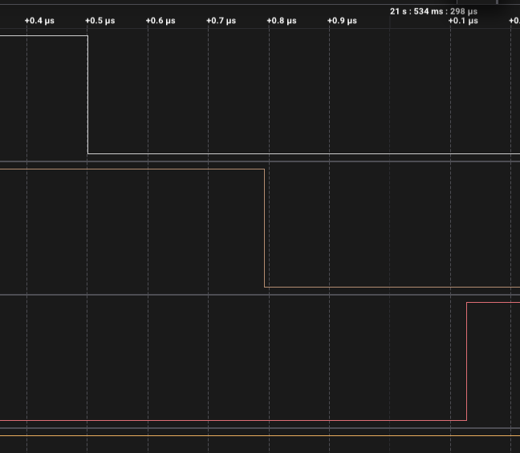

# ДЗ 2.5 — два апаратні таймери (TIMERS)

Та сама витяжка на **ESP32-S3-DevKitC-1**, але період і тривалість роботи живуть у різних таймерах. Кожен відповідає рівно за одну подію.

| Таймер | Роль | Режим |
|---|---|---|
| TIMERG0, таймер 0 | раз на період вмикає вентилятор | періодичний, авто-перезавантаження |
| TIMERG1, таймер 0 | через 15 хвилин вимикає вентилятор | одноразовий, компаратор ставиться на кожному пуску |

Це класична схема «період + тривалість імпульсу», і вона найближча до того, що в уроці названо режимом захоплення-порівняння: лічильник другого таймера нікуди не скидається, він вільно біжить, а подію задає значення в регістрі порівняння.

## Схема

Схема, розпіновка й підключення аналізатора ті самі, що в [`timer_tick`](../timer_tick/#схема-та-плата). Повний розбір — у [README ДЗ](../#схема).

## Як працює код

Файл: [`main.cpp`](main.cpp)

```cpp
static constexpr uint8_t PERIOD_TIMER = 0;  // TIMERG0, таймер 0 — ритм
static constexpr uint8_t RUN_TIMER    = 1;  // TIMERG1, таймер 0 — тривалість
```

Індекси 0 і 1 у таблиці Arduino (`timer_dev[4] = {{0,0}, {1,0}, {0,1}, {1,1}}`) потрапляють у **різні групи**, тобто це два незалежні джерела переривання, а не два таймери одного блоку.

- `onPeriod()` — раз на період вмикає вентилятор і заводить компаратор другого таймера на 15 хвилин уперед.
- `onRunEnd()` — один раз на пуск вимикає вентилятор і відводить свій компаратор у недосяжне майбутнє.
- `loop()` — друкує лог. У циклі участі не бере.

Кожен обробник короткий, і жоден не перепитує «а в якій ми фазі» — у [`timer_phase`](../timer_phase/) це питання стояло в кожному рядку.

### Чому компаратор ставиться «уперед», а не скидається лічильник

Природний хід думки для одноразового таймера: скинути лічильник у нуль і чекати 15 хвилин. З переривання так не виходить. Серед IRAM-безпечних функцій IDF є `timer_group_set_alarm_value_in_isr()`, але **`set_counter_value_in_isr()` не існує** — обнулити лічильник з обробника нічим, а `timerWrite()` лежить у flash.

Тому замість «скинути і почекати RUN» робиться «порівняти з поточне + RUN»:

```cpp
const uint64_t runNow = timer_group_get_counter_value_in_isr(RUN_TG, RUN_TIX);
const uint64_t alarm  = runNow + Config::RUN_US;
timer_group_set_alarm_value_in_isr(RUN_TG, RUN_TIX, alarm);
timer_group_enable_alarm_in_isr(RUN_TG, RUN_TIX);
```

Результат той самий, а з HAL таймера в обробнику не викликається нічого, що лежить у flash. І по дорозі вийшло ближче до того, як регістр порівняння замислений: лічильник тече, а програма переставляє мітку. Переповнення цьому не загрожує — 54 біти на 1 МГц це 571 рік вільного бігу.

### Чому компаратор відводиться в майбутнє після спрацювання

Аларм при `auto_reload = false` апаратно знімається сам. Покладатися на це не хочеться: якщо він десь лишиться ввімкненим, лічильник уже перейшов за значення порівняння, і переривання посипалися б підряд. Функції «вимкнути аларм з переривання» в IDF немає, тому замість неї компаратор просто відводиться туди, куди лічильник не дійде до наступного пуску:

```cpp
timer_group_set_alarm_value_in_isr(RUN_TG, RUN_TIX, runNow + 2 * Config::PERIOD_US);
```

### Перший пуск через паузу, а не через цілий період

Якщо нічого не робити, перший пуск стався б через повний період після старту. Щоб усі варіанти ДЗ стартували однаково, лічильник таймера періоду зсувається вперед на одну робочу фазу:

```cpp
timerAlarmWrite(periodTimer, Config::PERIOD_US, true);
timerWrite(periodTimer, Config::RUN_US);   // перший аларм через IDLE, далі через PERIOD
timerAlarmEnable(periodTimer);
```

Це робиться в `setup()`, тобто поза перериванням, тому `timerWrite()` тут цілком доречний.

## Що показали заміри

Запис логічним аналізатором на 24 MS/s, 23,2 с. Експорт: [`digital.csv`](digital.csv).

| | Значення |
|---|---|
| тривалість робочої фази | **5,000259 с** (треба 5,000000) |
| похибка | +259 мкс, +52 ppm |
| пусків / стопів | 1 / 1 — рівно, зайвих спрацювань одноразового таймера немає |
| зайвих перемикань | 0 |



Реле замикається о 16,534038 с і розмикається о 21,534298 с.

**Головний критерій цього варіанта — рівність пусків і стопів**, і він виконаний: одноразовий таймер спрацював рівно один раз на один пуск. Якби припущення про апаратне зняття аларму було хибним, зайві переривання посипалися б одразу після першого ж стопу і лінія реле перетворилася б на кашу. Нічого подібного за весь запис не сталося.

Тривалість фази збіглася з [`timer_phase`](../timer_phase/) **до мікросекунди** — 5,000259 с в обох. При тому що в одному випадку її відміряв один таймер із переписуванням аларму, а в іншому — окремий таймер через регістр порівняння. Два різні механізми дають той самий результат, і це найкраще підтвердження, що обидва реалізовані правильно.

### Межі фази крупно

| Вмикання (16,534038 с) | Вимикання (21,534298 с) |
|---|---|
|  |  |
| реле → зелений 333 нс, реле → червоний 1625 нс | реле → зелений 292 нс, реле → червоний 625 нс |

Ті самі ~300 нс на один `digitalWrite`, що і в двох попередніх варіантах.

### Пачка на старті запису

З 1,3214 до 1,5019 с на всіх каналах сидять сотні фронтів по 41 нс — це завантаження плати, а не збій. Кінець пачки плюс 15 с паузи дає 16,502 с, реле замкнулося о 16,534 — різниця 32 мс на ініціалізацію. Розбір — у [README ДЗ](../#чому-на-старті-запису-сотні-фронтів).

## Вивід у Serial Monitor (115200 бод)

```
=== ДЗ 2.5, варіант 3: два апаратні таймери ===
період 20 с, робота 5 с, пауза 15 с
таймер періоду: індекс 0 -> TIMERG0.0, аларм 20000000 мкс, авто-перезавантаження
таймер тривалості: індекс 1 -> TIMERG1.0, компаратор +5000000 мкс, одноразовий
обидва таймери запущено, loop() у циклі не бере участі
```

На кожну подію додається рядок із затримкою входу в обробник, а на стопі — ще й із фактичною тривалістю роботи. Текстового логу з цього запуску я не зберіг, тривалість міряв аналізатором.

## Запуск

### На залізі (PlatformIO)

1. У [`platformio.ini`](../../platformio.ini) розкоментуй рядок цього варіанту:
   ```ini
   build_src_filter = +<../dz2.5 (TIMERS)/two_timers/main.cpp>
   ```
2. ```sh
   ./tools/compiledb.sh
   pio run -t upload && pio device monitor
   ```

Для справжніх 15 хвилин на годину — `#define FAST_DEMO 0` на початку [`main.cpp`](main.cpp).

### У симуляторі (Wokwi for VS Code)

1. `make -C "dz2.5 (TIMERS)/chips" install`
2. `pio run`
3. `Wokwi: Select Config File` → [`wokwi.toml`](wokwi.toml)
4. відкрити [`diagram.json`](diagram.json) і запустити `Wokwi: Start Simulator`

## Файли

| Файл | Опис |
|---|---|
| [`main.cpp`](main.cpp) | прошивка |
| [`diagram.json`](diagram.json) | схема для Wokwi |
| [`wokwi.toml`](wokwi.toml) | конфіг симулятора |
| [`chips/`](chips/) | зібрані кастомні чипи; джерела в [`../chips/`](../chips/) |
| [`digital.csv`](digital.csv) | експорт із Logic 2, 24 MS/s |
| [`capture-overview.png`](capture-overview.png) | уся робоча фаза |
| [`capture-switch-on.png`](capture-switch-on.png), [`capture-switch-off.png`](capture-switch-off.png) | межі фази крупно |

Інші варіанти цього ДЗ: [**timer_tick**](../timer_tick/) — тік 1 с; [**timer_phase**](../timer_phase/) — аларм під довжину фази; [**millis_vs_timer**](../millis_vs_timer/) — замір проти `millis()`; [**fan_full**](../fan_full/) — повна версія.
