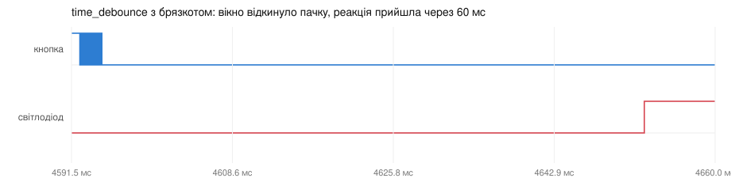

# ДЗ 2.6 — Debounce на ESP-IDF (ESP-IDF DEBOUNCE)

Те саме завдання, що в [ДЗ 2.4](../dz2.4%20%28BUTTON%20DEBOUNCE%29/), але без Arduino: шість прошивок на **ESP-IDF v5.5.5**, кожна — окремий CMake-проєкт, збірка через `idf.py`.

Ті самі прошивки збираються і другим шляхом — PlatformIO-env із `framework = espidf`, без жодної копії коду. [Як це влаштовано](#дві-збірки-однієї-прошивки).

Перші чотири прошивки — порти чотирьох методів із ДЗ 2.4, логіка один в один. П'ята і шоста роблять те, чого в Arduino-версії зробити було не можна: витримку відмірює одноразовий `esp_timer`, а в шостій брязкіт ріже апаратний glitch filter у самому IO MUX.

| Завдання | Що це | Прошивка |
|---|---|---|
| 1 | базова реалізація без debounce | [`raw_interrupt`](raw_interrupt/) |
| 2 | software debounce по часу | [`time_debounce`](time_debounce/) |
| 3 | debounce по рівню | [`state_debounce`](state_debounce/) |
| 4 | polling без переривань | [`polling_debounce`](polling_debounce/) |
| 5 | debounce на одноразовому таймері `esp_timer` | [`timer_debounce`](timer_debounce/) |
| 6 | апаратний pin glitch filter ESP32-S3 | [`glitch_filter`](glitch_filter/) |

## Схема

Та сама плата, що в ДЗ 2.4, нічого не перепаював: кнопка на GPIO 16 другим контактом на GND, світлодіод на GPIO 4 через 220 Ω. Логічний аналізатор: D0 — лінія кнопки, D1 — світлодіод.

| Схема (Wokwi, з ДЗ 2.4) | Зібрана плата |
|---|---|
|  |  |

Підтяжка всюди внутрішня, `GPIO_PULLUP_ENABLE`. RC-ланку з [завдання 5 ДЗ 2.4](../dz2.4%20%28BUTTON%20DEBOUNCE%29/#завдання-5--hardware-debounce-rc-фільтр) не збирав удруге: вона вже зміряна, а її роль в цьому ДЗ займає [`glitch_filter`](glitch_filter/).

## Arduino → ESP-IDF: що саме змінилось

| Arduino (ДЗ 2.4) | ESP-IDF (ДЗ 2.6) | Коментар |
|---|---|---|
| `pinMode()` | `gpio_config()` | одна структура: пін, напрямок, підтяжка, тип переривання |
| `attachInterrupt(digitalPinToInterrupt(...))` | `gpio_install_isr_service()` + `gpio_isr_handler_add()` | драйвер ставить один спільний обробник на всі GPIO, мій колбек підписується на пін |
| `digitalRead()` / `digitalWrite()` | `gpio_get_level()` / `gpio_set_level()` | — |
| `micros()` | `esp_timer_get_time()` | 64 біти замість 32: `micros()` перевертався через 71 хвилину |
| `delay(10)` | `vTaskDelay(pdMS_TO_TICKS(10))` | `delay()` крутить цикл, `vTaskDelay()` віддає процесор |
| сітка на `millis()` | `xTaskDelayUntil()` | прив'язка до попереднього пробудження, тож сітка не дрейфує |
| `volatile` + опитування в `loop()` | нотифікація задачі або черга з ISR | задача спить, а не крутиться |
| `Serial.printf()` | `ESP_LOGI()` | рівні логування і мітка часу в кожному рядку |
| `setup()` / `loop()` | `extern "C" void app_main()` | `loop()` немає: цикл пишу сам і сам вирішую, на чому задача блокується |

Найбільша зміна — остання. В Arduino `loop()` крутився вільно і бачив зміну `volatile` за мікросекунди, але процесор при цьому не робив нічого корисного. На ESP-IDF задача спить на нотифікації чи черзі, і на реакцію додається пробудження планувальника. Скільки це коштує — буде видно із замірів аналізатором.

## Чому прошивки на C++, хоч ESP-IDF — це C

Сам фреймворк написаний на C, його приклади теж, і нічого з використаного тут C++ не вимагає: `gpio_config()`, `esp_timer_*`, FreeRTOS — чистий C. Але в ДЗ 1.x-2.5 код на C++, бо його нав'язував Arduino, і разом з ним з'явилася звичка тримати константи в `struct Config` зі `static constexpr`. Щоб стиль по репозиторію не розсипався, цього ж тримаюсь і тут.

Для C++ в ESP-IDF потрібні дві речі:

```cpp
idf_component_register(SRCS "main.cpp")   // main/CMakeLists.txt

extern "C" void app_main()                // без extern "C" ім'я спотворюється
```

`extern "C"` обов'язковий: стартовий код фреймворку написаний на C і шукає символ `app_main`, а C++ без цієї обгортки дав би йому манглінг. Хедери IDF про C++ знають самі — у них уже стоять `extern "C"` обгортки, тож нічого додатково загортати не треба.

Що лишається вимкненим за замовчуванням: виключення (`CONFIG_COMPILER_CXX_EXCEPTIONS`) і RTTI. Тобто C++ тут — це типи, `constexpr`, `enum class` і область видимості, а не `try/catch` і динамічний поліморфізм. Для прошивки на вісімдесят рядків саме цього й достатньо.

Що дав перехід на `.cpp` проти C-варіанту:

| | C | C++ |
|---|---|---|
| константи | `enum { BUTTON_PIN = GPIO_NUM_16 }`, усе типу `int` | `static constexpr gpio_num_t BUTTON_PIN` — свій тип у кожної |
| чому не `static const` у C | не константний вираз, `_Static_assert` із ним не збереться | `constexpr` працює і в `static_assert` |
| станова машина | `typedef enum { ... } button_state_t` | `enum class ButtonState : uint8_t` — без неявних перетворень |
| перевірки на етапі збірки | `_Static_assert` | `static_assert` |
| лічильники між ISR і задачею | `volatile uint32_t`, `count++` | `std::atomic<uint32_t>`, `fetch_add` |
| ініціалізація структур драйвера | пропущені поля — тихо | треба перелічити всі, інакше `-Wmissing-field-initializers` |

Останній рядок — не стиль, а виправлена помилка. C-версія інкрементувала `volatile` лічильник прямо в обробнику, і на C++ це відразу дало попередження: `'++' expression of 'volatile'-qualified type is deprecated`. C++20 цю конструкцію свідомо поховав, і правильно: `volatile` ніколи не обіцяв атомарності, він лише забороняє компілятору кешувати значення в регістрі. Інкремент — це читання, додавання і запис, тобто три операції, і на двоядерному S3 задача на одному ядрі може прочитати лічильник посеред того, як переривання на іншому його змінює.

`std::atomic<uint32_t>` робить саме те, що тут потрібно, і `fetch_add(1, std::memory_order_relaxed)` на Xtensa розгортається в інструкцію `S32C1I` без виклику бібліотеки, тож в обробнику переривання це так само дешево.

## Чотири речі, які стали видні тільки на ESP-IDF

**Такт планувальника за замовчуванням 100 Гц.** Arduino-core для ESP32 ставить `CONFIG_FREERTOS_HZ=1000`, тому `delay(10)` там означав саме 10 мс. У чистому ESP-IDF типове значення — 100, тобто такт 10 мс. Для [`state_debounce`](state_debounce/) витримка квантувалася б до 10-20 мс, а для [`polling_debounce`](polling_debounce/) `pdMS_TO_TICKS(5)` дає **нуль тіків** — опитування перестало б мати період, і фільтр перестав би фільтрувати, нічим себе не виказавши. В обох прошивках стоїть `CONFIG_FREERTOS_HZ=1000` у `sdkconfig.defaults` і `_Static_assert`, який не дає зібратися без нього.

**Витримку можна віддати таймеру.** [`timer_debounce`](timer_debounce/) не чекає ні в задачі, ні в циклі: ISR перезаводить одноразовий `esp_timer` на кожному фронті, і колбек спрацьовує лише тоді, коли лінія затихла. Це єдиний метод у цьому ДЗ, який міряє тишу, а не паузу чи момент, — і єдиний, якому байдуже до такту планувальника.

**У чипі є власний апаратний фільтр.** [`glitch_filter`](glitch_filter/) включає pin glitch filter в IO MUX — три рядки коду, нуль деталей. На ESP32-S3 він із зашитими параметрами і ріже все, що коротше за два такти APB, тобто близько 25 нс. Для кнопки це на три-чотири порядки замало, але, на відміну від RC-ланки з ДЗ 2.4, він не псує фронт і зробити гірше не може.

**Переривання мусить попросити перемикання контексту.** `vTaskNotifyGiveFromISR()` і `xQueueSendFromISR()` беруть аргументом прапорець `pxHigherPriorityTaskWoken`, і без `portYIELD_FROM_ISR()` розбуджена задача чекає наступного такту планувальника. В Arduino такої ручки немає взагалі — і такої помилки теж. Мені вона коштувала 200× затримки, [деталі нижче](#що-знайшлося-по-дорозі).

## Як це збирається

ESP-IDF поставлений менеджером версій **eim** від Espressif, за їхнім гайдом:

```sh
brew tap espressif/eim
brew install --cask eim-gui          # ставить /Applications/eim.app і CLI `eim`
eim install -n true -i v5.5.5 -t esp32s3
```

Перша спроба установки зупинилась на перевірці пререквізитів: eim вимагає `dfu-util`, якого не було (`brew install dfu-util`). Ще одне попередження в кінці — `Downloading required components failed`, бо eim 0.20 кличе підкоманду `compote cooking`, якої в менеджері компонентів цієї версії IDF немає. На збірку це не впливає: керованих компонентів із реєстру тут не використовується.

eim поклав IDF у `~/.espressif/v5.5.5/esp-idf`, тулчейни в `~/.espressif/tools`, python-venv у `~/.espressif/tools/python/v5.5.5/venv` і згенерував активаційний скрипт `~/.espressif/tools/activate_idf_v5.5.5.sh`. Установлені версії показує `eim list`, активну перемикає `eim select`.

Збірка — через обгортку [`tools/idf.sh`](../tools/idf.sh):

```sh
./tools/idf.sh "dz2.6 (ESP-IDF DEBOUNCE)/raw_interrupt" build
./tools/idf.sh "dz2.6 (ESP-IDF DEBOUNCE)/raw_interrupt" flash monitor
./tools/idf.sh "dz2.6 (ESP-IDF DEBOUNCE)/raw_interrupt" menuconfig
```

Обгортка потрібна через три речі.

**Активація середовища.** Скрипт від eim сам виставляє `IDF_PATH`, `IDF_TOOLS_PATH` і `IDF_PYTHON_ENV_PATH` і не викликає `export.sh`. Це важливо: `~/.zshrc` кладе `~/.platformio/penv/bin` на початок `PATH` для решти ДЗ, і `export.sh` на цьому падав — бачив python із virtualenv PlatformIO і відмовлявся: `can not create a virtual environment again`. З eim цієї проблеми немає.

**Виклик без `exec`.** Активаційний скрипт оголошує `idf.py` shell-функцією, а не кладе його на `PATH`, тож `exec idf.py` не працює — обгортка викликає його звичайним чином.

**Build-каталог поза репозиторієм**, у `~/.cache/idf-dz2.6/<варіант>`. У назві папки ДЗ є дужки, а CMake і ninja підставляють шляхи в `/bin/sh`, екрануючи пробіли і не екрануючи `(`. Збірка всередині папки ДЗ падає ще на bootloader:

```
/bin/sh: -c: line 0: syntax error near unexpected token `('
```

Побічна користь — у репозиторії не лишається `build/` на 300 МБ, а `compile_commands.json` для IDEA генерується там же сам.

Версія в обгортці прибита свідомо: ДЗ зібране й зміряне саме на v5.5.5. Інша версія — через змінну, без правок у скрипті:

```sh
IDF_ACTIVATE=~/.espressif/tools/activate_idf_v6.1.sh ./tools/idf.sh "dz2.6 (ESP-IDF DEBOUNCE)/raw_interrupt" build
```

Цільовий чип заданий у `sdkconfig.defaults` кожного проєкту (`CONFIG_IDF_TARGET="esp32s3"`), тому `idf.py set-target` виконувати не треба. Порт плати в обгортці прошитий той самий, що для PlatformIO — `/dev/cu.usbmodem5C371991551`, UART-місток CH343; перебивається змінною `ESPPORT`. Монітор на 115200, як і консоль ESP-IDF за замовчуванням.

### Дві збірки однієї прошивки

У репозиторії співіснують два фреймворки: ДЗ 1.x-2.5 на Arduino через PlatformIO, ДЗ 2.6 на ESP-IDF. Щоб ESP-IDF прошивки теж збиралися звичним `pio`, у [`platformio.ini`](../platformio.ini) є окремі env — по одному на варіант:

| env | Варіант | Збирає |
|---|---|---|
| `idf_raw_interrupt` | [`raw_interrupt`](raw_interrupt/) | той самий `main/main.cpp` |
| `idf_time_debounce` | [`time_debounce`](time_debounce/) | " |
| `idf_state_debounce` | [`state_debounce`](state_debounce/) | " |
| `idf_polling_debounce` | [`polling_debounce`](polling_debounce/) | " |
| `idf_timer_debounce` | [`timer_debounce`](timer_debounce/) | " |
| `idf_glitch_filter` | [`glitch_filter`](glitch_filter/) | " |

```sh
pio run -e idf_raw_interrupt -t upload
pio device monitor -e idf_raw_interrupt
```

Код не дублюється: обидві збірки читають один і той самий `main/main.cpp` і той самий `sdkconfig.defaults`. Варіант задається одним рядком в env:

```ini
[env:idf_raw_interrupt]
extends = espidf
custom_dz_variant = dz2.6 (ESP-IDF DEBOUNCE)/raw_interrupt
board_build.esp-idf.sdkconfig_path = .pio/build/idf_raw_interrupt/sdkconfig
```

Далі [`tools/pio_idf_variant.py`](../tools/pio_idf_variant.py) перетворює це на дві змінні середовища — `DZ_VARIANT` і `SDKCONFIG_DEFAULTS`, — а [`src/CMakeLists.txt`](../src/CMakeLists.txt) реєструє рівно один файл прошивки.

Чому саме змінні середовища, а не `-D` у `board_build.cmake_extra_args`: ESP-IDF під час expansion компонентів включає `src/CMakeLists.txt` окремим процесом `cmake -P`, і визначення з командного рядка туди не доходять. Перший варіант падав із `DZ_VARIANT не заданий` просто тому, що до цього процесу `-DDZ_VARIANT` не дійшов.

`board_build.esp-idf.sdkconfig_path` потрібен, щоб згенерований `sdkconfig` ліг у `.pio/build/<env>/`, а не насмітив шістьма файлами `sdkconfig.<env>` у корені репозиторію.

### Яка збірка канонічна

Нативна. Числа в цьому ДЗ зняті на **ESP-IDF v5.5.5** із eim — тій версії, яку я вибрав і прибив у `tools/idf.sh`.

PlatformIO бере ESP-IDF зі свого пакета `framework-espidf`, а там зараз **6.1.0**, і версію я не контролюю: оновиться платформа — зміниться IDF. Тож цей шлях — для зручності (`pio run -t upload`, монітор, збірка з IDE, Wokwi), а не для замірів.

Побічний корисний результат: усі шість прошивок збираються без змін і на 5.5.5, і на 6.1 — жодного API з того, що тут використано, мажорна версія не поламала.

### Wokwi

Симулятор працює — але тільки через PlatformIO-env, і це єдина причина, чому вони взагалі з'явилися в цьому ДЗ. `wokwi.toml` указує шлях до прошивки відносно себе, а нативна збірка кладе результат у `~/.cache/idf-dz2.6/<варіант>` — шлях поза репозиторієм і прив'язаний до машини. PlatformIO ж складає `firmware.bin` і `firmware.elf` у `.pio/build/<env>/`, тобто там, де на них уже посилаються всі інші ДЗ.

```sh
pio run -e idf_raw_interrupt
```

Далі `Wokwi: Select Config File` → [`wokwi.toml`](raw_interrupt/wokwi.toml) потрібного варіанту, відкрити [`diagram.json`](raw_interrupt/diagram.json) і `Wokwi: Start Simulator`.

Схема в симуляторі та сама, що в [ДЗ 2.4](../dz2.4%20%28BUTTON%20DEBOUNCE%29/raw_interrupt/): кнопка на GPIO 16, світлодіод на GPIO 4 через 220 Ω, логічний аналізатор на D0 і D1. Кастомних чипів тут не потрібно — RC-ланки в цьому ДЗ немає.

Чого Wokwi не покаже: ні такту планувальника, ні апаратного glitch filter в IO MUX. Брязкіт він симулює свій власний, тож `raw_interrupt` там теж рахує зайве — вимикається атрибутом `"bounce": "0"` у `diagram.json`.

## Як міряв

Серію натискань задає сценарій, а не рука: [`sim/series20.yaml`](sim/) описує 22 натискання — по п'ять довгих (утримання 250 мс), середніх (150), коротких (60) і ледь-ледь (25), а в кінці подвійне, де другий спад приходить через 35 мс після першого. Усі шість прошивок отримали рівно цю послідовність, до мілісекунди, тож числа між ними порівнювані.

Серій дві. У першій брязкіт кнопки увімкнений — вона показує, скільки зайвих подій пропускає метод. У другій вимкнений (`"bounce": "0"`) — вона показує, скільки коштує сама реакція. Затримку міряю від першого спаду на лінії кнопки до перемикання світлодіода, як і в [ДЗ 2.4](../dz2.4%20%28BUTTON%20DEBOUNCE%29/).

Межі цих замірів, інструменти й повні таблиці — у [`sim/README.md`](sim/). Коротко: брязкіт тут синтетичний (пачка ~2 мс, як у реальної кнопки, але 37-117 фронтів замість 13), тож колонку «реакцій» можна читати лише в порівнянні методів між собою.

## Що показала серія

22 натискання, очікувано 22 реакції:

| Прошивка | Реакцій з брязкотом | Реакцій без брязкоту | Затримка (чиста лінія) |
|---|---:|---:|---:|
| [`raw_interrupt`](raw_interrupt/) | 143 | 22 | 0.032 мс |
| [`glitch_filter`](glitch_filter/) | 137 | 22 | 0.032 мс |
| [`time_debounce`](time_debounce/) | 37 | 21 | 0.035 мс |
| [`state_debounce`](state_debounce/) | **22** | 22 | 9.95 мс |
| [`polling_debounce`](polling_debounce/) | 21 | 21 | 17.78 мс |
| [`timer_debounce`](timer_debounce/) | **22** | 22 | 10.06 мс |

Розкол проходить рівно там само, де й на платі в ДЗ 2.4: **хто рахує фронти — ламається, хто читає рівень — навіть не помічає**. Різниця лише в масштабі. На залізі брязкіт давав 3 зайвих спрацювання з 20, тут модель кидає по сотні фронтів на натискання, і `raw_interrupt` замість 22 реакцій видає 143.

`time_debounce` зламався найцікавіше. Вікно 50 мс відкинуло 1307 переривань із 1344 — бездоганно, — але чотири натискання лишились **узагалі без реакції**, а одинадцять реакцій прийшли тоді, коли кнопки ніхто не торкався. Максимальна затримка 162 мс: вікно блокує справжнє натискання, а приймається вже якийсь пізній фронт пачки. Це той самий висновок, що в ДЗ 2.4, тільки доведений до абсурду: фільтр по часу ріже не те, що треба.



Два методи відпрацювали ідеально — `state_debounce` і `timer_debounce`, обидва читають рівень піна. `polling_debounce` дав 21 реакцію замість 22 в обох серіях, і це не збій фільтра, а його поріг: йому потрібні чотири однакові виміри по 5 мс, тобто 20 мс стабільного рівня, а одне з натискань у подвійному якраз 20 мс завдовжки.

| Пачка без фільтра | Та сама пачка з фільтром по рівню |
|---|---|
|  |  |

## Що знайшлося по дорозі

Перший прогін чистої серії дав затримку 6.5 мс там, де я очікував мікросекунди, причому розкид був рівномірний від 1.5 до 6.5 мс. Це виявився мій баг: в обробнику переривання я передавав `nullptr` замість `pxHigherPriorityTaskWoken` і не викликав `portYIELD_FROM_ISR()`. Тобто ISR клав подію в чергу, але **не просив планувальник перемкнутися** — і розбуджена задача чекала найближчого такту. Такт у цих прошивках 100 Гц, звідси й рівномірні 0-10 мс.

```cpp
BaseType_t task_woken = pdFALSE;
vTaskNotifyGiveFromISR(s_worker, &task_woken);
portYIELD_FROM_ISR(task_woken);
```

Після виправлення — **32 мкс**, стабільно, в усіх прогонах. Різниця у двісті разів, і без заміру її не видно взагалі: прошивка з таким багом виглядає робочою, кнопка натискається, світлодіод перемикається.

В Arduino такої помилки зробити неможливо, бо там немає ні ISR-to-task handoff, ні планувальника, який треба просити. Це ціна того, що в ESP-IDF FreeRTOS видно: дає контроль і одразу дає чим помилитися.

## Скільки коштує пробудження задачі

У ДЗ 2.4 `loop()` крутився вільно й бачив зміну `volatile` за 2.8 мкс. Тут задача спить і її треба розбудити. Щоб порівняння було чесним, я прогнав **ту саму Arduino-прошивку з ДЗ 2.4** через цей самий сценарій і цей самий симулятор:

| | Затримка, чиста лінія |
|---|---:|
| Arduino, вільний `loop()` ([`dz2.4/raw_interrupt`](../dz2.4%20%28BUTTON%20DEBOUNCE%29/raw_interrupt/)) | 0.024 мс |
| ESP-IDF, пробудження задачі ([`raw_interrupt`](raw_interrupt/)) | 0.032 мс |
| ESP-IDF до виправлення `portYIELD_FROM_ISR` | 1.5-6.5 мс |

Вісім мікросекунд — ось скільки коштує віддати процесор замість того, щоб крутити цикл. За ці вісім мікросекунд ядро лишається вільним, і на ньому можуть жити інші задачі.

Під брязкотом картина перевертається: Arduino видав 265 реакцій проти 143 в IDF. Вільний `loop()` встигає відреагувати майже на кожен фронт пачки, а задача прокидається, друкує рядок і за цей час пропускає десятки — тобто гірший код випадково виглядає кращим. Ще одна причина не читати колонку «реакцій» як оцінку якості.

## esp_timer проти затримки в задачі

Два методи чекають 10 мс, але по-різному, і серія це показує:

| | Чиста лінія | З брязкотом |
|---|---:|---:|
| [`state_debounce`](state_debounce/), `vTaskDelay` | 9.945-9.950 мс | 9.713-9.950 мс |
| [`timer_debounce`](timer_debounce/), `esp_timer` | 10.055-10.056 мс | 11.948-12.391 мс |

`vTaskDelay` дає трохи менше за 10 мс і трохи плаває — витримка квантується тактом планувальника, і саме тому в цій прошивці довелось піднімати `CONFIG_FREERTOS_HZ` до 1000. `esp_timer` дає 10.056 мс із розкидом в одну мікросекунду: він відмірює час власним апаратним таймером і про планувальник не знає нічого.

Під брязкотом різниця стає змістовною. `state_debounce` реагує так само швидко, бо читає рівень через 10 мс після **першого** фронту й на решту пачки не дивиться. `timer_debounce` чекає 10 мс **тишi**, тож його затримка зростає рівно на довжину пачки — 12.2 мс замість 10.06. Повільніше, зате пачка, довша за витримку, його не обдурить: кожен новий фронт просто перезаводить таймер.


## Апаратний glitch filter

[`glitch_filter`](glitch_filter/) дав 137 реакцій проти 143 у `raw_interrupt` — тобто не зробив нічого. Це очікувано з двох причин, і обидві варто розрізняти.

Перша: Wokwi не моделює фільтрацію в IO MUX, тож у симуляторі цей фільтр просто не існує. Друга, важливіша: він би й не допоміг. Поріг pin glitch filter на ESP32-S3 — два такти APB, тобто близько 25 нс, а пачка брязкоту тут триває 2 мс. Це різниця в сто тисяч разів. Фільтр призначений проти наведень на лінії, а не проти контактів, що торкаються.

Перевірити його можна лише на залізі й лише аналізатором — у ДЗ 2.4 найкоротша голка, яку вдалося зловити, була 41 нс, і це єдине, що взагалі потрапляє в його діапазон.

## Завдання 6 — порівняльна таблиця

| Метод | Хибних спрацювань | Затримка | Складність | Коментар |
|---|---|---|---|---|
| Без debounce | 121 зайва на 22 натискання | 0.032 мс | найменша: лічильник в ISR | еталон, непридатний |
| Time-based | 15 зайвих, 4 натискання втрачені | 0.035 мс | низька: черга міток часу і одне порівняння | ріже пачку, але блокує й те, що треба пропустити |
| State-based | 0 | 9.95 мс | середня: прапорець стану і витримка | читає рівень, тому брязкіт для нього не існує |
| Polling | 0, але одне натискання під порогом | 17.78 мс | найбільша: машина станів із чотирьох станів | найстабільніший, найповільніший |
| esp_timer, одноразовий | 0 | 10.06 мс чиста, 12.2 під брязкотом | середня: таймер, колбек і черга | єдиний, хто міряє тишу на лінії |
| Апаратний glitch filter | 115 зайвих | 0.032 мс | три рядки коду | поріг 25 нс — не той масштаб для кнопки |

## Висновки

**Вирішує те, на що метод дивиться, а не наскільки довго він чекає.** Обидва методи, що читають рівень піна, дали рівно 22 реакції на 22 натискання при чотирьох тисячах фронтів на лінії. Обидва, що рахують фронти, зламались. Той самий висновок я зробив на платі в ДЗ 2.4 — тут він відтворився на іншому брязкоті, на іншому фреймворку і в сто разів жорсткіших умовах.

**Фільтр по часу небезпечніший, ніж здається.** Він не просто пропускає зайве — він втрачає справжні натискання: чотири з двадцяти двох не дійшли нікуди. Прошивка при цьому виглядає робочою, і в лозі навіть видно бурхливу діяльність: 1307 відкинутих подій.

**`esp_timer` — те, чого в Arduino-версії не було.** Він єдиний чекає тишi, а не фіксованого часу від першого фронту, і єдиний не залежить від такту планувальника. Коштує це 2 мс затримки під брязкотом; я б поставив у робочий пристрій саме його.

**Найдорожчою помилкою виявилась не архітектура, а один забутий аргумент.** `portYIELD_FROM_ISR` коштував 200× затримки й не проявився б ніде, крім заміру. Різниця між Arduino і ESP-IDF тут не в API, а в тому, що з'являється ціла категорія помилок, яких в Arduino зробити не було як.

## Файли

```
dz2.6 (ESP-IDF DEBOUNCE)/
├── raw_interrupt/        завдання 1
├── time_debounce/        завдання 2
├── state_debounce/       завдання 3
├── polling_debounce/     завдання 4
├── timer_debounce/       завдання 5 — esp_timer
├── glitch_filter/        завдання 6 — апаратний фільтр
└── sim/                  сценарій серії, прогін, розбір VCD і графіки
```

У кожній папці — `README.md`, `main/main.cpp`, `CMakeLists.txt`, `main/CMakeLists.txt`, `sdkconfig.defaults`, `diagram.json` і `wokwi.toml`, а поряд дані прогону: `serial.log` і `digital.csv` для серії з брязкотом, `serial-clean.log` і `digital-clean.csv` для чистої. `sdkconfig` генерується при збірці і в репозиторій не потрапляє.

Спільне для обох збірок лежить у корені репозиторію: [`CMakeLists.txt`](../CMakeLists.txt) і [`src/CMakeLists.txt`](../src/CMakeLists.txt) потрібні PlatformIO-env, [`tools/idf.sh`](../tools/idf.sh) — нативній збірці, [`tools/pio_idf_variant.py`](../tools/pio_idf_variant.py) — вибору варіанту в PlatformIO.
