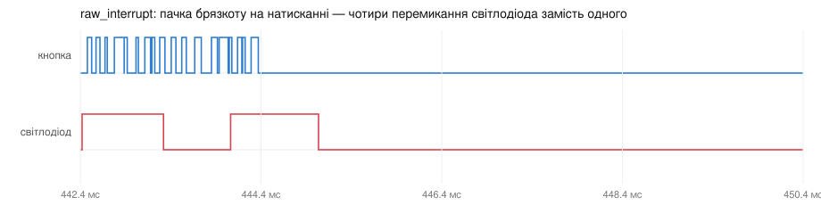

# ДЗ 2.6 — Без debounce (ESP-IDF DEBOUNCE)

Завдання 1, порт [`raw_interrupt`](../../dz2.4%20%28BUTTON%20DEBOUNCE%29/raw_interrupt/) з ДЗ 2.4 на ESP-IDF. Фільтра немає свідомо: це еталон, з яким порівнюється решта п'яти прошивок.

Логіка не змінилась — переривання на спадному фронті, лічильник в обробнику, реакція поза ним. Змінилось усе навколо: `pinMode()` → `gpio_config()`, `attachInterrupt()` → спільний диспетчер переривань GPIO, а замість `loop()`, який крутиться без зупинки і опитує `volatile`, тут задача, що спить на нотифікації.

## Як працює код

Файл: [`main/main.cpp`](main/main.cpp)

- `gpio_config()` — одна структура замість двох викликів `pinMode()`: піни, напрямок, підтяжка і тип переривання описуються разом.
- `gpio_install_isr_service(0)` — ESP-IDF не дає чіпати вектор переривання напряму: драйвер ставить один спільний обробник на всі GPIO, а `gpio_isr_handler_add()` підписує мій колбек на конкретний пін.
- `button_isr()` — `IRAM_ATTR`, інкремент лічильника і `vTaskNotifyGiveFromISR()`. Більше нічого: друк і `gpio_set_level()` лишаються в задачі, як і в ДЗ 2.4.
- `app_main()` — після налаштування стає тією самою задачею: `ulTaskNotifyTake(pdTRUE, portMAX_DELAY)` блокує її до наступного переривання.

Нотифікації лічильні, тому пачка фронтів, що прийшла поки задача друкувала рядок, не губиться — вона просто розблокує задачу стільку ж разів. Реагую все одно на лічильник, а не на кожне пробудження: інакше на один спад припало б кілька перемикань світлодіода.

Принципова різниця з Arduino-версією саме тут. Там `loop()` крутився вільно і бачив зміну `volatile` за мікросекунди, але процесор при цьому був зайнятий нічим. Тут задача спить, і на реакцію додається пробудження планувальника — заміри покажуть, скільки це коштує.

## Результати

Серія з [`sim/series20.yaml`](../sim/): 22 натискання, дві прошивки-еталони — ця й [`glitch_filter`](../glitch_filter/) — без жодного фільтра.

| | З брязкотом | Без брязкоту |
|---|---:|---:|
| Переривань нарахував МК | 1798 | 22 |
| Перемикань світлодіода | 143 | 22 |
| Хибних спрацювань | **121** | 0 |
| Затримка, медіана | 0.032 мс | 0.032 мс |

На чистій лінії все сходиться до одиниці: 22 натискання, 22 переривання, 22 реакції, затримка 32 мкс без жодного розкиду. Це й є ціна пробудження задачі з переривання — [порівняння з вільним `loop()` в Arduino](../#скільки-коштує-пробудження-задачі).

З брязкотом прошивка поводиться так, як і має еталон без фільтра: кожна пачка дає кілька реакцій замість однієї.



Цікава деталь: переривань 1798, а перемикань світлодіода 143. Задача фізично не встигає за ISR — поки вона друкує рядок у лог, обробник нараховує ще десятки, і в лозі видно, як лічильник стрибає через 10-40. Реагую я на лічильник, а не на кожне пробудження, тому одна реакція припадає на цілу групу переривань. На платі в [ДЗ 2.4](../../dz2.4%20%28BUTTON%20DEBOUNCE%29/raw_interrupt/) брязкіт був настільки слабший, що ця різниця не проявлялась.

Повний лог — [`serial.log`](serial.log), фронти — [`digital.csv`](digital.csv).

## Запуск

```sh
./tools/idf.sh "dz2.6 (ESP-IDF DEBOUNCE)/raw_interrupt" build
./tools/idf.sh "dz2.6 (ESP-IDF DEBOUNCE)/raw_interrupt" flash monitor
```

Навіщо обгортка і чому не `idf.py` напряму — [у головному README](../README.md#як-це-збирається).

## Файли

| Файл | Опис |
|---|---|
| [`main/main.cpp`](main/main.cpp) | прошивка |
| [`CMakeLists.txt`](CMakeLists.txt), [`main/CMakeLists.txt`](main/CMakeLists.txt) | проєкт ESP-IDF |
| [`sdkconfig.defaults`](sdkconfig.defaults) | тільки `CONFIG_IDF_TARGET` — решта за замовчуванням |
| [`serial.log`](serial.log), [`digital.csv`](digital.csv) | серія з брязкотом: лог і фронти |
| [`serial-clean.log`](serial-clean.log), [`digital-clean.csv`](digital-clean.csv) | серія без брязкоту |
| [`diagram.json`](diagram.json), [`wokwi.toml`](wokwi.toml) | схема й конфіг симулятора |
| `wave-*.svg` | осцилограми з VCD |

Та сама логіка на Arduino: [`dz2.4/raw_interrupt`](../../dz2.4%20%28BUTTON%20DEBOUNCE%29/raw_interrupt/). Апаратний фільтр поверх цього коду: [`glitch_filter`](../glitch_filter/).
