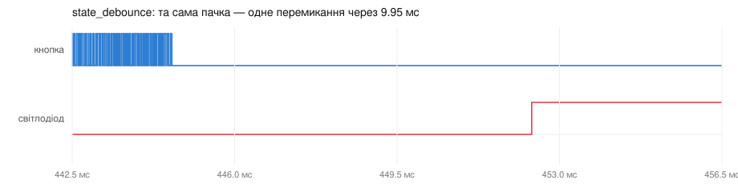

# ДЗ 2.6 — Debounce по рівню (ESP-IDF DEBOUNCE)

Завдання 3, порт [`state_debounce`](../../dz2.4%20%28BUTTON%20DEBOUNCE%29/state_debounce/) з ДЗ 2.4. Переривання на обидва фронти не вирішує нічого — лише каже «на лінії щось сталося». Задача витримує 10 мс, читає справжній рівень піна і зараховує натискання, тільки якщо кнопка досі притиснута до GND.

## Як працює код

Файл: [`main/main.cpp`](main/main.cpp)

- `GPIO_INTR_ANYEDGE` замість `CHANGE`, `gpio_get_level()` замість `digitalRead()`.
- `vTaskDelay(pdMS_TO_TICKS(10))` замість `delay(10)`. Це не косметика: `delay()` в Arduino крутить цикл, а `vTaskDelay()` віддає процесор іншим задачам на весь час витримки.
- Прапорець `pressed` — як і в ДЗ 2.4, без нього серія фронтів усередині одного натискання дала б кілька подій, бо рівень весь цей час лишається низьким.

## Пастка, якої в Arduino не було

`vTaskDelay()` міряє не мілісекунди, а такти планувальника, а їхня частота — опція Kconfig. Arduino-core для ESP32 ставить `CONFIG_FREERTOS_HZ=1000`, тож `delay(10)` там означав саме 10 мс. Чистий ESP-IDF за замовчуванням має **100 Гц**: такт 10 мс, витримка квантується до нього, і замість 10 мс я отримував би від 10 до 20.

Тому в [`sdkconfig.defaults`](sdkconfig.defaults) стоїть `CONFIG_FREERTOS_HZ=1000`, а в коді — `static_assert`, який не дасть зібрати прошивку, якщо такт довший за витримку. Опція перевіряється в `menuconfig` → Component config → FreeRTOS → Kernel → configTICK_RATE_HZ.

## Результати

| | З брязкотом | Без брязкоту |
|---|---:|---:|
| Переривань нарахував МК | 2760 | 43 |
| Натискань зараховано | **22 з 22** | 22 з 22 |
| Хибних спрацювань | **0** | 0 |
| Затримка, мін / медіана / макс | 9.713 / 9.929 / 9.950 мс | 9.945 / 9.947 / 9.950 мс |

Нуль хибних спрацювань при 4296 фронтах на лінії. Переривання тут на обидва фронти, тож обробник відпрацював 2760 разів — і жоден із цих викликів нічого не вирішував: рішення ухвалює читання рівня через 10 мс.



Порівняйте з тією самою пачкою в [`raw_interrupt`](../raw_interrupt/): лінія кнопки однакова, а світлодіод перемикається один раз замість чотирьох. Метод не рахує брязкіт не тому, що той короткий, а тому, що через 10 мс пін читається як LOW — кнопка досі натиснута, значить подія одна.

Затримка тримається в межах 9.713-9.950 мс, тобто трохи менше за задані 10. Це квантування такту планувальника: `vTaskDelay(pdMS_TO_TICKS(10))` при 1000 Гц дає 10 тіків, а момент натискання припадає у випадкову точку такту. Метод, якому планувальник не потрібен взагалі, — [`timer_debounce`](../timer_debounce/).

Межа методу лишається та сама, що на платі: пачка, довша за 10 мс, його обдурить. У цій серії такої не трапилось — найдовша тривала 2 мс.

Логи: [`serial.log`](serial.log), [`serial-clean.log`](serial-clean.log); фронти: [`digital.csv`](digital.csv), [`digital-clean.csv`](digital-clean.csv).

## Запуск

```sh
./tools/idf.sh "dz2.6 (ESP-IDF DEBOUNCE)/state_debounce" build
./tools/idf.sh "dz2.6 (ESP-IDF DEBOUNCE)/state_debounce" flash monitor
```

## Файли

| Файл | Опис |
|---|---|
| [`main/main.cpp`](main/main.cpp) | прошивка |
| [`CMakeLists.txt`](CMakeLists.txt), [`main/CMakeLists.txt`](main/CMakeLists.txt) | проєкт ESP-IDF |
| [`sdkconfig.defaults`](sdkconfig.defaults) | `CONFIG_FREERTOS_HZ=1000` — інакше витримка квантується до 10 мс |
| [`serial.log`](serial.log), [`digital.csv`](digital.csv) | серія з брязкотом: лог і фронти |
| [`serial-clean.log`](serial-clean.log), [`digital-clean.csv`](digital-clean.csv) | серія без брязкоту |
| [`diagram.json`](diagram.json), [`wokwi.toml`](wokwi.toml) | схема й конфіг симулятора |
| `wave-*.svg` | осцилограми з VCD |

Та сама логіка на Arduino: [`dz2.4/state_debounce`](../../dz2.4%20%28BUTTON%20DEBOUNCE%29/state_debounce/). Та сама перевірка рівня, але витримку відмірює таймер, а не задача: [`timer_debounce`](../timer_debounce/).
