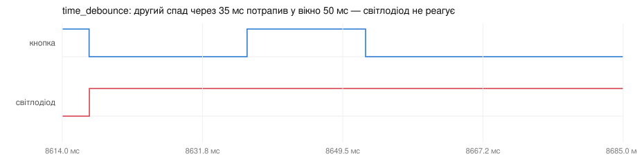

# ДЗ 2.6 — Debounce по часу (ESP-IDF DEBOUNCE)

Завдання 2, порт [`time_debounce`](../../dz2.4%20%28BUTTON%20DEBOUNCE%29/time_debounce/) з ДЗ 2.4. Подія приймається, лише якщо від попередньої прийнятої минуло ≥ 50 мс. Умова вимагає тримати фільтр поза обробником, тому ISR лише знімає мітку часу, а рішення ухвалює задача.

## Як працює код

Файл: [`main/main.cpp`](main/main.cpp)

- `esp_timer_get_time()` замість `micros()` — теж мікросекунди від старту і теж в IRAM, але 64-бітний. `micros()` в ДЗ 2.4 перевертався через 71 хвилину; тут запас на 292 тисячі років.
- `xQueueSendFromISR()` — черга на 64 мітки часу замість одного `volatile` і прапорця. В Arduino-версії два фронти між ітераціями `loop()` означали втрачену мітку: другий перезаписував перший. Тут усі фронти стають у чергу і жоден не губиться.
- `s_overruns` — якщо черга все-таки переповнилась, прошивка про це скаже. Чесніше, ніж тихо втратити подію.
- Фільтр у задачі — одне порівняння `edge - last_accepted >= 50000`, як і було.

Вікно і довжина черги задані в `enum` на початку файла.

## Результати

| | З брязкотом | Без брязкоту |
|---|---:|---:|
| Прийнято подій | 37 | 21 |
| Відкинуто | **1307** | 1 |
| Натискань без жодної реакції | **4** | 0 |
| Реакцій поза натисканням | **11** | 0 |
| Затримка, медіана / макс | 0.054 / **161.97** мс | 0.035 мс |

Почну з хорошого. На чистій лінії фільтр зробив рівно те, для чого існує: з 22 натискань прийняв 21 і відкинув одне — другий спад подвійного натискання, що прийшов через 35 мс, тобто всередині вікна 50 мс.



А тепер про те, чому цей метод у ДЗ 2.4 я назвав таким, що лікує не ту хворобу. З брязкотом він відкинув 1307 подій із 1344 — і при цьому **чотири натискання не дали жодної реакції**, а одинадцять реакцій прийшли тоді, коли кнопки ніхто не торкався. Медіанна затримка 0.054 мс, максимальна — 162 мс.


Механізм видно на картинці: перший спад приймається, далі вікно 50 мс глушить усю пачку — але пачка триває довше за вікно, тож приймається якийсь випадковий пізній фронт. Фільтр міряє паузу між подіями і не знає ні рівня піна, ні того, натиснута кнопка зараз чи ні.

Повні логи: [`serial.log`](serial.log) (1402 рядки — переважно «Rejected»), [`serial-clean.log`](serial-clean.log). Фронти: [`digital.csv`](digital.csv), [`digital-clean.csv`](digital-clean.csv).

## Запуск

```sh
./tools/idf.sh "dz2.6 (ESP-IDF DEBOUNCE)/time_debounce" build
./tools/idf.sh "dz2.6 (ESP-IDF DEBOUNCE)/time_debounce" flash monitor
```

## Файли

| Файл | Опис |
|---|---|
| [`main/main.cpp`](main/main.cpp) | прошивка |
| [`CMakeLists.txt`](CMakeLists.txt), [`main/CMakeLists.txt`](main/CMakeLists.txt) | проєкт ESP-IDF |
| [`sdkconfig.defaults`](sdkconfig.defaults) | тільки `CONFIG_IDF_TARGET` |
| [`serial.log`](serial.log), [`digital.csv`](digital.csv) | серія з брязкотом: лог і фронти |
| [`serial-clean.log`](serial-clean.log), [`digital-clean.csv`](digital-clean.csv) | серія без брязкоту |
| [`diagram.json`](diagram.json), [`wokwi.toml`](wokwi.toml) | схема й конфіг симулятора |
| `wave-*.svg` | осцилограми з VCD |

Та сама логіка на Arduino: [`dz2.4/time_debounce`](../../dz2.4%20%28BUTTON%20DEBOUNCE%29/time_debounce/). Метод, який міряє не паузу між подіями, а тишу на лінії: [`timer_debounce`](../timer_debounce/).
