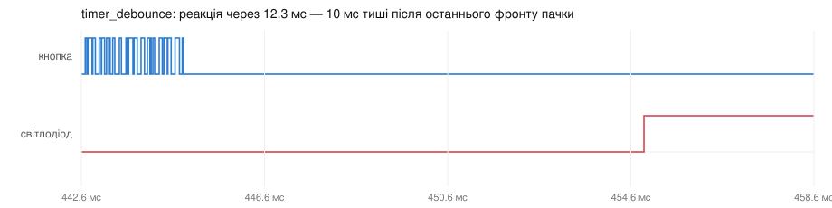

# ДЗ 2.6 — Debounce на одноразовому таймері (ESP-IDF DEBOUNCE)

Завдання 5, і цього в ДЗ 2.4 не було. Витримку відмірює не затримка в задачі, а апаратний таймер `esp_timer`, причому кожен новий фронт її перезапускає. Поки контакт брязкотить, таймер не доходить до кінця; коли лінія затихла на 10 мс — колбек читає рівень піна і вирішує, що це було.

Тема модуля 2.6 — саме це: надійний ввід через таймери, а не через очікування в коді.

## Чим це відрізняється від завдань 2 і 3

| | Що міряє метод | Коли реагує |
|---|---|---|
| [`time_debounce`](../time_debounce/) | паузу між прийнятими подіями | одразу на фронт, далі блокує вікно 50 мс |
| [`state_debounce`](../state_debounce/) | рівень через фіксовані 10 мс після **першого** фронту | через 10 мс |
| `timer_debounce` | тишу на лінії | через 10 мс після **останнього** фронту |

Різниця практична. `state_debounce` читає пін через 10 мс від першого фронту і сподівається, що брязкіт до того часу закінчився; пачка, довша за витримку, його обдурить. Тут витримка відлічується від останнього фронту, тож довга пачка лише відкладає реакцію, але не проходить.

Плата за це — реакція плаває разом із довжиною брязкоту. У ДЗ 2.4 найдовша пачка на цій кнопці була 0.8 мс, тож на практиці мова про десяті частки мілісекунди поверх 10 мс.

## Як працює код

Файл: [`main/main.cpp`](main/main.cpp)

- `esp_timer_create()` з `ESP_TIMER_TASK` — колбек виконується в задачі `esp_timer`, спільній для всіх таймерів системи.
- `button_isr()` — переривання на обидва фронти, `esp_timer_stop()` + `esp_timer_start_once()`. Обидві функції беруть спінлок через `portENTER_CRITICAL_SAFE` і помічені `ESP_TIMER_IRAM_ATTR`, тобто лежать в IRAM, поки ввімкнений `CONFIG_ESP_TIMER_IN_IRAM` — а він за замовчуванням `y`. Тому викликати їх із переривання можна. `ESP_ERR_INVALID_STATE` від `stop()` означає «таймер і не був запущений» — по ньому ж рахую, скільки фронтів справді перезавели відлік.
- `settle_timer_cb()` — читає `gpio_get_level()`, перемикає світлодіод і кладе подію в чергу. Друку тут немає свідомо: колбеки `esp_timer` виконуються один за одним, і рядок у UART на 115200 бод (близько 3 мс) затримав би всі інші таймери системи. Черга, а не нотифікація, саме щоб лог не втратив події, якщо репортер не встигне між натисканням і відпусканням — цей лог потім звіряється з фронтами на аналізаторі.
- `app_main()` після налаштування стає тією задачею-репортером.

Ще одна перевага: `esp_timer` міряє мікросекунди власним апаратним таймером і не залежить від такту планувальника. У [`state_debounce`](../state_debounce/) і [`polling_debounce`](../polling_debounce/) довелось піднімати `CONFIG_FREERTOS_HZ` до 1000, щоб витримка взагалі мала сенс; тут [`sdkconfig.defaults`](sdkconfig.defaults) лишився з налаштуваннями за замовчуванням.

## Результати

| | З брязкотом | Без брязкоту |
|---|---:|---:|
| Переривань нарахував МК | 3353 | 43 |
| З них перезавели таймер | **3310** | **0** |
| Натискань зараховано | **22 з 22** | 22 з 22 |
| Хибних спрацювань | **0** | 0 |
| Затримка, мін / медіана / макс | 11.948 / 12.202 / 12.391 мс | 10.055 / 10.056 / 10.056 мс |

Число, яке найкраще описує метод: із 3353 переривань **3310 нічого не зробили, крім перезапуску таймера**. Тобто 98.7% фронтів пачки впали в нікуди — саме так і задумано, бо відлік починається заново з кожним із них, а колбек спрацьовує лише тоді, коли лінія затихла на 10 мс.

На чистій лінії перезапусків **нуль**: кожен фронт приходить тоді, коли таймер від попереднього вже відпрацював, тож перезаводити нічого. Ці два числа — 3310 і 0 — і є вся різниця між брязкотом і його відсутністю з погляду цього методу.



Звідси й підпис методу в затримці. На чистій лінії — 10.056 мс із розкидом в одну мікросекунду: `esp_timer` відмірює час власним апаратним таймером і такт планувальника йому не потрібен. З брязкотом — 12.2 мс, і ці зайві 2 мс рівно дорівнюють довжині пачки, яку він пересидів.

Порівняння з [`state_debounce`](../state_debounce/), який чекає стільки ж, але від першого фронту:

| | Чиста лінія | З брязкотом |
|---|---:|---:|
| `state_debounce`, `vTaskDelay` | 9.945-9.950 мс | 9.713-9.950 мс |
| `timer_debounce`, `esp_timer` | 10.055-10.056 мс | 11.948-12.391 мс |

`state_debounce` швидший, бо на пачку не дивиться — але пачка, довша за його витримку, його обдурить. Цей метод повільніший рівно настільки, наскільки довгий брязкіт, і обдурити його пачкою не можна в принципі.

Логи: [`serial.log`](serial.log), [`serial-clean.log`](serial-clean.log); фронти: [`digital.csv`](digital.csv), [`digital-clean.csv`](digital-clean.csv).

## Запуск

```sh
./tools/idf.sh "dz2.6 (ESP-IDF DEBOUNCE)/timer_debounce" build
./tools/idf.sh "dz2.6 (ESP-IDF DEBOUNCE)/timer_debounce" flash monitor
```

## Файли

| Файл | Опис |
|---|---|
| [`main/main.cpp`](main/main.cpp) | прошивка |
| [`CMakeLists.txt`](CMakeLists.txt), [`main/CMakeLists.txt`](main/CMakeLists.txt) | проєкт ESP-IDF |
| [`sdkconfig.defaults`](sdkconfig.defaults) | тільки `CONFIG_IDF_TARGET`: таймеру такт планувальника не потрібен |
| [`serial.log`](serial.log), [`digital.csv`](digital.csv) | серія з брязкотом: лог і фронти |
| [`serial-clean.log`](serial-clean.log), [`digital-clean.csv`](digital-clean.csv) | серія без брязкоту |
| [`diagram.json`](diagram.json), [`wokwi.toml`](wokwi.toml) | схема й конфіг симулятора |
| `wave-*.svg` | осцилограми з VCD |
