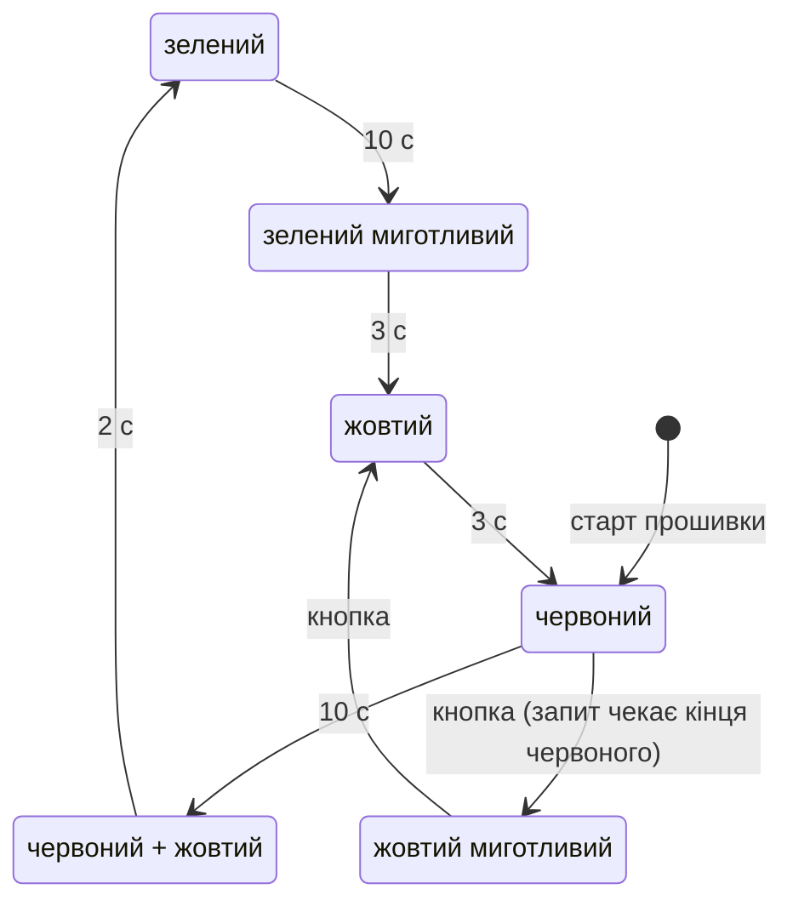

# ДЗ 2.7 — Світлофор за ПДР України (TRAFFIC LIGHT)

Мініпроєкт: світлофор на **ESP32-S3-DevKitC-1** з усіма станами з ПДР України, включно з миготливим зеленим, суміщеним червоним із жовтим і окремим режимом миготливого жовтого. Фреймворк — **ESP-IDF**, як у [ДЗ 2.6](../dz2.6%20%28ESP-IDF%20DEBOUNCE%29/): збирається і нативною 5.5.5, і 6.1.0 із пакета PlatformIO; заміри зняті на другій.

Прошивок дві:

| Прошивка | Що в ній |
|---|---|
| [`traffic_light`](traffic_light/) | чиста відповідь на умову: автомат фаз, кнопка на жовтий миготливий — знята на залізі |
| [`traffic_barrier`](traffic_barrier/) | те саме плюс шлагбаум на SG90 — ускладнення поза умовою, теж знята на залізі |

Коду із заняття для цього уроку немає, тож за відправну точку взяв схему з власного [ДЗ 2.3](../dz2.3%20%28SUPERLOOP%29/three_leds/) — ті самі три світлодіоди, — а керування переписав із трьох незалежних таймерів на один автомат станів.

| Цикл ПДР | Зібрана плата |
|---|---|
| <a href="traffic_light/video.mp4"></a> |  |

На фото — «червоний + жовтий», стан ПДР 8.7.6: рух ще заборонено, але зелений уже анонсовано.

## Фази

| ПДР | Фаза | Лампи | Тривалість |
|---|---|---|---:|
| 8.7.1 — зелений, дозволяє рух | `Green` | зелений | 10 с |
| 8.7.2 — зелений миготливий, дозвіл закінчується | `GreenBlink` | зелений, 1 Гц | 3 с (3 блимання) |
| 8.7.3 — жовтий, забороняє рух і попереджає про зміну | `Yellow` | жовтий | 3 с |
| 8.7.5 — червоний, забороняє рух | `Red` | червоний | 10 с |
| 8.7.6 — червоний і жовтий разом, попереджають про зелений | `RedYellow` | червоний + жовтий | 2 с |
| 8.7.4 — жовтий миготливий, перехрестя нерегульоване | `YellowBlink` | жовтий, 1 Гц | до вимкнення режиму |

Повний цикл — 28 с. ПДР задають **порядок** сигналів, а не секунди; тривалості тут зі звичайної практики міських перехресть і правляться кожна окремо, а весь масштаб часу — одним множником `TIME_DIVIDER` (зручно для відео й аналізатора).

## Переходи



Жовтий миготливий — не фаза циклу, а режим, і вмикається він не там, де натиснули кнопку. У нічний режим автомат іде **тільки після червоного**: на червоному вже всі стоять, тож зміна сигналу нікого не позбавляє щойно виданого дозволу. Назад — **через рівний жовтий**, бо він забороняє рух і попереджає про зміну сигналів; інакше ті, хто рухався під миготливим жовтим, отримали б червоний без попередження.

Старт прошивки — з червоного: єдина фаза, яку можна ввімкнути на вже зайнятому перехресті, нікому не збрехавши.

## Що вимагала умова і де це зроблено

| Умова | Де | Як перевірено |
|---|---|---|
| зелений — дозволяє рух | `Phase::Green`, GPIO 6 | — |
| зелений миготливий — попереджає про кінець дозволу | `Phase::GreenBlink`, 1 Гц | `static_assert`: зелений не може гаснути без миготіння |
| жовтий — забороняє рух, попереджає про зміну | `Phase::Yellow` | `static_assert`: рівний жовтий не може стати миготливим |
| червоний — забороняє рух | `Phase::Red`, GPIO 4 | — |
| червоний і жовтий одночасно — попереджають про зелений | `Phase::RedYellow` | `static_assert`: червоний не перемикається прямо в зелений |
| зелений — цикл повторюється | `next` у таблиці замикає цикл | `static_assert`: цикл повертається в зелений рівно за 5 фаз |
| *особливий випадок:* жовтий миготливий | `Phase::YellowBlink`, кнопка на GPIO 16 | окремий режим, вхід після червоного, вихід через жовтий |
| Arduino Framework або ESP-IDF | ESP-IDF v5.5.5 (нативно) і 6.1.0 (через PlatformIO) | обидві збірки без помилок і попереджень |
| номер модуля і уроку в назві | папка `dz2.7 (TRAFFIC LIGHT)`, коміт `dz2.7: ...` | — |

Додатково, чого умова не просила, але без чого світлофор був би іграшкою: червоний і зелений **фізично не можуть** засвітитися разом — це перевіряє `static_assert` по всій таблиці фаз і, на випадок помилки вже в логіці миготіння, ще раз рантайм-перевірка в `apply_lamps()`, де в суперечності перемагає заборонний сигнал. Список усіх перевірок і те, як вони спрацьовують, — у [README прошивки](traffic_light/#що-перевіряє-компілятор).

## Ускладнення: шлагбаум

[`traffic_barrier`](traffic_barrier/) додає до того самого автомата стрілу на SG90. Сенс не в тому, що серво рухається, а в тому, що **рух займає час**, — і через це жовтий та червоний+жовтий перестають бути просто попередженнями й отримують фізичну роботу: на жовтому стріла опускається і має встигнути вниз до червоного, на червоному+жовтому піднімається і має встигнути вгору до зеленого.

Звідси два нових `static_assert`, які перевіряють уже не таблицю, а механіку: фаза не може бути коротшою за хід стріли. Вони ж і ламають `TIME_DIVIDER = 10` — ущільнений масштаб часу брехав би, бо серво не прискорюється разом із таймерами. Тобто ручка «швидке демо» фізично не може збрехати.

Плюс інтерлок: вхід у нічний режим чекає, поки стріла підніметься, бо миготливий жовтий дозволяє рух; і зелений не засвічується, поки стріла не вгорі. Зворотного зв'язку серво не має, тож положення стріли прошивка рахує з часу, а не знає — і [README прошивки](traffic_barrier/) цього не приховує.


Ліворуч зелений, стріла вгорі; праворуч червоний, стріла внизу. Хід 90°, від 1000 до 2000 мкс імпульсу.

## Схема

| Компонент | Пін ESP32-S3 | Примітка |
|---|---|---|
| Червоний LED | GPIO 4 | через 220 Ω, катод на GND |
| Жовтий LED | GPIO 5 | через 220 Ω |
| Зелений LED | GPIO 6 | через 220 Ω |
| Кнопка режиму | GPIO 16 | другий контакт на GND, підтяжка внутрішня (`GPIO_PULLUP_ENABLE`) |
| Серво SG90, сигнал | GPIO 8 | лише `traffic_barrier`; живлення — окреме, 5 В |

Ті самі три світлодіоди, що в [ДЗ 2.3](../dz2.3%20%28SUPERLOOP%29/three_leds/), тільки жовтий і зелений помінялися пінами, щоб порядок GPIO 4-5-6 відповідав порядку сигналів на світлофорі. Кнопка — та сама, що в [ДЗ 1.5](../dz1.5%20%28BUTTON%20BOUNCE%29/), [ДЗ 2.4](../dz2.4%20%28BUTTON%20DEBOUNCE%29/) і [ДЗ 2.6](../dz2.6%20%28ESP-IDF%20DEBOUNCE%29/).

Схеми для симулятора в кожної прошивки свої: [`traffic_light/diagram.json`](traffic_light/diagram.json) — три світлодіоди з резисторами, кнопка і аналізатор на чотирьох каналах (`RED`, `YELLOW`, `GREEN`, `BUTTON`); [`traffic_barrier/diagram.json`](traffic_barrier/diagram.json) — те саме плюс серво і п'ятий канал `SERVO`. В аналізаторі канали лампи зняті з анода світлодіода, як у ДЗ 2.6; на залізі зручніше чіплятися до самого піна.

## Збірка

Канонічна — нативний `idf.py` через [обгортку](../tools/idf.sh):

```sh
./tools/idf.sh "dz2.7 (TRAFFIC LIGHT)/traffic_light" build
./tools/idf.sh "dz2.7 (TRAFFIC LIGHT)/traffic_light" flash monitor
```

Той самий код через PlatformIO — потрібен для Wokwi, бо `wokwi.toml` шукає прошивку в `.pio/build/`:

```sh
pio run -e idf_traffic_light -t upload
pio device monitor -e idf_traffic_light
```

Код не дублюється: обидва шляхи читають один `main/main.cpp` і один `sdkconfig.defaults`. Як це влаштовано — [в README ДЗ 2.6](../dz2.6%20%28ESP-IDF%20DEBOUNCE%29/#дві-збірки-однієї-прошивки).

Побічна перевірка: прошивка збирається без попереджень і на ESP-IDF 5.5.5 (нативно), і на 6.1.0 (пакет `framework-espidf` у PlatformIO).

Обгортка `idf.sh` цього ДЗ отримала одну правку — build-каталог тепер `~/.cache/idf-<номер ДЗ>/<варіант>`, а не прибитий до `idf-dz2.6`.

## Заміри

`traffic_light` знята на залізі — один прогон на 53 с із повним циклом, входом у нічний режим і виходом із нього. [Повний розбір](traffic_light/#заміри-на-залізі), коротко:

| | номінал | зміряно |
|---|---:|---:|
| червоний | 10000 мс | 10001,02 мс |
| червоний + жовтий | 2000 мс | 2001,18 мс |
| жовтий | 3000 мс | 3001,16 мс |
| півперіод миготіння | 500 мс | 500,0267 мс |
| розкид півперіоду по 13 замірах | — | **0,083 мкс** |
| затримка режиму до кінця червоного | — | 3,840 с |

Стабільний плюс мілісекунда на кожній фазі — округлення очікування вгору до цілого тіка; воно не накопичується. Вісімдесят три наносекунди розкиду на миготінні — результат того, що сітка прив'язана до дедлайну, а не до моменту пробудження задачі.

`traffic_barrier` знята так само. Крім довжин фаз там зміряне серво: імпульси 999,833 і 1999,625 мкс проти номінальних 1000 і 2000 (це квантування 14 біт, сходиться до десятих мікросекунди), період PWM 20,0011 мс і затримка від фронту лампи до зміни імпульсу — 2,4…13,6 мс, тобто завжди в межах одного періоду. Інтерлок видно в числах: червоний, на якому автомат чекав стрілу, тривав **10651,70 мс** замість 10000.

Той прогон заодно знайшов баг у `hold_phase()` — тримання фази спрацьовувало двічі замість одного разу. Виправлено; [розбір у README прошивки](traffic_barrier/#що-цей-прогон-знайшов-у-коді).

## Що лишилось зняти

- хід стріли `BARRIER_TRAVEL_MS = 600` досі **паспортний, а не зміряний**: без кінцевого вимикача прошивка моменту доїзду не бачить. Порахувати можна з відео по кадрах — на 60 fps один кадр це 16,7 мс;
- повторити серію `traffic_barrier` на виправленому `hold_phase()`, щоб у логу було одне тримання замість двох.

## Файли

```
dz2.7 (TRAFFIC LIGHT)/
├── traffic_light/        відповідь на умову
└── traffic_barrier/      те саме плюс шлагбаум на серво
```

У кожній папці — `README.md`, `main/main.cpp`, `main/CMakeLists.txt`, `CMakeLists.txt`, `sdkconfig.defaults`, `diagram.json` і `wokwi.toml`, а поряд дані прогону: `serial.log`, `digital.csv`, `schema.png`, `photo.jpeg`, `demo.gif`, `video.mp4` і кадри з аналізатора `capture-*.png`.

`sdkconfig` генерується при збірці, `video.MOV` лишається локально — обидва в `.gitignore`.
