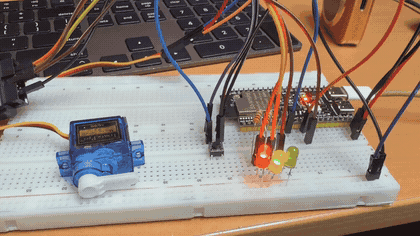
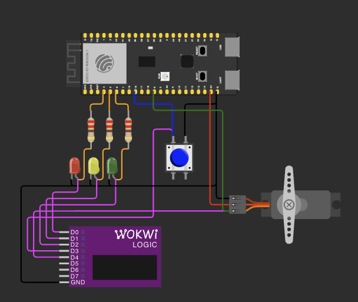
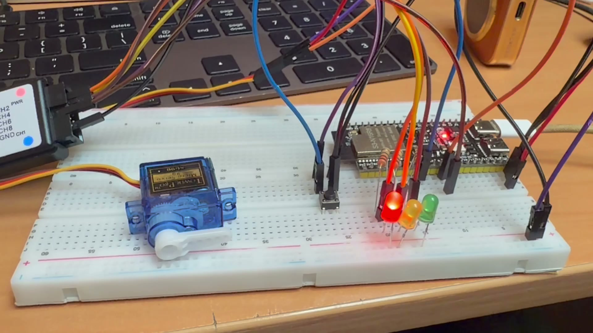
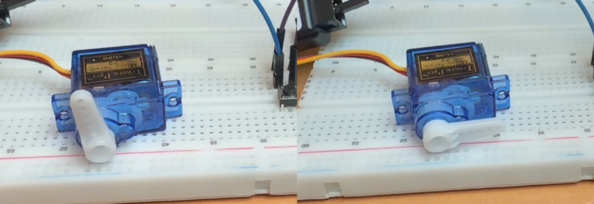
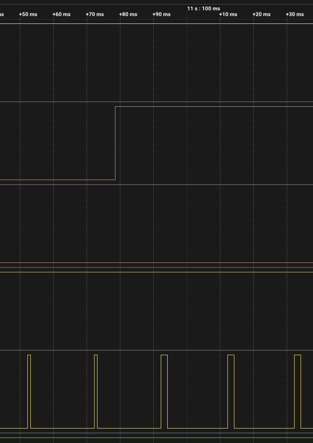

# ДЗ 2.7 — traffic_barrier (TRAFFIC LIGHT)

Той самий автомат, що в [`traffic_light`](../traffic_light/), плюс шлагбаум на SG90. Цікаве тут не те, що серво рухається, а те, що **рух займає час** — і через це жовтий та червоний+жовтий перестають бути просто попередженнями й отримують фізичну роботу.

| Фаза | Стріла | Чому саме тут |
|---|---|---|
| зелений, зелений миготливий | вгорі, не рухається | рух дозволений — проїзд мусить бути вільний |
| жовтий (3 с) | опускається | має бути **внизу** до того, як червоний почне діяти |
| червоний | внизу | — |
| червоний + жовтий (2 с) | піднімається | має бути **вгорі** до того, як засвітиться зелений |
| жовтий миготливий | вгорі | перехрестя нерегульоване, проїзд вільний |

Команди стрілі прив'язані до входу у фазу, а не до окремих таймерів: заборонний сигнал опускає, попередження про зелений піднімає. Увесь зв'язок між світлофором і механікою — це шість рядків у `enter_phase()`.

## Демо

<a href="video.mp4"></a>

[Відео в повній якості (MP4)](video.mp4). У кліпі саме той момент, заради якого все це зроблено: горить червоний, стріла лежить; вмикається червоний+жовтий — і стріла встигає піднятися рівно до того, як засвітиться зелений.

## Фаза не може бути коротшою за хід стріли

Два нових `static_assert` перевіряють уже не таблицю, а фізику:

```cpp
static_assert(Config::YELLOW_MS     >= Config::BARRIER_BUDGET_MS, ...);
static_assert(Config::RED_YELLOW_MS >= Config::BARRIER_BUDGET_MS, ...);
```

`BARRIER_BUDGET_MS` — це хід стріли плюс маржа на PWM. І це найкорисніше, що взагалі дало це ускладнення: у `traffic_light` був множник `TIME_DIVIDER`, яким можна було ущільнити цикл із 28 с до 2,8 с для відео. Тут він більше не працює — серво не вміє прискорюватися разом із таймерами:

```
main.cpp:190:33: error: static assertion failed: the yellow phase is shorter than the boom travel
budget: the barrier would still be moving when the red phase starts
main.cpp:193:37: error: static assertion failed: the red+yellow phase is shorter than the boom
travel budget: green would come on before the barrier is up
```

Тобто ручка «швидке демо» фізично не може збрехати. Щоб зняти ущільнене відео, довелось би або масштабувати й хід стріли, або чесно відмовитися від ущільнення в цій прошивці — і компілятор змушує вибрати одне з двох, а не забути про питання.

`BARRIER_TRAVEL_MS` свідомо **не** діленеться на `TIME_DIVIDER`: це фізика, а не таймінг.

## Серво

`ledc` на 50 Гц, 14 біт. Крок шпаруватості виходить 1,22 мкс — перевірено `static_assert`, бо в SG90 мертва зона близько 5 мкс, і грубіше квантування було б видно як смикання.

Дві неочевидні речі:

**`ledc_update_duty()` застосовується з наступного періоду.** Кожна команда квантується до 20 мс, і це треба закладати в маржу, а не в хід. `LEDC_MARGIN_MS = 40` — два періоди, щоб і команда долетіла, і лишився запас; на це теж є `static_assert`.

**PWM не знімається на припаркованій стрілі.** Спокуса є: `ledc_stop()` прибрав би гудіння і струм утримання. Але без механічного упору серво тоді безсиле, і стріла обвисає — а шлагбаум, який сам відкривається, гірший за той, що гуде. На аналізаторі це видно напряму: PWM присутній завжди, міняється лише ширина імпульсу між 1000 і 2000 мкс.

Структури `ledc_timer_config_t` і `ledc_channel_config_t` я заповнюю не повним списком полів, як `esp_timer_create_args_t` у [ДЗ 2.6](../../dz2.6%20%28ESP-IDF%20DEBOUNCE%29/), а через `= {}` і присвоєння. Причина прагматична: їхній склад між версіями IDF міняється (у 5.4+ додалися `deconfigure` і `sleep_mode`), а прошивка має збиратися і на 5.5.5, і на 6.1. Форма `= {}` при цьому не дає `-Wmissing-field-initializers` — gcc звільняє саме її.

## Чого серво не вміє

SG90 не має зворотного зв'язку. Прошивка керує часом, а не положенням: стріла вважається «вгорі», коли вийшов бюджет ходу. Вона не знає, чи стріла справді доїхала, — і README не вдає, що знає.

Тому єдине, що тут узагалі можна гарантувати, це що **фаза довша за хід**. Саме це й перевіряють два `static_assert` вище. Усе решта — модель.

Щоб стан став фактом, потрібен кінцевий вимикач угорі: він дав би реальний час ходу замість паспортного, спіймав би стрілу, яка не дійшла, і стрілу, яка обвисла з верхнього положення. Я його не роблю, бо для нього потрібна змонтована стріла з упором, а тут усе на макетній платі. Якщо стріла колись з'явиться — це один GPIO на вхід, переривання по обох фронтах і стан `Fault`, у який автомат ішов би замість того, щоб вважати хід успішним по таймауту.

## Інтерлок

Два правила, які не дають автомату піти далі, поки механіка не готова. Фаза при цьому **не бреше про сигнал** — вона просто продовжується, лампи не міняються:

1. **вхід у нічний режим чекає на стрілу** — миготливий жовтий дозволяє рух, тому стріла має бути вгорі ДО того, як він засвітиться. Підняття замовляється в кінці червоного, і червоний тримається, поки воно не завершиться;
2. **зелений не засвічується, поки стріла не вгорі** — тримався б червоний+жовтий.

Перше спрацьовує щоразу при вході в нічний режим, на ~640 мс, і це видно в логу. Друге при нинішніх тривалостях спрацювати не може: `static_assert` уже вимагає, щоб червоний+жовтий був довший за хід стріли. Я лишив його не як захист, а як місце, де головне твердження програми — «зеленого не буде, поки проїзд не відкрито» — записане виконуваним кодом, а не лише перевіркою збірки.

`hold_phase()` продовжує фазу рівно на час, що лишився стрілі, а не фіксованим шматком — інакше в лог ішло б тридцять попереджень замість одного. Плюс 1 мс запасу: без нього фаза закінчувалася за мікросекунди **до** дедлайну стріли (між двома читаннями годинника встигає пройти рядок у UART на 115200) і писала ще одне попередження.

## Старт

Стріла при старті в невідомому положенні — для цього є окремий стан `Unknown`: це не «внизу» і не «вгорі», це просто ще нічого не відомо. Перше, що робить прошивка, — опускає стрілу під червоним. Піднімати на старті не можна: це означало б відкрити проїзд, нічого про нього не знаючи.

## Схема та плата

| Схема (Wokwi) | Зібрана плата |
|---|---|
|  |  |

На фото червоний і стріла лежить — проїзд перекрито. Два крайні положення поруч:



Ліворуч зелений, стріла вгорі; праворуч червоний, стріла внизу. Хід — 90°, від 1000 до 2000 мкс імпульсу.

| Компонент | Пін ESP32-S3 | Примітка |
|---|---|---|
| Червоний / жовтий / зелений LED | GPIO 4 / 5 / 6 | через 220 Ω, катоди на GND |
| Кнопка режиму | GPIO 16 | другий контакт на GND, підтяжка внутрішня |
| Серво SG90, сигнал | GPIO 8 | той самий пін, що був реле в [ДЗ 2.2](../../dz2.2%20%28POWER%20LOAD%29/) і [2.5](../../dz2.5%20%28TIMERS%29/) |

**Живлення серво — окреме.** SG90 бере ~200-300 мА в русі й до ~700 мА в упорі; що з цього виходить на одній шині з мікроконтролером, уже зміряно в [ДЗ 2.2](../../dz2.2%20%28POWER%20LOAD%29/motor_pwm/) — пусковий струм садив плату в brownout. Тому 5 В на серво йде з того самого модуля живлення з власним USB-C, що в [ДЗ 2.5](../../dz2.5%20%28TIMERS%29/), землі спільні, по шині електроліт.

У [`diagram.json`](diagram.json) серво живиться від `5V` плати — у симуляторі іншого джерела немає, і brownout він усе одно не моделює. На залізі так робити не треба.

Логічний аналізатор на п'яти каналах: `RED`, `YELLOW`, `GREEN`, `BUTTON`, `SERVO`. Останній — найцікавіший: на ньому видно і ширину імпульсу, і де фронт команди стрілі відносно фронту світлодіода.

## Заміри на залізі

Один прогон, 53 секунди: повний цикл, вхід у нічний режим і вихід. Дані — [`serial.log`](serial.log) і [`digital.csv`](digital.csv) (Logic 2, п'ять каналів: GPIO 4, 5, 6, кнопка і сигнал серво, 1 MS/s).

```
I (279) barrier: ready: PDR cycle 10000+3000+3000+10000+2000 ms, boom budget 640 ms (travel 600 + ledc 40), servo GPIO 8 at 50 Hz, boom position is modelled from time
I (284) barrier: RED             [R..] 10000 ms  boom unknown
I (290) barrier: boom: lowering, pulse 1000 us, budget 640 ms
I (931) barrier: boom down (640 ms, by budget)
I (10285) barrier: RED+YELLOW      [RY.]  2000 ms  boom down
I (10285) barrier: boom: raising, pulse 2000 us, budget 640 ms
I (10926) barrier: boom up (640 ms, by budget)
I (12286) barrier: cycle 1 starts
I (12286) barrier: GREEN           [..G] 10000 ms  boom up
I (22287) barrier: GREEN BLINKING  [..g]  3000 ms  boom up
I (25288) barrier: YELLOW          [.Y.]  3000 ms  boom up
I (25288) barrier: boom: lowering, pulse 1000 us, budget 640 ms
I (25929) barrier: boom down (640 ms, by budget)
I (28037) barrier: mode: blinking yellow requested, applies after the red phase (edges: 1)
I (28289) barrier: RED             [R..] 10000 ms  boom down
I (38290) barrier: boom: raising, pulse 2000 us, budget 640 ms
W (38290) barrier: interlock: ... holding RED 640 ms more (hold 1)
I (38934) barrier: mode: entering blinking yellow after red
```

Рядок `by budget` щоразу нагадує, звідки взявся висновок «стріла вгорі»: не з датчика, а з таймера.

### Довжина фаз

| Фаза | Константа | Зміряно | Похибка |
|---|---:|---:|---:|
| червоний | 10000 мс | 10000,73 мс | +0,73 мс |
| червоний + жовтий | 2000 мс | 2001,18 мс | +1,18 мс |
| жовтий | 3000 мс | 3001,16 мс | +1,16 мс |
| півперіод миготіння | 500 мс | 500,0267 мс | +27 мкс |
| **червоний під інтерлоком** | 10000 мс | **10651,70 мс** | **+651,7 мс** |

Останній рядок — це і є інтерлок, видний у числах: на тому червоному автомат чекав, поки підніметься стріла, і не випускав миготливий жовтий, поки вона не стала вгорі.

### Серво



Зверху вниз: жовтий, червоний, серво. Два вузькі імпульси по **999,8 мкс** — стріла внизу. О **11,0785** піднімається жовтий (тут це червоний+жовтий, команда піднімати). Серво добиває поточний період і лише з наступного, о **11,0921**, видає широкий імпульс **1999,6 мкс**.

| | Номінал | Зміряно |
|---|---:|---:|
| імпульс «стріла внизу» | 1000 мкс | 999,833 мкс |
| імпульс «стріла вгорі» | 2000 мкс | 1999,625 мкс |
| період PWM | 20,000 мс | 20,0011 мс |

Відхилення імпульсів — не похибка вимірювання, а квантування 14 біт, і воно сходиться до десятих мікросекунди. Крок шпаруватості 20000/16384 = 1,2207 мкс; для 1000 мкс драйвер рахує 1000 × 16384 / 20000 = 819,2 і бере 819, тобто **999,76 мкс** — зміряно 999,833. Для 2000 мкс виходить 1638 кроків і 1999,5 мкс — зміряно 1999,625. Це саме та роздільність, під яку стоїть `static_assert` про крок ≤ 2 мкс.

### Затримка від лампи до серво

Те, під що закладено `LEDC_MARGIN_MS = 40`: команда застосовується лише з межі періоду PWM, тобто може спізнитися на 20 мс.

| Подія | Фронт лампи | Зміна імпульсу | Δ |
|---|---:|---:|---:|
| червоний+жовтий, підняти | 11,078509 | 11,092144 | 13,64 мс |
| жовтий, опустити | 26,082300 | 26,092947 | 10,65 мс |
| вихід із нічного, опустити | 44,531562 | 44,533932 | 2,37 мс |

Усі три вклалися в один період. Маржа у два періоди лишається із запасом — і саме тому вона в бюджеті ходу, а не в самому ході.

Кнопка: натискання о 44,521362, рівний жовтий спалахує о 44,531562 — **10,20 мс**, тобто `DEBOUNCE_MS = 10` відпрацював як заявлено.

### Що цей прогон знайшов у коді

У логу інтерлок спрацював **двічі**:

```
W (38290) interlock: ... holding RED 640 ms more (hold 1)
W (38930) interlock: ... holding RED   1 ms more (hold 2)
```

Причина не в механіці, а в моєму `hold_phase()`: він **додавав** шматок до старту фази, а на момент тримання фаза вже прострочена — між її дедлайном і викликом устигають пройти команда серво і рядок у UART, разом близько 5 мс. Це прострочення з'їдало запас, фаза закінчувалася за крок **до** дедлайну стріли, і тримання йшло на друге коло.

Тепер кінець фази рахується напряму від дедлайну стріли, а не додаванням до старту, тож тримання завжди одне. На поведінку це не впливало — зайвий 1 мс червоного, — але в логу виглядало як невпевненість автомата.

Лог і капча в репозиторії лишені **такими, якими були**: саме вони цей баг і показали, і прогон на виправленому коді дав би один рядок `hold 1` замість двох.

### На чому знято

PlatformIO-збірка, **ESP-IDF 6.1.0** — видно в шапці лога; на нативній 5.5.5 цю серію я не повторював. Аналізатор — клон на 24 MHz у Logic 2, частота дискретизації **1 MS/s**: вузький імпульс серво триває 1000 мкс, тож одна мікросекунда роздільності дає запас у три порядки, а 24 MS/s на 53-секундному захопленні ризикували б втратою семплів.

Хід стріли `BARRIER_TRAVEL_MS = 600` лишається **паспортним, а не зміряним**: без кінцевого вимикача прошивка моменту доїзду не бачить, а аналізатор бачить команду, не механіку. Порахувати його можна з [відео](video.mp4) по кадрах — на 60 fps один кадр це 16,7 мс.

## Запуск

```sh
./tools/idf.sh "dz2.7 (TRAFFIC LIGHT)/traffic_barrier" build
./tools/idf.sh "dz2.7 (TRAFFIC LIGHT)/traffic_barrier" flash monitor
```

Через PlatformIO (потрібен для Wokwi):

```sh
pio run -e idf_traffic_barrier -t upload
pio device monitor -e idf_traffic_barrier
```

У VS Code те саме одним таском із `.vscode/tasks.json`.

## Файли

| Файл | Опис |
|---|---|
| [`main/main.cpp`](main/main.cpp) | автомат світлофора, автомат стріли, серво, інтерлок |
| [`CMakeLists.txt`](CMakeLists.txt), [`main/CMakeLists.txt`](main/CMakeLists.txt) | проєкт ESP-IDF |
| [`sdkconfig.defaults`](sdkconfig.defaults) | цільовий чип і `CONFIG_FREERTOS_HZ=1000` |
| [`diagram.json`](diagram.json), [`wokwi.toml`](wokwi.toml) | схема й конфіг для Wokwi: три LED, кнопка, серво, аналізатор |
| [`schema.png`](schema.png), [`photo.jpeg`](photo.jpeg), [`photo-boom.jpeg`](photo-boom.jpeg) | схема в симуляторі, зібрана плата і два крайні положення стріли |
| [`demo.gif`](demo.gif), [`video.mp4`](video.mp4) | відео роботи |
| [`serial.log`](serial.log), [`digital.csv`](digital.csv) | лог і захоплення аналізатора з одного прогону |
| [`capture-servo-switch.png`](capture-servo-switch.png) | кадр з аналізатора: перемикання імпульсу серво |

Базова прошивка без шлагбаума: [**traffic_light**](../traffic_light/) — чиста відповідь на умову ДЗ.
