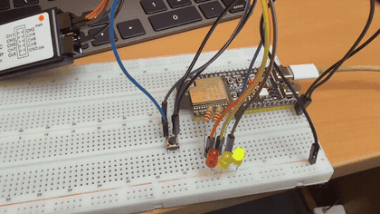
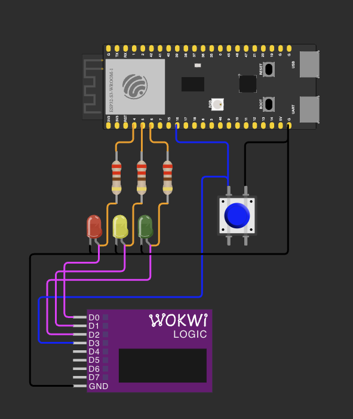
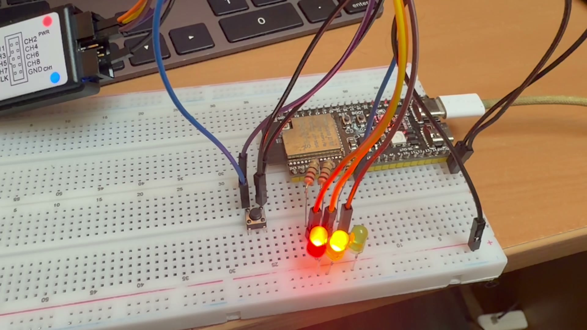
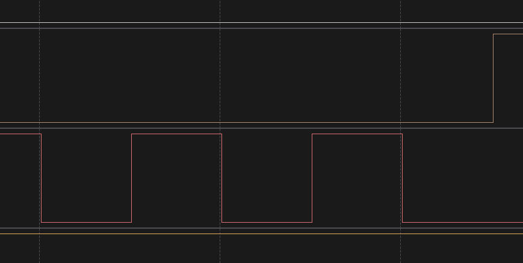
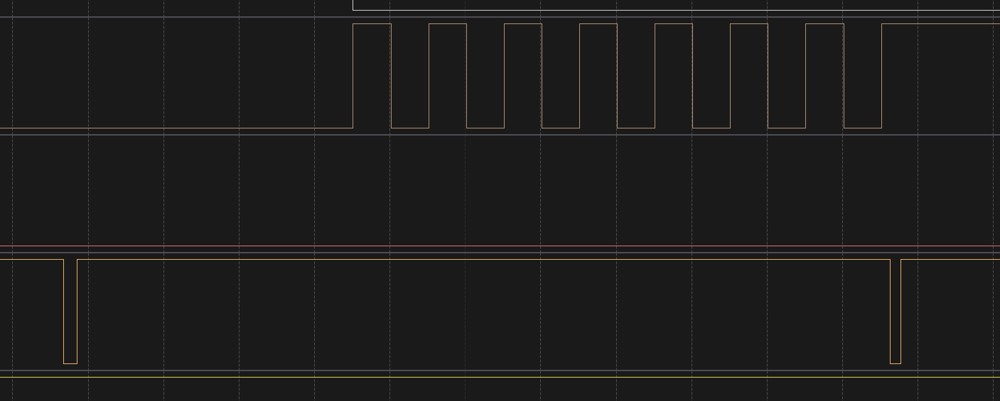

# ДЗ 2.7 — traffic_light (TRAFFIC LIGHT)

Автомат світлофора за ПДР України на **ESP32-S3-DevKitC-1**, ESP-IDF. Три світлодіоди, кнопка на жовтий миготливий режим, нуль `delay()`.

Фази й вимоги умови розписані в [README ДЗ](../). Тут — як це зроблено в коді і що показало залізо.

## Демо

<a href="video.mp4"></a>

[Відео в повній якості (MP4)](video.mp4). У кліпі — найщільніша частина циклу: суцільний зелений, три блимання, жовтий і червоний.

## Схема та плата

| Схема (Wokwi) | Зібрана плата |
|---|---|
|  |  |

На фото — стан «червоний + жовтий», той самий ПДР 8.7.6: рух ще заборонено, але зелений уже анонсовано.

| Компонент | Пін ESP32-S3 | Примітка |
|---|---|---|
| Червоний LED | GPIO 4 | через 220 Ω, катод на GND |
| Жовтий LED | GPIO 5 | через 220 Ω |
| Зелений LED | GPIO 6 | через 220 Ω |
| Кнопка режиму | GPIO 16 | другий контакт на GND, `GPIO_PULLUP_ENABLE` |

Порядок пінів 4-5-6 відповідає порядку сигналів на світлофорі. Логічний аналізатор знімає ті самі піни плюс лінію кнопки.

## Автомат — це таблиця

Уся умова задачі зводиться до порядку сигналів, тому порядок і є структурою коду. Один рядок таблиці — одна фаза: які лампи задіяні, чи вони миготять, скільки це триває і що настає далі.

```cpp
static constexpr PhaseDef TABLE[PHASE_COUNT] = {
  { Phase::Green,       Lamp::GREEN,                 0, GREEN_MS,       Phase::GreenBlink, "GREEN"           },
  { Phase::GreenBlink,  Lamp::GREEN,     BLINK_HALF_MS, GREEN_BLINK_MS, Phase::Yellow,     "GREEN BLINKING"  },
  { Phase::Yellow,      Lamp::YELLOW,                0, YELLOW_MS,      Phase::Red,        "YELLOW"          },
  { Phase::Red,         Lamp::RED,                   0, RED_MS,         Phase::RedYellow,  "RED"             },
  { Phase::RedYellow,   Lamp::RED | Lamp::YELLOW,    0, RED_YELLOW_MS,  Phase::Green,      "RED+YELLOW"      },
  { Phase::YellowBlink, Lamp::YELLOW,    BLINK_HALF_MS,              0, Phase::Yellow,     "YELLOW BLINKING" },
};
```

Це машина Мура: вихід — маска ламп — залежить тільки від стану і лежить у тому самому рядку. Саме тому ПДР вдається перевірити `static_assert`-ами: і стани, і переходи, і виходи є константними даними, доступними на етапі збірки.

Поза таблицею лишилось два рядки логіки, обидва про перемикання режиму. `advance_phase()` бере `next` із поточного рядка, `enter_phase()` ставить лампи й лог. Додати фазу — це додати рядок, а не правити `if`.

Миготіння не окрема фаза і не окремий таймер: `blink_ms` — півперіод, а лампи щоразу беруться з того самого `lamps`, просто через маску `0`, коли темно. Тому зелений миготливий і зелений рівний — один і той самий `Lamp::GREEN`, і неможливо випадково зробити їх різними лампами.

Поле `self` дублює індекс рядка. Воно не потрібне в рантаймі — воно потрібне компілятору, щоб спіймати перестановку рядків.

## Нічний режим — не там, де натиснули

Жовтий миготливий (ПДР 8.7.4) — не фаза циклу, а режим. Кнопка не перемикає лампи, а ставить бажаний режим; коли його застосувати, вирішує автомат:

- **у нічний режим** — лише після червоного. На червоному вже всі стоять, тож поява миготливого жовтого нікого не позбавляє щойно виданого дозволу на рух. Натиснута на зеленому кнопка спокійно чекає, поки цикл дійде до червоного;
- **з нічного режиму** — через рівний жовтий. Жовтий забороняє рух і попереджає про зміну сигналів (8.7.3), і далі таблиця сама веде через червоний і червоний+жовтий до зеленого. Якби автомат виходив із миготливого жовтого прямо в червоний, ті, хто вже рухався, отримали б заборону без попередження.

Вихід записаний не константою, а полем `next` у рядку `YellowBlink` — тобто таблиця описує і цей перехід теж, і він так само перевірений на етапі збірки.

Старт прошивки — з червоного. Це єдина фаза, яку можна ввімкнути на вже зайнятому перехресті, нікому не збрехавши: далі червоний+жовтий попередить про зелений, як у звичайному циклі.

Формально станів більше, ніж в `enum`: бажаний режим (`s_night_wanted`) і підстан миготіння (`s_blink_on`) винесені в окремі прапорці. Інакше шість фаз перетворилися б на дванадцять, половина з яких відрізнялася б лише прапорцем, а перевірка «закінчується темним» із арифметики стала б обходом графа.

## Що перевіряє компілятор

Послідовність сигналів — це вся умова задачі, тому вона перевіряється `static_assert`-ами, а не очима. Прошивка з порядком, що суперечить ПДР, не збереться.

| Перевірка | Що ламається без неї |
|---|---|
| `regulated_cycle_closes()` | цикл не повертається в зелений за п'ять фаз — десь розірваний або закоротив |
| `def_of(Phase::Red).next == Phase::RedYellow` | червоний перемикається прямо в зелений, без попередження (8.7.6) |
| `def_of(Phase::Green).next == Phase::GreenBlink` | зелений гасне без миготіння, тобто без попередження (8.7.2) |
| `red_never_with_green()` | якась фаза світить червоний і зелений разом |
| `def_of(Phase::Yellow).blink_ms == 0` | рівний жовтий став миготливим, а це протилежний за змістом сигнал (8.7.3 проти 8.7.4) |
| `GREEN_BLINK_MS % (2 × BLINK_HALF_MS) == 0` | зелений миготливий закінчується посеред блимання, і жовтий вмикається поверх світла |
| `table_matches_enum()` | рядки таблиці переставлені місцями щодо `enum class Phase` |
| `CONFIG_FREERTOS_HZ == 1000` | такт 10 мс замість 1 мс, і всі дедлайни фаз квантуються до нього |

Перевірив, що вони справді спрацьовують. Якщо в таблиці замінити `Phase::RedYellow` після червоного на `Phase::Green`:

```
main.cpp:129:37: error: static assertion failed: the regulated cycle must come back to green in exactly five phases
main.cpp:138:39: error: static assertion failed: PDR 8.7.6: red must never switch straight to green
```

А якщо в рядку `RedYellow` поставити `Lamp::RED | Lamp::GREEN`:

```
main.cpp:118:35: error: static assertion failed: no phase may light red and green at the same time
```

Тексти `static_assert` англійською свідомо: gcc спотворює в них не-ASCII, і повідомлення в консолі стає нечитабельним.

Табличні маски перевірені на етапі збірки, але в `apply_lamps()` та сама перевірка лишилась і в рантаймі — на випадок помилки вже в логіці миготіння. Там вона не падає, а гасить зелений: у суперечності між дозвільним і заборонним сигналом перемагає заборонний.

## Час без delay()

Автомат не спить фіксованими порціями. Він тримає два дедлайни в мікросекундах `esp_timer_get_time()` — кінець фази і найближче перемикання миготіння — і засинає на черзі рівно до найраннішого з них:

```cpp
const int64_t next_us = phase_end_us < blink_at_us ? phase_end_us : blink_at_us;
if (xQueueReceive(s_events, &ev, wait_ticks(next_us, now)) == pdTRUE) {
    on_mode_toggle();
}
```

Те саме пробудження приносить і натискання кнопки, тож опитувати нічого не треба: задача або прокинулась на дедлайн, або її розбудила кнопка. У фазах без миготіння `blink_at_us` дорівнює `INT64_MAX`, у нічному режимі — кінець фази, і автомат просто не прокидається на подію, якої не буде.

Дві деталі, без яких це б не працювало рівно:

**Якір миготіння — на дедлайн, а не на `now`.** `s_blink_toggled_us = blink_at_us`, а не `= now`. Інакше час пробудження задачі щоразу додавався б до півперіоду, і сітка миготіння дрейфувала б — та сама причина, через яку в ДЗ 2.6 `xTaskDelayUntil()` рівніший за `millis()`. [Що з цього вийшло на залізі](#миготіння-не-дрейфує).

**Округлення очікування вгору, мінімум один тік.** `pdMS_TO_TICKS()` ділить із відкиданням, тож залишок менший за тік дав би нульовий таймаут, а `xQueueReceive()` із нулем повертається негайно — і цикл закрутився б без діла до самого дедлайну. Тому `wait_ticks()` округлює вгору і ніколи не повертає менше за один тік. Саме це округлення і видно в замірах як стабільний плюс мілісекунду до кожної фази.

Масштаб часу — один множник: `Config::TIME_DIVIDER`. `1` — реальні секунди і цикл 28 с, `10` ущільнює його до 2,8 с. Миготіння масштабується разом із фазами, інакше зелений миготливий перестав би закінчуватися темним — і цього б не пропустив `static_assert`.

## Кнопка

Брязкіт гасить метод із [ДЗ 2.6/`timer_debounce`](../../dz2.6%20%28ESP-IDF%20DEBOUNCE%29/timer_debounce/) без змін: обробник переривання нічого не чекає, а перезаводить одноразовий `esp_timer` на 10 мс. Поки контакт брязкотить, таймер не доходить до кінця; колбек спрацьовує, коли лінія затихла, і аж тоді рівень піна щось означає.

Це єдиний метод із ДЗ 2.6, якому байдуже до такту планувальника, і тут це доречно: автомат світлофора не має чекати на кнопку, а кнопка не має чекати на автомат. Лічильник фронтів `s_isr_edges` — `std::atomic<uint32_t>`, бо його інкрементує ISR на одному ядрі, а читає задача на іншому.

Режим перемикає натискання, не відпускання.

## Заміри на залізі

Один прогон, 53 секунди: повний цикл, вхід у нічний режим і вихід із нього. Дані — [`serial.log`](serial.log) і [`digital.csv`](digital.csv) (Logic 2, чотири канали: GPIO 4, 5, 6 і лінія кнопки).

Обидва артефакти з **одного** запуску: захоплення стартувало на 226,4 мс раніше за завантаження, і після цього зсуву всі події лога лягають на фронти в CSV з точністю до мілісекунди — наприклад, `mode: entering blinking yellow after red` о 38285 мс лога відповідає гасінню червоного о 38,5130 с у капчі.

```
I (276) traffic: ready: PDR cycle 10000+3000+3000+10000+2000 ms, blink half-period 500 ms, button GPIO 16 toggles blinking yellow
I (279) traffic: RED             [R..] 10000 ms
I (10280) traffic: RED+YELLOW      [RY.]  2000 ms
I (12281) traffic: cycle 1 starts
I (12281) traffic: GREEN           [..G] 10000 ms
I (22282) traffic: GREEN BLINKING  [..g]  3000 ms
I (25283) traffic: YELLOW          [.Y.]  3000 ms
I (28284) traffic: RED             [R..] 10000 ms
I (34455) traffic: mode: blinking yellow requested, applies after the red phase (edges: 1)
I (38285) traffic: mode: entering blinking yellow after red
I (38285) traffic: YELLOW BLINKING [.y.]  until the mode is switched back
I (45415) traffic: mode: leaving blinking yellow through a steady yellow (edges: 3)
I (45416) traffic: YELLOW          [.Y.]  3000 ms
I (48417) traffic: RED             [R..] 10000 ms
```

Великі літери в дужках — лампа горить рівно, малі — миготить.

### Довжина фаз

| Фаза | Константа | Зміряно аналізатором | Похибка |
|---|---:|---:|---:|
| червоний | 10000 мс | 10001,024 мс | +1,02 мс |
| червоний + жовтий | 2000 мс | 2001,180 мс | +1,18 мс |
| жовтий | 3000 мс | 3001,160 мс | +1,16 мс |
| червоний (другий) | 10000 мс | 10001,635 мс | +1,63 мс |

Систематичний плюс — це округлення очікування вгору до цілого тіка в `wait_ticks()`. Головне тут не величина, а те, що вона **не накопичується**: друга червона фаза 10001,6 мс, а не 20002. Кожна фаза міряється від власного старту, а не від попередньої.

### Миготіння не дрейфує

Тринадцять послідовних півперіодів миготливого жовтого:

| | |
|---|---:|
| номінал | 500 мс |
| зміряно | 500,0267 мс |
| розкид по 13 півперіодах | **0,083 мкс** |

Вісімдесят три наносекунди за шість із половиною секунд. Це і є віддача від того, що якір стоїть на дедлайні, а не на `now`: постійні +27 мкс — це затримка пробудження задачі, і вона щоразу та сама, бо наступний дедлайн рахується від попереднього дедлайну, а не від моменту, коли задача фактично прокинулась. У реалізації через `millis()` ці 27 мкс додавалися б одна до одної.

### Зелений миготливий закінчується темним



Зверху вниз: червоний, жовтий, зелений, кнопка. Зелений гасне о 23,0101, блимає тричі, востаннє гасне о **25,0102** — і далі йдуть повні 500 мс темряви, аж поки о **25,5102** не підніметься жовтий.

Саме це гарантує `static_assert` на кратність `GREEN_BLINK_MS` періоду миготіння. Якби тривалість фази не була кратна, жовтий увімкнувся б поверх світла — і на перехресті це читалося б як «зелений і жовтий разом», сигнал, якого в ПДР немає.

### Кнопка задає намір, а не дію



Натискання о **34,6727** (вузький провал на лінії кнопки ліворуч). Червоний після нього світить ще **3,840 с** і гасне лише о **38,5130**, де й починається миготливий жовтий. Тобто режим застосувався на межі фази, а не там, де натиснули — рівно як описано вище.

Друге натискання о **45,6342** виходить із режиму відразу, і доказ цього — **відсутній фронт**: жовтий піднявся о 45,5143 і мав би згаснути о 46,0143, але лишається світити. Автомат уже в рівному жовтому.

### Дрібниці, які видно тільки в капчі

**Лампи перемикаються не атомарно.** `apply_lamps()` робить три окремих `gpio_set_level()`, і між ними **292 нс**. На переході «жовтий → червоний» це означає, що червоний спалахує на 292 нс раніше, ніж гасне жовтий. Пари «червоний + зелений» це дати не може, але не через порядок запису, а тому, що прямого переходу із зеленого в червоний немає в таблиці фаз.

**Кнопка спрацювала абсолютно чисто.** У логу `edges: 1` на першому натисканні, і капча це підтверджує: один фронт униз, один угору, жодного брязкоту. Два сплески на лінії кнопки о 0,2222 і 0,2243 (25 і 2 мкс) — це до `gpio_config()`, коли пін ще висить без підтяжки, а не брязкіт контакту.

**Витримка debounce зміряна з того ж файлу.** Між другим натисканням (45,6342) і кінцем рівного жовтого (48,6455) рівно 3011,3 мс; за вирахуванням фази 3001,2 мс лишається **10,1 мс** — тобто `DEBOUNCE_MS = 10` відпрацював як заявлено.

### На чому знято

Серія знята з **PlatformIO-збірки, ESP-IDF 6.1.0** — це видно в шапці лога. ДЗ 2.6 називало канонічною для замірів нативну 5.5.5; на ній цю серію я не повторював. Аналізатор — клон на 24 MHz у Logic 2, частота дискретизації 1 MS/s: події тут масштабу мілісекунд, а не брязкоту, тож 24 MS/s були б зайві й ризикували б втратою семплів на довгому захопленні.

## Запуск

Канонічна збірка — нативний `idf.py` через обгортку:

```sh
./tools/idf.sh "dz2.7 (TRAFFIC LIGHT)/traffic_light" build
./tools/idf.sh "dz2.7 (TRAFFIC LIGHT)/traffic_light" flash monitor
```

Той самий код через PlatformIO (потрібен для Wokwi):

```sh
pio run -e idf_traffic_light -t upload
pio device monitor -e idf_traffic_light
```

У VS Code те саме одним `Cmd+Shift+B` — task лежить у `.vscode/tasks.json`.

У симуляторі: `pio run -e idf_traffic_light`, далі `Wokwi: Select Config File` → [`wokwi.toml`](wokwi.toml), відкрити [`diagram.json`](diagram.json) і `Wokwi: Start Simulator`.

## Файли

| Файл | Опис |
|---|---|
| [`main/main.cpp`](main/main.cpp) | прошивка: таблиця фаз, автомат, кнопка |
| [`CMakeLists.txt`](CMakeLists.txt), [`main/CMakeLists.txt`](main/CMakeLists.txt) | проєкт ESP-IDF |
| [`sdkconfig.defaults`](sdkconfig.defaults) | цільовий чип і `CONFIG_FREERTOS_HZ=1000` |
| [`diagram.json`](diagram.json), [`wokwi.toml`](wokwi.toml) | схема й конфіг для Wokwi |
| [`schema.png`](schema.png), [`photo.jpeg`](photo.jpeg) | схема в симуляторі та зібрана плата |
| [`demo.gif`](demo.gif), [`video.mp4`](video.mp4) | відео роботи |
| [`serial.log`](serial.log), [`digital.csv`](digital.csv) | лог і захоплення аналізатора з одного прогону |
| [`capture-blink.png`](capture-blink.png), [`capture-button-delay.png`](capture-button-delay.png) | кадри з аналізатора |

`sdkconfig` генерується при збірці, `video.MOV` лишається локально — обидва в `.gitignore`.

Ускладнення поза умовою: [**traffic_barrier**](../traffic_barrier/) — той самий автомат зі шлагбаумом на серво, де хід стріли перевіряється `static_assert`-ами так само, як порядок сигналів.
