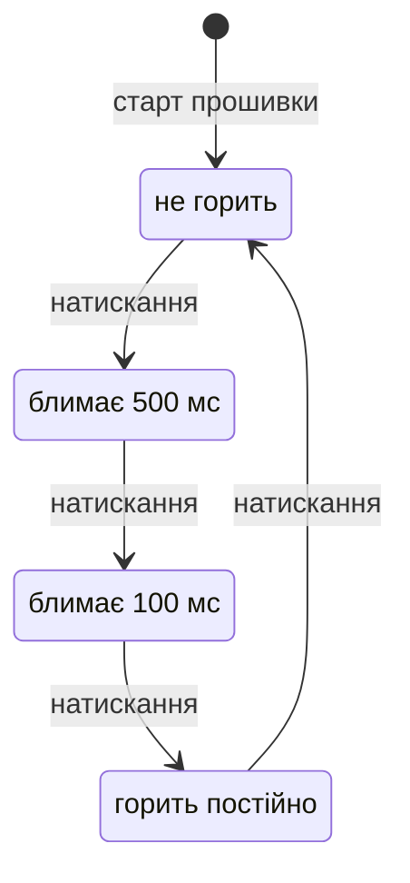

# ДЗ 2.8 — знайомство зі STM32 (STM32 BUTTON)

Цей документ описує першу домашку не на ESP32. Кнопка на платі перемикає режими світлодіода по колу.

| Параметр | Значення |
|---|---|
| плата | WeAct Black Pill V3.1, мікроконтролер STM32F411CEU6 |
| бібліотека | STM32 HAL |
| збірка | PlatformIO, `framework = stm32cube` |
| прошивання | ST-LINK V2 через SWD |

| Прошивка | Опис |
|---|---|
| [`button_modes`](button_modes/) | відповідь на умову |
| [`button_modes_uart`](button_modes_uart/) | та сама логіка й лог у USART1, поза умовою |

## Режими

Після старту світлодіод не горить. Кожне натискання кнопки KEY перемикає режим на наступний:

| Стан | Режим | Світлодіод |
|---|---|---|
| старт прошивки | `Off` | не горить |
| 1-ше натискання | `Slow` | блимає з періодом 500 мс, як у коді з уроку |
| 2-ге натискання | `Fast` | блимає з періодом 100 мс |
| 3-тє натискання | `Solid` | горить постійно |
| 4-те натискання | `Off` | не горить |



Режим перемикає момент натискання. Відпускання кнопки режим не змінює.

## Чому код з уроку не підходить

Код з уроку блимає так:

```c
HAL_GPIO_TogglePin(LED_GPIO_Port, LED_Pin);
HAL_Delay(500);
```

`HAL_Delay()` виконує порожній цикл: `while ((HAL_GetTick() - tickstart) < wait) { }`. Протягом цього циклу прошивка не читає пін кнопки. Тоді прошивка опитує кнопку раз на 500 мс. Коротке натискання між двома опитуваннями прошивка не помітить.

Тому прошивка не викликає `HAL_Delay()`. Час рахує сітка на `HAL_GetTick()`, як `millis()` у [ДЗ 2.3](../dz2.3%20%28SUPERLOOP%29/three_leds/). Цикл не блокується, і прошивка читає пін на кожній ітерації.

Час реакції тепер задає debounce: рівень має бути стабільним 20 мс. Метод `state_debounce` перенесено з [ДЗ 2.4](../dz2.4%20%28BUTTON%20DEBOUNCE%29/state_debounce/) без змін.

Переривання EXTI на PA0 тут нічого не дає. Брязкіт контактів однаково треба придушувати, а цикл і так вільний.

## Умова і реалізація

| Умова | Реалізація | Перевірка |
|---|---|---|
| використати код з уроку | період 500 мс з уроку став режимом `Slow` | — |
| обробити стан кнопки | прошивка опитує PA0 у циклі без блокування, debounce 20 мс | `static_assert`: debounce коротший за найшвидше блимання |
| світлодіод реагує на кнопку | кожне натискання одразу перемикає режим | — |
| використати STM32 HAL | `HAL_Init`, `HAL_RCC_*`, `HAL_GPIO_*`, `HAL_GetTick`, без прямого доступу до регістрів | обидві прошивки зібрано без попереджень |
| номер модуля й уроку в назві | папка `dz2.8 (STM32 BUTTON)`, коміт `dz2.8: ...` | — |

`HAL_GPIO_TogglePin` замінено явним записом рівня. Стан світлодіода тепер зберігає автомат режимів.

Ще два `static_assert` перевіряють таблицю режимів:
- порядок рядків збігається з `enum class Mode`;
- `FAST_MS` менший за `SLOW_MS`.

Пояснення — у [README прошивки](button_modes/).

## Схема

Світлодіод і кнопка вже є на платі:

| Елемент | Пін | Примітка |
|---|---|---|
| світлодіод | PC13 | катод на піні, анод через резистор на 3,3 В; світлодіод горить від низького рівня |
| кнопка KEY | PA0 | кнопка з'єднує пін із GND, внутрішня підтяжка до живлення `GPIO_PULLUP` |

Підключіть ST-LINK V2 до SWD-роз'єму плати чотирма проводами:

| ST-LINK | Black Pill |
|---|---|
| SWDIO | DIO |
| SWCLK | CLK |
| GND | GND |
| 3.3V | 3V3 |

> **ОБЕРЕЖНО:** не живіть плату від ST-LINK і від USB-C одночасно. Виберіть одне джерело живлення.

## Дві пастки

Перша пастка: `SysTick_Handler` треба оголосити в прошивці. PlatformIO з `framework = stm32cube` не додає файл `stm32f4xx_it.c`. Тоді спрацьовує заглушка зі `startup_*.s`, яка є нескінченним циклом. `HAL_GetTick()` завжди повертає 0, а `HAL_Delay()` ніколи не завершується.

Друга пастка: лічильник `HAL_GetTick()` переповнюється через 49,7 доби. Тому прошивка порівнює час різницею беззнакових чисел: `now - last_edge >= DEBOUNCE_MS`. Порівняння `now >= deadline` після переповнення дає неправильний результат.

Як перевірити обидві пастки у файлі `.elf`, описано в [README прошивки](button_modes/).

## Тактування

Прошивка працює від HSI 16 МГц без PLL. F411CE підтримує 100 МГц, а на платі є кварц HSE 25 МГц. Для світлодіода й кнопки висока частота не потрібна.

HSI має дві переваги:
- одна конфігурація працює на всіх трьох моделях Black Pill. Для PLL це неможливо: межі F401 і F411 різні, 84 і 100 МГц.
- HSI завжди запускається, а помилка старту HSE переводить прошивку в `Error_Handler()`.

На 16 МГц флеш працює з `FLASH_LATENCY_0`.

## Як спостерігати за прошивкою

Ця плата не має послідовного порту для монітора:
- USB-C плати підключено до пінів USB мікроконтролера (PA11, PA12). Комп'ютер не побачить пристрій, поки прошивка сама не запустить USB CDC.
- Синій ST-LINK V2 не має віртуального COM-порту (VCP). VCP є тільки в ST-LINK V2-1 і V3 на платах Nucleo й Discovery.

Тому прошивка [`button_modes_uart`](button_modes_uart/) пише лог у USART1 на PA9 (115200 8N1). Лог можна прочитати через перехідник USB-UART або логічним аналізатором з декодером Async Serial.

Лог не блокує цикл. Рядки йдуть у кільцевий буфер, а в UART прошивка передає один байт, коли передавач вільний. `HAL_UART_Transmit()` чекає на кожен байт і затримав би цикл. При debounce 20 мс трьох рядків досить, щоб пропустити натискання.

Другий спосіб — GDB через той самий ST-LINK. Параметр `debug_tool = stlink` уже задано в базовій секції `[stm32]`:

```sh
pio debug -e stm32_button_modes
```

## Чому немає симулятора

Для прошивок ESP32 у репо є `diagram.json` для Wokwi. Для STM32F411 жоден симулятор не підійшов:

| Симулятор | Результат перевірки |
|---|---|
| Wokwi | ядра F411 немає; парт `board-stm32-blackpill` дав 2 нульові події у VCD, а `board-stm32-bluepill` (F103) — 27 змін рівня |
| QEMU `netduinoplus2` (F405) | прошивка працює, точка зупинки на `HAL_GPIO_TogglePin` спрацювала 6 разів із 6; GPIO не змодельовано: `GPIOC: unimplemented device write` |
| Renode `stm32f412.repl` | найближчий до F411, але теж не підійшов |

Вигаданий парт, якого не існує, Wokwi обробив так само, як `board-stm32-blackpill`. Отже, Wokwi ігнорує цей парт. Офіційно Wokwi підтримує тільки Blue Pill F103C8, Nucleo-C031C6 і Nucleo-L031K6.

Тому прошивки STM32 перевіряють тільки на платі: логічним аналізатором і GDB через ST-LINK.

## Збірка

Зберіть і прошийте основну прошивку:

```sh
pio run -e stm32_button_modes -t upload
```

PlatformIO сам завантажує `openocd`. Окремо встановлювати `openocd` чи `st-flash` не треба. Після прошивання лог показав `** Verified OK **` і `** Resetting Target **`.

Діагностична прошивка має окреме середовище:

```sh
pio run -e stm32_button_modes_uart -t upload
pio device monitor -e stm32_button_modes_uart
```

| Прошивка | Flash | RAM |
|---|---:|---:|
| `button_modes` | 3524 Б | 44 Б |
| `button_modes_uart` | 4876 Б | 636 Б |

Обидва середовища в [`platformio.ini`](../platformio.ini) наслідують базову секцію `[stm32]`. Файл прошивки задає `build_src_filter`, як в Arduino-ДЗ.

`board = blackpill_f411ce` відповідає маркуванню чіпа. Прошивка також збирається під `blackpill_f401cc` і `blackpill_f401ce`.

## Що ще не перевірено

- Поведінку кнопки на платі ще не перевірено. Прошивку записано й верифіковано, але чотири режими на платі ще ніхто не перевіряв.
- Брязкіт на PA0 разом з логом з PA9 ще не виміряно логічним аналізатором.
- Фото плати й відео з перемиканням режимів ще не зроблено.

## Файли

| Файл | Опис |
|---|---|
| [`button_modes/main.cpp`](button_modes/main.cpp) | відповідь на умову |
| [`button_modes_uart/main.cpp`](button_modes_uart/main.cpp) | та сама логіка й лог у USART1 |

У папках немає `CMakeLists.txt` і `sdkconfig`. PlatformIO збирає `framework = stm32cube` без них.
