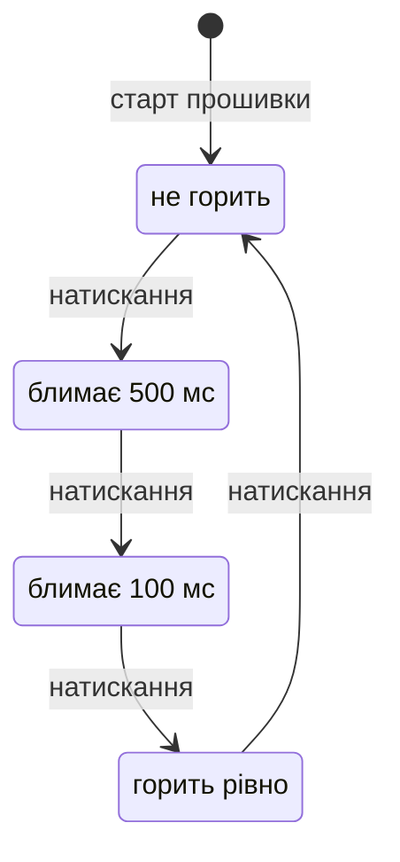

# ДЗ 2.8 — STM32 знайомство (STM32 BUTTON)

Гнучкий слот: перша домашка не на ESP32. **WeAct Black Pill V3.1** зі **STM32F411CEU6**, **STM32 HAL**, збірка через PlatformIO з `framework = stm32cube` — той самий `pio run`, що й у решті репозиторію, але інший мікроконтролер, інша платформа і прошивання через **ST-LINK V2** по SWD замість USB.

Прошивок дві:

| Прошивка | Що в ній |
|---|---|
| [`button_modes`](button_modes/) | відповідь на умову: кнопка на платі перемикає режими світлодіода по колу |
| [`button_modes_uart`](button_modes_uart/) | та сама логіка плюс лог у USART1 — поза умовою, бо спостерігати за цією платою інакше нічим |

## Режими

Старт — світлодіод не горить, далі кожне натискання кнопки KEY зсуває режим по колу:

| Стан | Режим | Світлодіод |
|---|---|---|
| старт прошивки | `Off` | не горить |
| 1-ше натискання | `Slow` | блимає з періодом 500 мс — тим самим, що в коді з уроку |
| 2-ге | `Fast` | блимає з періодом 100 мс |
| 3-тє | `Solid` | горить рівно |
| 4-те | `Off` | не горить, цикл замикається |



Режим перемикає натискання, а не відпускання.

## Головне в цій домашці

Код з уроку не можна просто доповнити читанням кнопки:

```c
HAL_GPIO_TogglePin(LED_GPIO_Port, LED_Pin);
HAL_Delay(500);
```

`HAL_Delay()` — це не пауза, а порожній цикл очікування: `while ((HAL_GetTick() - tickstart) < wait) { }`. Поки він крутиться, читати пін нема кому. Кнопку опитували б раз на пів секунди, а натискання, яке почалося й закінчилось між двома опитуваннями, прошивка не побачила б узагалі.

Тому `HAL_Delay()` у прошивці немає взагалі. Час відмірює сітка на `HAL_GetTick()` — той самий прийом, що `millis()` у [ДЗ 2.3](../dz2.3%20%28SUPERLOOP%29/three_leds/), — і цикл ніде не блокується, тож пін читається на кожній ітерації. Швидкість реакції задає вже не період блимання, а витримка debounce: 20 мс по рівню, метод `state_debounce` із [ДЗ 2.4](../dz2.4%20%28BUTTON%20DEBOUNCE%29/state_debounce/), перенесений один в один.

Переривання EXTI на PA0 тут нічого не додали б: брязкіт однаково довелося б гасити, а цикл і так вільний.

## Що вимагала умова і де це зроблено

| Умова | Де | Як перевірено |
|---|---|---|
| використати код з уроку | період 500 мс із `HAL_Delay(500)` лишився як режим `Slow`; `HAL_GPIO_TogglePin` замінений явним записом рівня, бо стан світлодіода тепер тримає автомат режимів | — |
| додати обробку стану кнопки | опитування PA0 у незаблокованому циклі, витримка по рівню 20 мс | `static_assert`: витримка мусить бути коротшою за найшвидше блимання, інакше натискання могло б загубитися між двома перемиканнями |
| світлодіод реагує на натискання | кожне натискання перемикає режим; реакція видна одразу, а не наприкінці періоду блимання | — |
| використати STM32 HAL | `HAL_Init`, `HAL_RCC_*`, `HAL_GPIO_*`, `HAL_GetTick` — без прямої роботи з регістрами | обидві прошивки збираються без попереджень |
| номер модуля і уроку в назві | папка `dz2.8 (STM32 BUTTON)`, коміт `dz2.8: ...` | — |

Таблицю режимів стережуть ще два `static_assert`: порядок рядків мусить збігатися з `enum class Mode` (поле `self` дублює індекс, щоб перестановку спіймав компілятор), а `FAST_MS` мусить бути меншим за `SLOW_MS`. Розбір — [у README прошивки](button_modes/).

## Схема

Паяти нічого не треба, обидві деталі вже на платі:

| | Пін | Примітка |
|---|---|---|
| Світлодіод | PC13 | катод на пін, анод через резистор на 3,3 В — горить від низького рівня |
| Кнопка KEY | PA0 | замикає пін на землю, підтяжка внутрішня `GPIO_PULLUP` |

Прошивання — ST-LINK V2 по SWD, чотири проводи:

| ST-LINK | Black Pill |
|---|---|
| SWDIO | DIO |
| SWCLK | CLK |
| GND | GND |
| 3.3V | 3V3 |

Двома джерелами одночасно плату живити не можна: або 3.3V зі свистка, або USB-C, не разом.

## Дві пастки, на які можна втратити вечір

**`SysTick_Handler` треба оголосити самому.** PlatformIO з `framework = stm32cube` не кладе згенерований `stm32f4xx_it.c`, тож обробника системного таймера в проєкті немає і спрацьовує слабка заглушка зі `startup_*.s` — нескінченний цикл. Наслідок тихий і неприємний: `HAL_GetTick()` назавжди лишається нулем, а `HAL_Delay()` не повертається ніколи.

**`HAL_GetTick()` перевертається через 49,7 доби.** Тому всі порівняння часу в прошивці — різницею беззнакових (`now - last_edge >= DEBOUNCE_MS`), а не `now >= deadline`: різниця переживає перевертання правильно, пряме порівняння — ні.

Обидві з розбором і зі способом перевірити результат прямо в `.elf` — [у README прошивки](button_modes/).

## Тактування

HSI 16 МГц, без PLL. F411CE вміє 100 МГц і на платі стоїть кварц HSE 25 МГц, але для блимання й кнопки це нічого не дає, а HSI має дві переваги: конфігурація лишається однаковою для всієї трійки Black Pill (межі PLL у F401 і F411 різні — 84 і 100 МГц, спільного набору дільників немає) і їй нема чому не запуститися — невдалий старт HSE завершився б у `Error_Handler()`, і плата виглядала б мертвою. На 16 МГц флеш читається з `FLASH_LATENCY_0`.

## Чим тут спостерігати

Послідовного порту в цій звʼязці немає взагалі — головна побутова відмінність від ESP32-S3 DevKit, на якому монітор працює «з коробки»:

- **USB-C на платі** заведений на піни USB мікроконтролера (PA11/PA12), а не на окрему мікросхему USB-UART. Поки прошивка не підніме USB CDC-стек сама, комп не побачить жодного пристрою — плата просто отримає живлення.
- **Синій ST-LINK V2** не має Virtual COM Port. VCP є тільки у V2-**1** і V3, розпаяних на платах Nucleo й Discovery.

Тому поряд лежить [`button_modes_uart`](button_modes_uart/) — та сама логіка з логом у USART1 на PA9 (115200 8N1), який читається USB-UART перехідником або логічним аналізатором із декодером Async Serial. Лог не блокує цикл: рядки складаються в кільцевий буфер, а в UART їх зливає по одному байту тоді, коли передавач вільний. Блокуючий `HAL_UART_Transmit()` зіпсував би саме те, що міряється, — при витримці 20 мс трьох рядків досить, щоб натискання загубилося.

Друге вікно — GDB через той самий ST-LINK, `debug_tool = stlink` уже стоїть у спільній базі `[stm32]`:

```sh
pio debug -e stm32_button_modes
```

## Чому тут немає симулятора

У решті репозиторію до кожної прошивки лежить `diagram.json` для Wokwi. Тут його немає, і це не лінь — усі три варіанти перевірені вимірюванням, а не вичитані з документації:

- **Wokwi не має ядра F411.** Креслення `board-stm32-blackpill` у репозиторії `wokwi-boards` існує з 2022 року, але це лише креслення: той самий блимач на `board-stm32-bluepill` (F103) дав 27 змін рівня у VCD, а на blackpill — дві події, обидві нулі. Вигаданий неіснуючий парт поводиться точно так само, тобто парт просто ігнорується. Офіційно підтримані лише Blue Pill F103C8, Nucleo-C031C6 і Nucleo-L031K6.
- **Апстрімний QEMU (`netduinoplus2`, F405) не моделює GPIO.** Прошивка виконується — точка спину на `HAL_GPIO_TogglePin` спрацювала 6 разів із 6, SysTick і `HAL_Delay` живі, — але QEMU сам пише `GPIOC: unimplemented device write` на BSRR, біт 13.
- **Renode** із `stm32f412.repl` найближчий до F411 і має порти, EXTI й таймери декларативно, але теж не підійшов.

Тож STM32-частина робиться тільки на залізі — логічний аналізатор і GDB через ST-LINK. Wokwi лишається для ESP32.

## Збірка

```sh
pio run -e stm32_button_modes -t upload
```

Окремий `openocd` чи `st-flash` ставити не треба — PlatformIO тягне готові бінарники сам; прошивка проходить `** Verified OK **` і `** Resetting Target **`.

Діагностичний варіант — окремим env:

```sh
pio run -e stm32_button_modes_uart -t upload
pio device monitor -e stm32_button_modes_uart
```

| Прошивка | Flash | RAM |
|---|---:|---:|
| `button_modes` | 3524 Б | 44 Б |
| `button_modes_uart` | 4876 Б | 636 Б |

Обидва env у [`platformio.ini`](../platformio.ini) ростуть зі спільної бази `[stm32]`, а файл прошивки вибирає `build_src_filter`, як в Arduino-ДЗ. `board = blackpill_f411ce` — за маркуванням чіпа; під `blackpill_f401cc` і `blackpill_f401ce` прошивка теж збирається.

## Що лишилось зняти

- перевірити на залізі, що кнопка справді перемикає всі чотири режими: прошивка залита й верифікована, але саму поведінку я ще не знімав;
- зняти брязкіт логічним аналізатором на PA0 разом із логом з PA9 — щоб у звіті були числа, а не лише код;
- фото плати і коротке відео з перемиканням режимів.

## Файли

```
dz2.8 (STM32 BUTTON)/
├── button_modes/         відповідь на умову
│   ├── README.md
│   └── main.cpp
└── button_modes_uart/    та сама логіка плюс лог у USART1
    ├── README.md
    └── main.cpp
```

Ні `CMakeLists.txt`, ні `sdkconfig` тут немає: `framework = stm32cube` збирається PlatformIO напряму.
