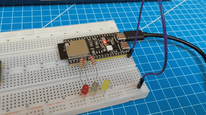
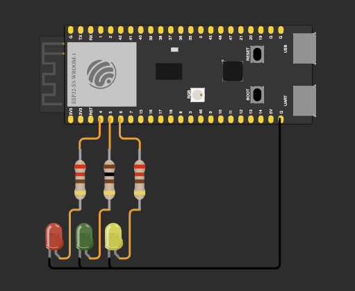
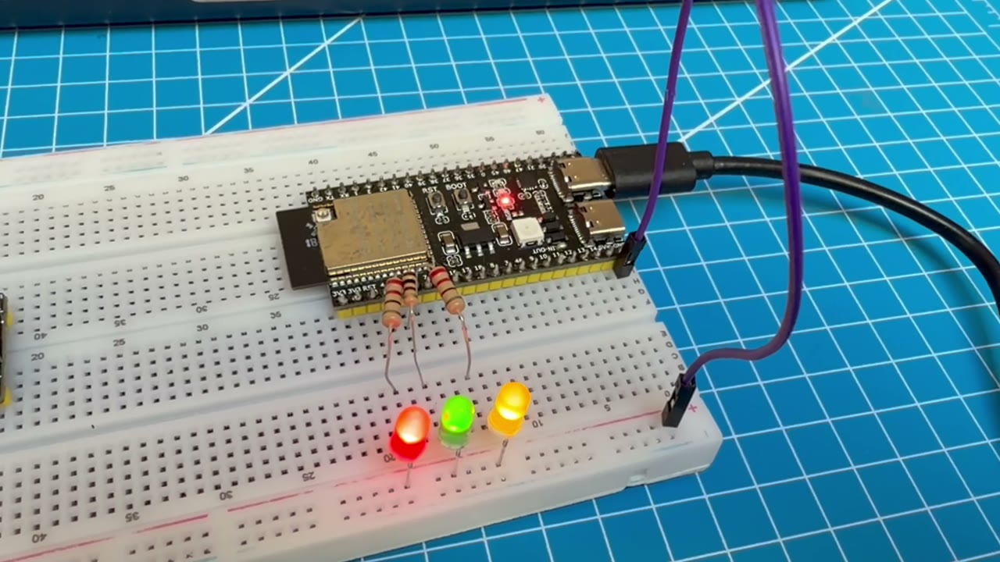

# ДЗ 6.1 — three_tasks (RTOS TASKS)

Прошивка для **ESP32-S3-DevKitC-1**. Три задачі FreeRTOS блимають трьома світлодіодами з інтервалами 200, 500 і 1000 мс.

| Світлодіод | Пін | Інтервал | Задача |
|---|---|---|---|
| червоний | GPIO 4 | 200 мс | `red` |
| зелений | GPIO 5 | 500 мс | `green` |
| жовтий | GPIO 6 | 1000 мс | `yellow` |

## Демо

<a href="video.mp4"></a>

[Відео в повній якості (MP4)](video.mp4)

## Схема та фото

| Схема (Wokwi) | Зібрана плата |
|---|---|
|  |  |

Схема та сама, що в [ДЗ 2.3](../../dz2.3%20%28SUPERLOOP%29/three_leds/). Фото — кадр з відео.

| Компонент | Пін ESP32-S3 | Примітка |
|---|---|---|
| червоний світлодіод | GPIO 4 | анод через резистор 220 Ом, катод на GND |
| зелений світлодіод | GPIO 5 | анод через резистор 220 Ом, катод на GND |
| жовтий світлодіод | GPIO 6 | анод через резистор 220 Ом, катод на GND |

## Як працює код

Файл: [`main/main.cpp`](main/main.cpp)

Структура `Blinker` замінює клас `LED` з ДЗ 2.3. Вона зберігає ім'я задачі, пін та інтервал. Масив `LEDS` містить три такі структури.

`app_main()` тричі викликає `xTaskCreatePinnedToCore` з однією функцією `blink_task`. Кожна задача отримує свій елемент `LEDS` як параметр:

```cpp
for (const Blinker &led : LEDS) {
  xTaskCreatePinnedToCore(
    blink_task,
    led.name,
    Config::LED_STACK,
    (void *)&led,
    Config::LED_PRIORITY,
    nullptr,
    Config::LED_CORE
  );
}
```

`blink_task` налаштовує пін як вихід. Потім задача виконує нескінченний цикл:

```cpp
TickType_t last_wake = xTaskGetTickCount();
for (;;) {
  vTaskDelayUntil(&last_wake, pdMS_TO_TICKS(led.interval_ms));
  level = !level;
  gpio_set_level(led.pin, level);
}
```

Між перемиканнями задача заблокована й не займає процесор. У ДЗ 2.3 `loop()` працював безперервно й тричі за прохід читав `millis()`.

Параметри задач:

| Параметр | Значення | Причина |
|---|---|---|
| функція затримки | `vTaskDelayUntil` | рахує інтервал від попереднього пробудження, тому період не зсувається |
| ядро | 1 | на ядрі 0 працюють системні задачі ESP-IDF |
| пріоритет | 3 | вищий за задачу `app_main`, яка має пріоритет 1 |
| стек | 2048 байт | в ESP-IDF стек задають у байтах, у звичайному FreeRTOS — у словах |
| тік | 1 мс | `CONFIG_FREERTOS_HZ=1000` у [`sdkconfig.defaults`](sdkconfig.defaults) |

`vTaskDelay` рахує інтервал від моменту виклику. Тоді час на перемикання щоразу додається до періоду.

Задача зберігає стан світлодіода у змінній `level`. У ДЗ 2.3 `digitalRead()` читав стан з піна. В ESP-IDF вхідний буфер на виході вимкнений, тому пін завжди повертає 0.

## Лог плати

Монітор порту (115200 бод) після перезапуску плати показав:

```
I (273) main_task: Calling app_main()
I (274) tasks: 3 blink tasks started on core 1
I (274) main_task: Returned from app_main()
```

`app_main()` створила задачі й завершилась. Задачі працюють далі без неї. Повний лог: [`serial.log`](serial.log).

## Запуск

### На платі, нативний ESP-IDF 5.5.5

1. Підключіть плату через USB.
2. Запустіть з кореня репо:
   ```sh
   ./tools/idf.sh "dz6.1 (RTOS TASKS)/three_tasks" flash monitor
   ```

### На платі, PlatformIO

1. Підключіть плату через USB.
2. Прошийте плату:
   ```sh
   pio run -e idf_three_tasks -t upload
   ```
3. Відкрийте монітор порту:
   ```sh
   pio device monitor -e idf_three_tasks
   ```

### У симуляторі (Wokwi for VS Code)

1. Зберіть прошивку: `pio run -e idf_three_tasks`.
2. Виконайте `Wokwi: Select Config File` і виберіть [`wokwi.toml`](wokwi.toml).
3. Відкрийте [`diagram.json`](diagram.json).
4. Виконайте `Wokwi: Start Simulator`.

## Файли

| Файл | Опис |
|---|---|
| [`main/main.cpp`](main/main.cpp) | прошивка |
| [`sdkconfig.defaults`](sdkconfig.defaults) | налаштування ESP-IDF |
| [`diagram.json`](diagram.json) | схема для Wokwi |
| [`wokwi.toml`](wokwi.toml) | конфіг симулятора |
| [`schema.png`](schema.png) | скриншот схеми |
| [`photo.jpeg`](photo.jpeg) | фото зібраної схеми |
| [`demo.gif`](demo.gif), [`video.mp4`](video.mp4) | відео роботи |
| [`serial.log`](serial.log) | лог плати |
