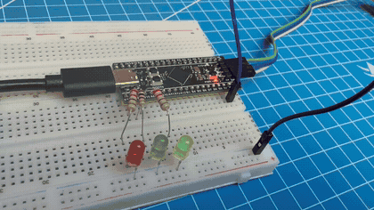
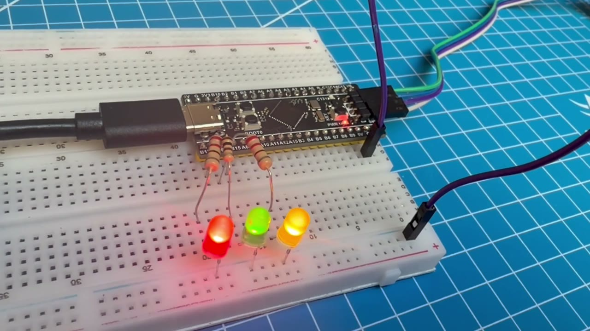

# ДЗ 6.1 — three_tasks_stm32 (RTOS TASKS)

Прошивка для **WeAct Black Pill V3.1** зі **STM32F411CEU6**. Три задачі FreeRTOS блимають трьома світлодіодами з інтервалами 200, 500 і 1000 мс. Код задач такий самий, як у прошивці [`three_tasks`](../three_tasks/) для ESP32-S3.

| Світлодіод | Пін | Інтервал | Задача |
|---|---|---|---|
| червоний | PB12 | 200 мс | `red` |
| зелений | PB13 | 500 мс | `green` |
| жовтий | PB14 | 1000 мс | `yellow` |

## Демо

<a href="video.mp4"></a>

[Відео в повній якості (MP4)](video.mp4)

## Схема



Фото — кадр з відео.

| Компонент | Пін Black Pill | Примітка |
|---|---|---|
| червоний світлодіод | PB12 | анод через резистор 220 Ом, катод на GND |
| зелений світлодіод | PB13 | анод через резистор 220 Ом, катод на GND |
| жовтий світлодіод | PB14 | анод через резистор 220 Ом, катод на GND |

Світлодіоди горять від високого рівня. Піни PB12, PB13 і PB14 розташовані поряд на одному боці плати. Кнопка (PA0), UART (PA9), USB (PA11, PA12) і SWD ці піни не використовують.

## Відмінності від ESP32-версії

| | ESP32-S3 | STM32F411 |
|---|---|---|
| створення задач | `xTaskCreatePinnedToCore` | `xTaskCreate`, бо ядро одне |
| розмір стеку | 2048 байт | 128 слів, тобто 512 байт |
| запуск планувальника | ESP-IDF до виклику `app_main()` | `main()` викликає `vTaskStartScheduler()` |
| налаштування пінів | кожна задача налаштовує свій пін | `main()` налаштовує всі три піни до старту планувальника |
| FreeRTOS | частина ESP-IDF | ядро 10.3.1 з пакета `framework-stm32cubef4` |
| налаштування FreeRTOS | `sdkconfig.defaults` | [`FreeRTOSConfig.h`](FreeRTOSConfig.h) |

`main()` налаштовує піни до старту задач. `HAL_GPIO_Init()` читає і записує спільні регістри порту B. Якщо дві задачі викличуть цю функцію одночасно, одна задача може перезаписати налаштування іншої.

Задача перемикає світлодіод через `HAL_GPIO_WritePin()`. Ця функція пише в регістр BSRR одним записом, тому задачі не заважають одна одній.

## Як працює код

Файл: [`main.cpp`](main.cpp)

Функція `blink_task` така сама, як в ESP32-версії:

```cpp
TickType_t last_wake = xTaskGetTickCount();
for (;;) {
  vTaskDelayUntil(&last_wake, pdMS_TO_TICKS(led.interval_ms));
  level = !level;
  HAL_GPIO_WritePin(LED_PORT, led.pin, level ? GPIO_PIN_SET : GPIO_PIN_RESET);
}
```

`main()` налаштовує тактування й піни, створює три задачі й запускає планувальник:

```cpp
for (const Blinker &led : LEDS) {
  xTaskCreate(blink_task, led.name, Config::LED_STACK_WORDS,
              (void *)&led, Config::LED_PRIORITY, nullptr);
}
vTaskStartScheduler();
```

Після виклику `vTaskStartScheduler()` керування в `main()` не повертається.

## SysTick для HAL і FreeRTOS

Таймер SysTick потрібен і HAL, і FreeRTOS:
- HAL рахує в ньому `HAL_GetTick()`. Від цього лічильника залежать тайм-аути в `HAL_RCC_OscConfig()`.
- FreeRTOS рахує в ньому тіки планувальника.

Тому [`main.cpp`](main.cpp) має власний `SysTick_Handler`:

```cpp
extern "C" void SysTick_Handler(void)
{
  HAL_IncTick();
  if (xTaskGetSchedulerState() != taskSCHEDULER_NOT_STARTED) {
    xPortSysTickHandler();
  }
}
```

До старту планувальника `xPortSysTickHandler()` викликати не можна. Тому обробник перевіряє стан планувальника.

Обробники `SVC_Handler` і `PendSV_Handler` задає [`FreeRTOSConfig.h`](FreeRTOSConfig.h). Ці макроси дають функціям FreeRTOS імена з таблиці векторів.

## Як FreeRTOS потрапляє в збірку

PlatformIO з `framework = stm32cube` збирає HAL, CMSIS і USB-бібліотеки ST. Ядро FreeRTOS лежить у пакеті, але PlatformIO його не збирає.

Скрипт [`tools/pio_stm32_freertos.py`](../../tools/pio_stm32_freertos.py) додає ядро в збірку:
- задає шляхи до заголовків FreeRTOS і до папки з `FreeRTOSConfig.h`;
- компілює `tasks.c`, `list.c`, `queue.c`, порт і `heap_4.c`.

Скрипт бере порт `ARM_CM3`, хоча чип має ядро Cortex-M4F. PlatformIO збирає F411 без апаратного FPU. Порт `ARM_CM4F` без FPU не компілюється. Порт `ARM_CM3` працює на Cortex-M4, якщо задачі не використовують `float`.

## Помилки

Якщо прошивка потрапила у фатальну помилку, усі три світлодіоди горять постійно. `Error_Handler()` викликають такі події:

| Подія | Обробник |
|---|---|
| `HAL_RCC_OscConfig()` або `HAL_RCC_ClockConfig()` повернула помилку | `SystemClock_Config()` |
| `xTaskCreate()` не створила задачу | `main()` |
| `configASSERT` спрацював | `dz61_assert_failed()` |
| задача переповнила стек | `vApplicationStackOverflowHook()` |
| купі FreeRTOS не вистачило пам'яті | `vApplicationMallocFailedHook()` |

## Перевірка на платі

ST-LINK прочитав лічильник `xTickCount` і регістр `GPIOB->ODR` 15 разів з інтервалом 100 мс. Прошивка працювала, ST-LINK її не зупиняв.

```
tick= 18275  PB12=1 PB13=0 PB14=0
tick= 18376  PB12=1 PB13=0 PB14=0
tick= 18476  PB12=0 PB13=0 PB14=0
tick= 18576  PB12=0 PB13=1 PB14=0
tick= 18675  PB12=1 PB13=1 PB14=0
tick= 18775  PB12=1 PB13=1 PB14=0
tick= 18874  PB12=0 PB13=1 PB14=0
tick= 18974  PB12=0 PB13=1 PB14=0
tick= 19074  PB12=1 PB13=0 PB14=1
tick= 19176  PB12=1 PB13=0 PB14=1
tick= 19276  PB12=0 PB13=0 PB14=1
tick= 19376  PB12=0 PB13=0 PB14=1
tick= 19475  PB12=1 PB13=0 PB14=1
tick= 19575  PB12=1 PB13=1 PB14=1
tick= 19675  PB12=0 PB13=1 PB14=1
```

| Пін | Перемикання між тіками | Інтервал |
|---|---|---|
| PB12 | 18376–18476, 18576–18675, 18775–18874, 18974–19074 | 200 мс |
| PB13 | 18476–18576, 18974–19074, 19475–19575 | 500 мс |
| PB14 | 18974–19074 | 1000 мс, перемикання на тіку 19000 |

Лічильник тіків росте на 100 за 100 мс, тобто тік дорівнює 1 мс.

## Запуск

1. Підключіть ST-LINK V2 до SWD-роз'єму плати, як у [ДЗ 2.8](../../dz2.8%20%28STM32%20BUTTON%29/).
2. Зберіть і прошийте прошивку:
   ```sh
   pio run -e stm32_three_tasks -t upload
   ```

Щоб повторити перевірку, запустіть з кореня репо:

```sh
OCD=~/.platformio/packages/tool-openocd
$OCD/bin/openocd -s $OCD/openocd/scripts -f interface/stlink.cfg -f target/stm32f4x.cfg \
  -c 'init; echo "[read_memory 0x20002124 32 1] [read_memory 0x40020414 32 1]"; shutdown'
```

Адреса `0x20002124` належить змінній `xTickCount` у цій збірці. Після зміни коду адреса може змінитися. Нову адресу покаже `arm-none-eabi-nm .pio/build/stm32_three_tasks/firmware.elf | grep xTickCount`.

## Збірка

| Параметр | Значення |
|---|---:|
| Flash | 6236 Б |
| RAM | 8496 Б, з них 8192 Б — купа FreeRTOS |

## Файли

| Файл | Опис |
|---|---|
| [`main.cpp`](main.cpp) | прошивка |
| [`FreeRTOSConfig.h`](FreeRTOSConfig.h) | налаштування FreeRTOS |
| [`photo.jpeg`](photo.jpeg) | фото зібраної схеми |
| [`demo.gif`](demo.gif), [`video.mp4`](video.mp4) | відео роботи |
| [`../../tools/pio_stm32_freertos.py`](../../tools/pio_stm32_freertos.py) | скрипт, який додає ядро FreeRTOS у збірку |
