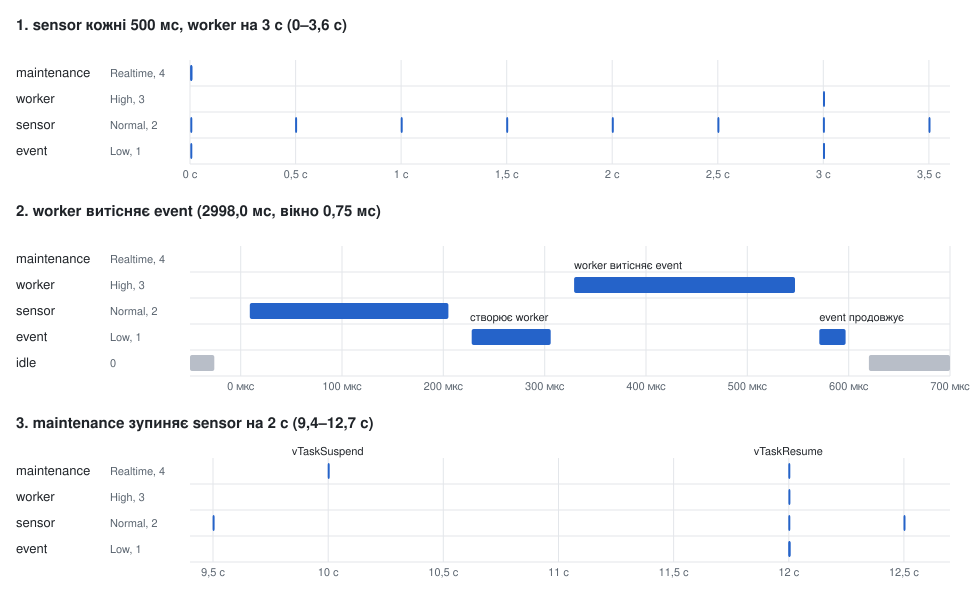
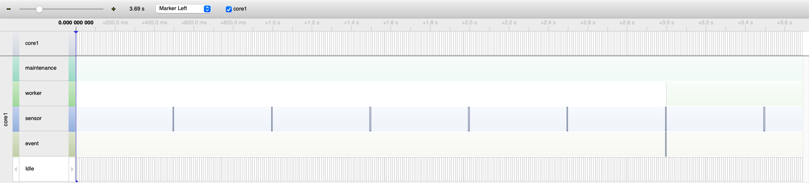
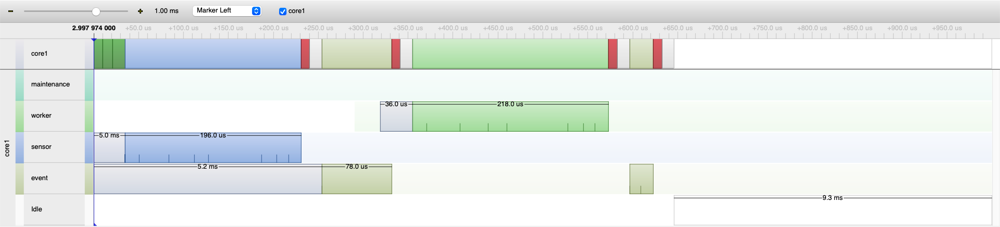
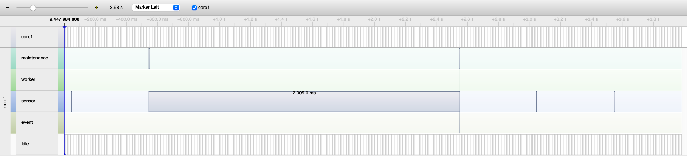

# ДЗ 6.2 — four_tasks_sysview (RTOS SCHEDULER)

Прошивка [`four_tasks`](../four_tasks/) під SEGGER SystemView на **ESP32-S3-DevKitC-1**. Код задач не змінено. SystemView вмикає тільки [`sdkconfig.defaults`](sdkconfig.defaults). Це бонусне завдання до уроку 6.2.

SystemView показує роботу задач на таймлайні: яка задача працює, на якому ядрі, коли одна задача витісняє іншу.

## Відмінності від four_tasks

| | `four_tasks` | `four_tasks_sysview` |
|---|---|---|
| код | [`../four_tasks/main/main.cpp`](../four_tasks/main/main.cpp) | той самий файл |
| ESP-IDF | 5.5.5 або 6.1 через PlatformIO | тільки 5.5.5 через `tools/idf.sh` |
| тік | 1 мс | 10 мс |
| кабель | порт UART | порт USB |
| трасування | немає | SystemView через вбудований USB-JTAG |

[`CMakeLists.txt`](CMakeLists.txt) бере компонент `main` з папки `four_tasks` через `EXTRA_COMPONENT_DIRS`.

Причину тіку 10 мс описано в розділі «Обмеження».

## Підготовка

1. Встановіть SEGGER SystemView 3.60 або новіший. На цьому комп'ютері встановлено версію 4.10b.
2. Замініть опис подій FreeRTOS у SystemView на файл з ESP-IDF. Збережіть оригінал:
   ```sh
   D=/Applications/SEGGER/SystemView/Description
   sudo cp $D/SYSVIEW_FreeRTOS.txt $D/SYSVIEW_FreeRTOS.txt.segger-orig
   sudo cp ~/.espressif/v5.5.5/esp-idf/tools/esp_app_trace/SYSVIEW_FreeRTOS.txt $D/
   ```
3. Підключіть плату кабелем у порт USB. JTAG є тільки на цьому порту.

OpenOCD `v0.12.0-esp32-20260424` поставив eim разом з ESP-IDF 5.5.5. Окремо OpenOCD ставити не треба.

## Запуск

1. Зберіть і прошийте прошивку з кореня репо:
   ```sh
   ESPPORT=/dev/cu.usbmodem1301 ./tools/idf.sh "dz6.2 (RTOS SCHEDULER)/four_tasks_sysview" build flash
   ```
2. Запишіть трасу 14 с:
   ```sh
   python3 tools/sysview.py "dz6.2 (RTOS SCHEDULER)/four_tasks_sysview" 14
   ```
3. У SystemView виберіть `File > Load Recording` і відкрийте [`trace_core1.SVDat`](trace_core1.SVDat).

Назва порту `/dev/cu.usbmodem1301` залежить від гнізда USB. Список портів покаже команда `ls /dev/cu.usbmodem*`.

Скрипт [`tools/sysview.py`](../../tools/sysview.py) виконує такі дії:
- запускає OpenOCD з `board/esp32s3-builtin.cfg`;
- скидає плату і зупиняє її на `app_main`;
- вмикає `esp sysview_mcore` і записує обидва ядра в один файл;
- через задану кількість секунд зупиняє запис і кладе `trace.SVDat` у папку прошивки;
- записує поруч `trace_core1.SVDat`, де є тільки ядро 1.

Причину другого файлу описано в розділі «Обмеження». Якщо `trace.SVDat` вже є, команда з аргументом `split` записує тільки `trace_core1.SVDat`:
```sh
python3 tools/sysview.py "dz6.2 (RTOS SCHEDULER)/four_tasks_sysview" split
```

## Що в трасі

Файл [`trace.SVDat`](trace.SVDat) містить 14 с роботи плати, 11 919 подій. Парсер ESP-IDF `sysviewtrace_proc.py` прочитав файл без помилок.



Картинку малює [`plot_trace.py`](plot_trace.py) з файлу `trace.SVDat`. Синій відрізок показує час, коли задача працює на ядрі 1. Сірий відрізок показує idle-задачу. Рядки впорядковано за пріоритетом.

| Момент, мс | Ядро 1 |
|---|---|
| 1,4–1,6 | `app_main` на ядрі 0 створює `sensor`, `event`, `maintenance`. Кожна задача стартує на ядрі 1. |
| 498,0, 998,0 ... | `sensor` кожні 500 мс |
| 2998,0 | `sensor` |
| 2998,2 | `event` створює `worker` |
| 2998,3 | `worker` витісняє `event` |
| 2998,6 | `worker` видаляє себе, `event` продовжує роботу |
| 9998,0 | `maintenance` зупиняє `sensor` |
| 11998,0 | `maintenance` відновлює `sensor` |
| 11998,1 | `sensor`, потім `event` і `worker` |
| 12498,0 ... | `sensor` знову кожні 500 мс |

Між 9998 і 11998 мс `sensor` не отримує процесор. `worker` у цей час працює.

Задачі займають процесор дуже коротко:

| Задача | Найдовший відрізок, мс |
|---|---:|
| `sensor` | 0,234 |
| `maintenance` | 0,259 |
| `worker` | 0,218 |
| `event` | 0,080 |

Решту часу ядро 1 виконує idle-задачу.

## Як побачити те саме в SystemView

Підготуйте вигляд один раз:
1. Виберіть `File > Load Recording` і відкрийте `trace_core1.SVDat`.
2. У нижньому вікні **Context** зніміть галочки з усіх переривань і з `Scheduler`.
3. Залиште задачі `sensor`, `event`, `worker`, `maintenance` і `Idle`.
4. У вікні **Timeline** виберіть у списку пункт `Marker Left`.

Тепер маркер стоїть на лівому краї вікна Timeline. Щоб перенести маркер на подію, двічі натисніть рядок події у вікні **Events List**. Ширину вікна задає меню `View > Timeline`.

> **ПРИМІТКА:** не використовуйте `Go > Go to Event`. У версії 4.10b ця команда закрила SystemView.

### sensor кожні 500 мс

1. Двічі натисніть подію № 0 у вікні Events List.
2. Виберіть `View > Timeline > View 5s`.
3. Виберіть `View > Timeline > Zoom In (Fine)` 4 рази. Ширина вікна стане 3,69 с.



`sensor` працює кожні 500 мс. На 3 с з'являються `event` і `worker`.

### worker витісняє event

1. Двічі натисніть подію № 1386 (2,997974 с).
2. Виберіть `View > Timeline > View 1ms`.



| Момент, мс | Що показує SystemView |
|---|---|
| 2998,0 | `sensor` працює 196 мкс |
| 2998,2 | `event` працює і створює `worker` |
| 2998,33 | `worker` витісняє `event` і працює 218 мкс |
| 2998,57 | `event` продовжує роботу |

### sensor на паузі з 10 до 12 с

1. Двічі натисніть подію № 4174 (9,447984 с).
2. Виберіть `View > Timeline > View 5s`.
3. Виберіть `View > Timeline > Zoom In (Fine)` 3 рази. Ширина вікна стане 3,98 с.



`maintenance` працює на 9,998 с і на 11,998 с. Між цими моментами `sensor` не отримує процесор. SystemView малює цей час сірим прямокутником `2 005.0 ms`.

## Обмеження

### Тільки ESP-IDF 5.5.5

PlatformIO збирає ESP-IDF 6.1. У версії 6.1 SystemView винесли з компонента `app_trace` в окремий компонент реєстру. Опцій `CONFIG_APPTRACE_SV_*` з інструкції курсу в 6.1 немає. Тому ця прошивка збирається тільки через `tools/idf.sh`.

### Тік 10 мс

З тіком 1 мс трасування зупиняло обидва ядра приблизно на 230 мс кожні 1,5–3 с. Причина така:
- Переривання тіку на двох ядрах дають 3/4 усіх подій. Потік даних становить близько 21 КБ/с.
- OpenOCD читає блок трасування 16 КБ з ядра, яке працює. CRC блоку не збігається з п'яти спроб поспіль.
- Тоді OpenOCD зупиняє обидва ядра і читає блок повторно. Лог OpenOCD: `All CRC attempts failed, trying with halted target`.

Частота JTAG 2, 10 і 40 МГц на результат не вплинула. OpenOCD версії `20241016` не перевіряє CRC. Ця версія не зупиняє ядра, але записує биті блоки (`Incomplete block`).

З тіком 10 мс потік становить близько 2,7 КБ/с. Траса 14 с не має пауз, крім кінця запису. Проєкт SystemView курсу теж використовує тік 10 мс.

Інтервали в `four_tasks` кратні 10 мс, тому поведінка задач не змінилась.

### Старт на app_main

Якщо запустити запис після `reset run`, OpenOCD видає `sysview: Invalid init seq` і записує порожній файл. Скрипт робить так, як приклад ESP-IDF `sysview_tracing`: зупиняє ядро на `app_main` і тільки потім вмикає запис.

### Задачі ядра 1 у SystemView

ESP-IDF записує ім'я кожної задачі в потоки обох ядер з однаковим часом. SystemView 4.10b прив'язує задачу до ядра, де першим прочитав ім'я. Це ядро 0.

Тому в `trace.SVDat` запуски задач на ядрі 1 не мають імені. SystemView показує їх як `Task 0x3CE9420`, а рядки `sensor`, `event`, `worker` порожні.

У `trace_core1.SVDat` є тільки потік ядра 1, тому цього конфлікту немає. SystemView показав `sensor` 25 запусків, `event` 9, `worker` 4, `maintenance` 4. Парсер ESP-IDF дав ті самі числа.

### Кінець запису

Команда `esp sysview_mcore stop` зупиняє ядра. Тому останні 70 мс траси не містять подій.

## Файли

| Файл | Опис |
|---|---|
| [`CMakeLists.txt`](CMakeLists.txt) | проєкт ESP-IDF, компонент `main` з `four_tasks` |
| [`sdkconfig.defaults`](sdkconfig.defaults) | тік 10 мс і налаштування SystemView |
| [`trace.SVDat`](trace.SVDat) | траса 14 с, обидва ядра |
| [`trace_core1.SVDat`](trace_core1.SVDat) | та сама траса, тільки ядро 1, для SystemView |
| [`sysview_periodic.png`](sysview_periodic.png) | SystemView: `sensor` кожні 500 мс |
| [`sysview_preempt.png`](sysview_preempt.png) | SystemView: `worker` витісняє `event` |
| [`sysview_suspend.png`](sysview_suspend.png) | SystemView: пауза `sensor` з 10 до 12 с |
| [`timeline.svg`](timeline.svg) | таймлайн ядра 1 у трьох вікнах часу |
| [`plot_trace.py`](plot_trace.py) | скрипт, який малює `timeline.svg` з траси |
| [`../../tools/sysview.py`](../../tools/sysview.py) | скрипт, який записує трасу |
