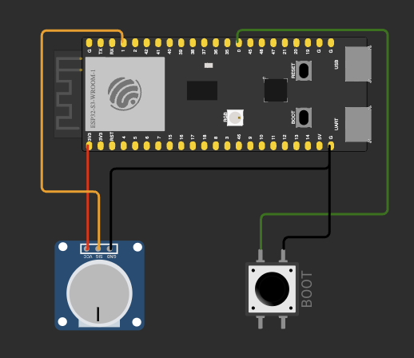
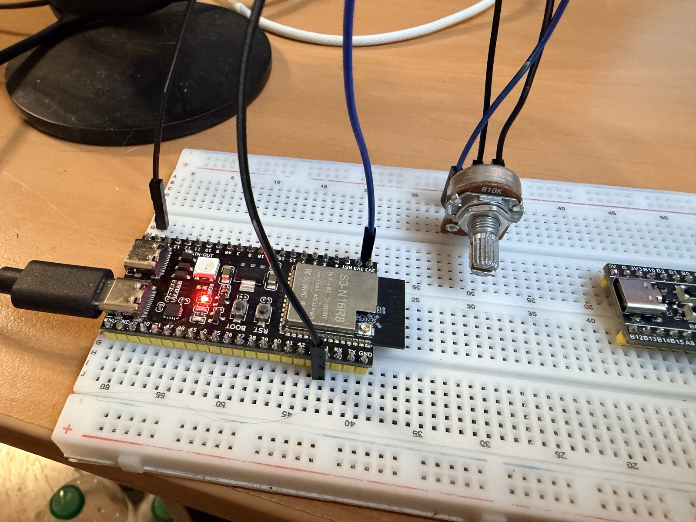

# ДЗ 6.3 — sensor_queue (RTOS QUEUES)

Прошивка для **ESP32-S3-DevKitC-1**. Два датчики й кнопка передають дані задачі `consumer` через одну чергу FreeRTOS.

| Джерело | Що вимірює | Як працює | Ядро |
|---|---|---|---|
| `temp` | вбудований датчик температури чипа | задача, кожні 1000 мс | 0 |
| `pot` | напруга на повзунку потенціометра, мВ | задача, кожні 250 мс | 0 |
| `button` | натискання кнопки BOOT | обробник переривання (ISR) | 0 |
| `consumer` | читає чергу, виводить дані й статистику | задача | 1 |

## Підключення

| Компонент | Пін ESP32-S3 | Примітка |
|---|---|---|
| потенціометр 10 кОм, крайні виводи | 3V3 і GND | |
| потенціометр 10 кОм, повзунок | GPIO 1 | ADC1, канал 0 |
| кнопка BOOT | GPIO 0 | кнопка на платі, підключати нічого не треба |
| датчик температури | | вбудований у чип |

ADC1 працює разом з Wi-Fi, ADC2 не працює. Тому потенціометр стоїть на GPIO 1. Вбудований датчик вимірює температуру кристала, а не повітря.

| Схема (Wokwi) | Зібрана плата |
|---|---|
|  |  |

## Як працює код

Файли: [`main/main.c`](main/main.c) і спільний код у [`../common`](../common/). `main.c` містить датчики, продюсери, ISR і задачі. `common` містить повідомлення, фільтр натискань, облік у `consumer` і тести на ПК. STM32-версія збирає ті самі файли `common`.

Дані між задачами передає тільки черга. Кожне джерело кладе в чергу копію повідомлення. Статистику бачить тільки `consumer`, тому mutex не потрібен.

### Повідомлення

```c
typedef struct {
  uint8_t  source;   // source_t: від кого
  uint8_t  core;     // ядро, на якому працював відправник
  uint32_t seq;      // номер від цього джерела
  uint32_t time_ms;  // момент вимірювання або натискання
  int32_t  value;    // temp: соті частки °C; pot: мВ; button: 0
} sensor_msg_t;
```

Повідомлення займає 16 байт. Черга копіює його цілим через `xQueueSend`, тож продюсер одразу може змінити свою змінну. Температура передається цілим числом у сотих частках градуса. Тому в черзі немає ні `float`, ні вказівників. Поле `source` має тип `uint8_t`, бо `enum` займає 4 байти.

Поле `seq` росте для кожного джерела окремо. Розрив у номерах показує `consumer`, скільки повідомлень загубилось.

### Продюсери

`temp` і `pot` — дві копії функції `producer_task`. Параметр задачі — рядок таблиці `PRODUCERS[]` з джерелом і функцією читання. Ім'я і період джерела дає таблиця `SOURCES[]` у [`common/sensor_msg.h`](../common/sensor_msg.h).

- Задача рахує період через `vTaskDelayUntil`, тому час читання не зсуває розклад.
- `pot` читає АЦП 16 разів і бере середнє значення. Калібрування з eFuse переводить код АЦП у мілівольти.
- Якщо датчик повернув помилку, задача виводить її в лог. У чергу помилка не потрапляє.
- `xQueueSend` чекає місця в черзі не більше 10 мс. Якщо черга повна, задача виводить `queue full` і працює далі.

### ISR кнопки

ISR не може чекати, тому викликає `xQueueSendFromISR`. Якщо ISR розбудив задачу з вищим пріоритетом, `portYIELD_FROM_ISR` перемикає задачу одразу після виходу з ISR.

Переривання спрацьовує на обидва фронти. Брязкіт контактів дає пачку фронтів без тиші між ними. ISR приймає натискання тільки тоді, коли виконано дві умови:
- до фронту пін не змінювався 30 мс;
- до цієї тиші кнопка була відпущена.

Ці умови перевіряє `press_filter_edge()` з `common`. ISR передає функції рівень піна й час.

ISR не може вивести `queue full`. Тому ISR рахує загублені натискання у змінній `button_dropped`, а `consumer` виводить її в статистиці. Ця змінна — єдина, яку бачать дві сторони поза чергою. Пише її тільки ISR, читає тільки `consumer`.

### Consumer

`consumer` має пріоритет 3, продюсери мають пріоритет 2. Після кожного повідомлення `consumer` виконує такі дії:
- перевіряє, що номер джерела не виходить за межі масиву;
- рахує загублені повідомлення за розривом у `seq`;
- виводить значення і `wait`: час від запланованого моменту вимірювання до обробки.

`xQueueReceive` чекає не більше 500 мс. Після кожного виклику `consumer` перевіряє тишу для кожного датчика окремо. Якщо датчик мовчить 3 свої періоди, `consumer` виводить `no data`. Загальний таймаут цього не помітить, бо від другого датчика повідомлення приходять.

Кожні 10 с `consumer` виводить статистику: скільки повідомлень отримано й загублено від кожного джерела. Також `consumer` виводить найбільшу глибину черги.

Облік і рядки логу дають функції `consumer_handle()` і `consumer_tick()` з `common`. Вони не викликають `printf`. Готовий рядок вони передають функції `log_print()`, яка додає час і виводить рядок.

### Порядок запуску

`app_main()` запускає частини в такому порядку:
1. черга;
2. датчики;
3. `consumer`;
4. продюсери `temp` і `pot`;
5. переривання кнопки.

Кожен крок спирається на попередній. Якщо ISR спрацює до створення черги, `xQueueSendFromISR` отримає `NULL`. Якщо `xQueueCreate` або `xTaskCreatePinnedToCore` повертає помилку, прошивка зупиняється через `abort()`.

### Параметри

| Параметр | Значення | Причина |
|---|---|---|
| довжина черги | 8 повідомлень | `consumer` забирає повідомлення одразу, у звичайній роботі в черзі 1 повідомлення |
| таймаут `xQueueSend` | 10 мс | менше за найкоротший період 250 мс |
| таймаут `xQueueReceive` | 500 мс | менше за 3 періоди `pot` |
| ядро продюсерів і ISR | 0 | черга передає дані між ядрами |
| ядро `consumer` | 1 | |
| стек | 3072 байти | задача з `printf` використовує близько 1,1 КБ, вимір з ДЗ 6.2 |
| тік | 1 мс | `CONFIG_FREERTOS_HZ=1000` у [`sdkconfig.defaults`](sdkconfig.defaults) |
| `CONSUMER_DELAY_MS` | 0 | експеримент: 500 мс сповільнюють `consumer` |

## Лог плати

Плата виконала прошивку 90 с після перезапуску. Прошивку зібрав нативний ESP-IDF 5.5.5. Логи плати записала перша версія прошивки на C++, до перенесення спільного коду в `common`. Протягом запису на 20–30 с потенціометр повернули від краю до краю. На 34–40 с кнопку BOOT натиснули 6 разів: 2 коротко, 2 довго і 2 швидко підряд.

Фрагмент [`serial.log`](serial.log):

```
  39021  temp   #38   23.40 C   core 0, wait 0 ms
  39021  pot    #155  1673 mV   core 0, wait 0 ms
  39070  button #4    pressed   core 0, wait 0 ms
  39271  pot    #156  1675 mV   core 0, wait 0 ms
  39276  button #5    pressed   core 0, wait 0 ms
  ...
  40021  stats  temp   received 40, lost 0
  40021  stats  pot    received 159, lost 0
  40022  stats  button received 6, lost 0
  40025  stats  queue  peak 1 of 8, ISR dropped 0
  40030  pot    #159  1676 mV   core 0, wait 9 ms
```

| Показник | Результат |
|---|---|
| `temp` | 89 повідомлень з інтервалом 1000 мс, значення 23,4 і 24,4 °C |
| `pot`, повний хід | від 0 до 3147 мВ |
| `pot`, повзунок нерухомий | від 1672 до 1679 мВ, розкид 7 мВ |
| `button` | 6 подій на 6 натискань, інтервал між швидкими натисканнями 206 мс |
| втрати за 90 с | 0 від кожного джерела, `ISR dropped 0` |
| найбільша глибина черги | 1 з 8 |
| `wait` | 0 мс у 443 повідомленнях з 453, 1 мс у 2, 9 мс у 8 |

Лог показує такі факти:
- Дані з ядра 0 доходять до `consumer` на ядрі 1 без втрат і без mutex.
- Затримка 9 мс буває тільки на рядку після статистики. Протягом цих 9 мс `consumer` виводить 4 рядки статистики, і повідомлення `pot` чекає в черзі.
- Драйвер датчика температури дає значення з кроком 1 °C.
- Вище 3147 мВ АЦП не розрізняє положення повзунка, бо атенюація 12 дБ обмежує діапазон.

### Експеримент: повільний consumer

Для експерименту `CONSUMER_DELAY_MS` дорівнює 500. Тоді `consumer` обробляє 2 повідомлення за секунду, а `temp` і `pot` разом кладуть 5. Фрагмент [`serial_slow.log`](serial_slow.log):

```
   3031  pot    queue full, #11 dropped
   ...
   7272  pot    lost 1 before #12
   ...
  14786  temp   lost 7 before #10
  14786  temp   #10   24.40 C   core 0, wait 3765 ms
  ...
  20296  stats  temp   received 9, lost 7
  20296  stats  pot    received 31, lost 31
  20299  stats  queue  peak 8 of 8, ISR dropped 0
```

| Показник | Результат |
|---|---|
| перший рядок `queue full` | через 3 с після запуску |
| найбільша глибина черги | 8 з 8 |
| `wait` | до 4015 мс |
| `temp` за 20 с | 9 отримано, 7 загублено |
| `pot` за 20 с | 31 отримано, 31 загублено |
| хибні рядки `no data` за 25 с | 14 |

Лог показує такі факти:
- Продюсер і `consumer` рахують ті самі втрати з двох боків. `pot` відкинув `#11`, а `consumer` побачив розрив `lost 1 before #12`.
- Довша черга не зменшує втрат. Вона тільки довше зберігає старі дані: температура доходить до `consumer` через 3,8 с.
- Перевірка тиші виводить `pot no data for 750 ms`, хоча `pot` працює. Перевірка рахує час від останнього отриманого повідомлення. Повільний `consumer` отримує повідомлення `pot` рідше, ніж `pot` їх кладе.

## Результати в симуляторі

Прошивку перевірено в Wokwi через `wokwi-cli` за 30 с. Після перенесення спільного коду в `common` обидва прогони повторено. Рядки логу збіглися з версією на C++, окрім часу на 1 мс. Сценарій [`scenario.yaml`](scenario.yaml) двічі повертає потенціометр і 6 разів натискає BOOT. Тривалість натискань від 50 до 1000 мс.

Wokwi не моделює вбудований датчик температури. Драйвер у симуляторі повертає `ESP_FAIL`, тому `temp` не кладе повідомлень у чергу. Через 3 с `consumer` виводить `temp no data for 3000 ms`. Так симулятор перевірив тишу одного датчика, коли інший працює.

| Прогін | Результат |
|---|---|
| звичайна робота, [`wokwi.log`](wokwi.log) | `pot` 80 повідомлень за 20 с без втрат, `button` 6 подій на 6 натискань, глибина черги 1 з 8 |
| повільний `consumer`, [`wokwi_slow.log`](wokwi_slow.log) | з 6 натискань `consumer` отримав 2, `ISR dropped 4`, розриви в `seq` кнопки показали 3 втрати |

У повільному прогоні ISR не чекає місця в черзі, тому натискання в повну чергу губиться. Розрив у `seq` кнопки видно тільки на наступному натисканні. Останнє загублене натискання `consumer` не побачив, а `button_dropped` його врахував.

### Помилки, які знайшов симулятор

Перша версія прошивки мала дві помилки. Обидві знайшов прогін у Wokwi.

| Помилка | Прояв | Виправлення |
|---|---|---|
| ISR визначав напрям фронту через `gpio_get_level` у момент переривання | 2 натискання дали 3 події: брязкіт при відпусканні знову опустив пін у 0 | ISR бере рівень, який прочитав на останньому фронті попередньої пачки |
| ISR не рахував невдалі `xQueueSendFromISR` | у повній черзі 2 натискання зникли без жодного рядка в лозі | лічильник `button_dropped` у статистиці |

## Запуск

### На платі, нативний ESP-IDF 5.5.5

1. Підключіть потенціометр за таблицею підключення.
2. Підключіть плату через USB.
3. Запустіть з кореня репо:
   ```sh
   ./tools/idf.sh "dz6.3 (RTOS QUEUES)/sensor_queue" flash monitor
   ```

### На платі, PlatformIO

1. Підключіть потенціометр і плату.
2. Прошийте плату:
   ```sh
   pio run -e idf_sensor_queue -t upload
   ```
3. Відкрийте монітор порту:
   ```sh
   pio device monitor -e idf_sensor_queue
   ```

### У симуляторі (Wokwi for VS Code)

1. Зберіть прошивку: `pio run -e idf_sensor_queue`.
2. Виконайте `Wokwi: Select Config File` і виберіть [`wokwi.toml`](wokwi.toml).
3. Відкрийте [`diagram.json`](diagram.json).
4. Виконайте `Wokwi: Start Simulator`.

Щоб записати лог без VS Code, запустіть з папки прошивки:

```sh
~/.wokwi/bin/wokwi-cli . --scenario scenario.yaml --timeout 30000 \
  --serial-log-file wokwi.log
```

Для `wokwi-cli` потрібен токен у змінній `WOKWI_CLI_TOKEN`.

### Експеримент з повільним consumer

1. У [`main/main.c`](main/main.c) задайте `CONSUMER_DELAY_MS = 500`.
2. Зберіть і запустіть прошивку.
3. Після експерименту поверніть значення 0.

## Файли

| Файл | Опис |
|---|---|
| [`main/main.c`](main/main.c) | прошивка: датчики, продюсери, ISR, задачі |
| [`../common`](../common/) | повідомлення, фільтр натискань, облік у `consumer`, тести на ПК |
| [`CMakeLists.txt`](CMakeLists.txt) | проєкт ESP-IDF, додає `../common` як компонент |
| [`schema.png`](schema.png) | схема у Wokwi |
| [`photo.jpeg`](photo.jpeg) | фото зібраної схеми |
| [`sdkconfig.defaults`](sdkconfig.defaults) | налаштування ESP-IDF |
| [`diagram.json`](diagram.json) | схема для Wokwi: потенціометр і кнопка на GPIO 0, яка замінює BOOT у симуляторі |
| [`wokwi.toml`](wokwi.toml) | конфіг симулятора |
| [`scenario.yaml`](scenario.yaml) | сценарій `wokwi-cli`: потенціометр і 6 натискань |
| [`serial.log`](serial.log) | лог плати за 90 с, звичайна робота |
| [`serial_slow.log`](serial_slow.log) | лог плати за 25 с, `CONSUMER_DELAY_MS = 500` |
| [`wokwi.log`](wokwi.log) | лог симулятора, звичайна робота |
| [`wokwi_slow.log`](wokwi_slow.log) | лог симулятора, `CONSUMER_DELAY_MS = 500` |
