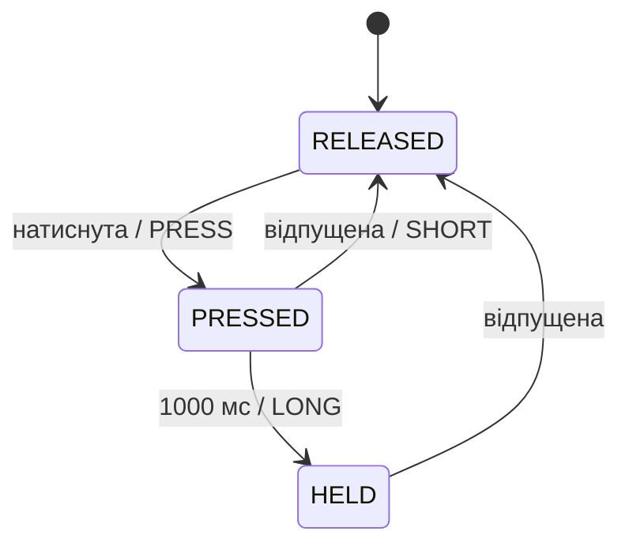
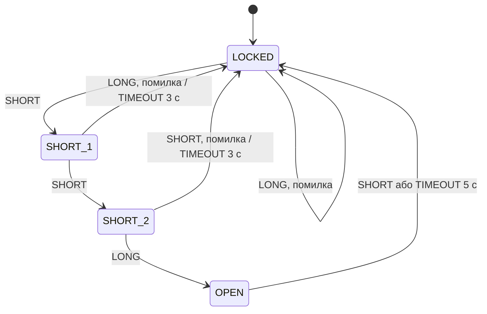

# ДЗ 6.4 — спільні автомати (common)

Ця папка містить автомат кнопки й автомат сейфа на C. Обидві прошивки, [`safe_fsm`](../safe_fsm/) для ESP32-S3 і [`safe_fsm_stm32`](../safe_fsm_stm32/) для STM32F411, збирають ці самі файли. Код не викликає FreeRTOS, GPIO і HAL, тому тести перевіряють його на ПК.

| Файл | Що містить |
|---|---|
| [`events.h`](events.h) | події `EVENT_*` і повідомлення черги `event_msg_t` |
| [`button_fsm.h`](button_fsm.h), [`button_fsm.c`](button_fsm.c) | автомат кнопки: `button_step()`, доставка в чергу `button_poll()` |
| [`safe_fsm.h`](safe_fsm.h), [`safe_fsm.c`](safe_fsm.c) | автомат сейфа: таблиця переходів `safe_step()`, таймаут, текст для логу |
| [`test/test_fsm.c`](test/test_fsm.c), [`test/run.sh`](test/run.sh) | тести на ПК |
| [`CMakeLists.txt`](CMakeLists.txt) | компонент ESP-IDF для нативної збірки |

Прошивка плати містить тільки периферію, чергу, задачі й лог.

| Що робить прошивка плати | Яку функцію викликає |
|---|---|
| кожні 10 мс читає пін кнопки | `button_poll(&button, pressed, now_ms, send, ctx)` |
| кладе подію в чергу | `send()`: обгортка над `xQueueSend` з таймаутом 0 |
| рахує, скільки чекати в `xQueueReceive` | `safe_wait_ms(&safe, now_ms)` |
| передає подію або `EVENT_TIMEOUT` автомату сейфа | `safe_handle(&safe, &msg, now_ms)` |
| пише рядок у лог | `safe_describe()` повертає текст і рівень `I` або `W` |

## Автомат кнопки (Producer)



`button_step(b, pressed, now_ms, &hold_ms)` отримує рівень піна й час і повертає подію. Якщо нічого не сталося, функція повертає `EVENT_NONE`.

- Усі інтервали функція рахує через різницю мілісекунд і порівнює через `>=`. Тому інший період опитування не ламає інтервали.
- Debounce приймає новий рівень, коли рівень не змінювався 30 мс. Debounce працює і для натискання, і для відпускання.
- Подія `LONG` приходить після 1000 мс утримання. Автомат не чекає на відпускання.
- Тривалість натискання автомат рахує від першого відліку нового рівня.

## Автомат сейфа (Consumer)



| Стан | `SHORT` | `LONG` | `TIMEOUT` | `PRESS` | `OVERFLOW` |
|---|---|---|---|---|---|
| `LOCKED` | `SHORT_1` | `LOCKED`, помилка | таймауту немає | без змін | `LOCKED` |
| `SHORT_1` | `SHORT_2` | `LOCKED`, помилка | `LOCKED` через 3 с | без змін | `LOCKED` |
| `SHORT_2` | `LOCKED`, помилка | `OPEN` | `LOCKED` через 3 с | без змін | `LOCKED` |
| `OPEN` | `LOCKED` | без змін | `LOCKED` через 5 с | без змін | `LOCKED` |

Функція `safe_step()` повертає новий стан для пари «стан, подія». Кожен `case` відповідає одному стану діаграми. Кожен `if` відповідає одній стрілці.

Помилка скидає автомат у `LOCKED`. Неправильне натискання не стає першим кроком нового пароля.

### Таймаут

Кожна подія з черги перезапускає таймаут: `safe_handle()` записує момент події. `safe_wait_ms()` повертає час, який залишився до таймауту. Прошивка передає цей час у `xQueueReceive`. Якщо подія не прийшла, прошивка передає автомату `EVENT_TIMEOUT`. У стані `LOCKED` таймауту немає: `safe_wait_ms()` повертає `SAFE_WAIT_FOREVER`, і `xQueueReceive` чекає з `portMAX_DELAY`.

Подія `PRESS` потрібна тільки для таймауту. `LONG` приходить через 1 с після натискання. Без `PRESS` таймаут рахувався б від попереднього `SHORT`. Після паузи 2,5 с `LONG` прийшов би через 3,5 с, і сейф скинувся б під час утримання.

### Переповнення черги

Кнопка кладе подію в чергу без чекання. Якщо черга повна, подія губиться, і послідовність натискань стає неповною. Наприклад, без другого `SHORT` пароль `S S L` перетворюється на `S L`.

`button_poll()` запам'ятовує втрату. На наступних опитуваннях функція спершу намагається доставити `EVENT_OVERFLOW`. Поки `EVENT_OVERFLOW` не доставлено, нові події теж губляться, бо вони належать до зламаної послідовності. Автомат сейфа за `OVERFLOW` переходить у `LOCKED` з будь-якого стану.

На платі черга на 8 подій не переповнюється. Кнопка дає не більше 2 подій за натискання, а сейф забирає їх одразу. Тому `OVERFLOW` перевіряють тільки тести на ПК.

## Тести на ПК

Запустіть з кореня репо:

```sh
"dz6.4 (STATE MACHINE)/common/test/run.sh"
```

Скрипт збирає тести компілятором ПК з `-std=c11 -Wall -Wextra -Wpedantic -Werror` і запускає їх. Кожен тест викликає функції автомата напряму і сам задає час у мілісекундах. Функція `poll()` у тестах опитує кнопку кожні 10 мс з однаковим рівнем.

| Тест | Що перевіряє |
|---|---|
| `table` | 8 послідовностей подій і кінцевий стан, `PRESS` і `OVERFLOW` у кожному стані |
| `button: short press` | `PRESS` через 30 мс, `SHORT` з тривалістю 150 мс |
| `button: long press` | `LONG` на 1000 мс без відпускання, після `LONG` відпускання не дає подій |
| `button: bounce` | 5 стрибків рівня за 8 мс дають один `PRESS` через 30 мс після останнього |
| `button: glitch while held` | 20 мс без контакту під час утримання не дають `SHORT` |
| `button: release at 990 ms` | `SHORT`, а не `LONG`, хоча debounce підтверджує відпускання після 1000 мс |
| `safe: input timeout` | `TIMEOUT` через 3000 мс після `SHORT`, у `LOCKED` таймауту немає |
| `safe: PRESS restarts the timeout` | `S S`, пауза 2500 мс, `LONG` через 3500 мс після `SHORT`: сейф відкритий |
| `safe: open closes itself` | `OPEN` чекає 5000 мс |
| `queue overflow` | фіктивна черга відкидає `SHORT`, наступне опитування надсилає `OVERFLOW` |

Результат: `51 checks, 0 failed`. Якщо перевірка не пройшла, тест виводить номер рядка й умову.

Тести перевірено помилками. Кожну помилку внесли в код окремо, і тести її знайшли.

| Помилка в коді | Тест, який упав |
|---|---|
| `PRESS` не перезапускає таймаут | `safe: PRESS restarts the timeout` |
| `LONG` без перевірки, що кнопку ще тримають | `button: release at 990 ms` |
| debounce тільки для натискання | `button: glitch while held` |
| `button_poll()` не запам'ятовує втрату | `queue overflow` |

## Параметри

| Параметр | Значення | Причина |
|---|---|---|
| `BUTTON_POLL_MS` | 10 мс | |
| `BUTTON_DEBOUNCE_MS` | 30 мс | 3 опитування, брязкіт кнопки триває близько 2 мс |
| `BUTTON_LONG_MS` | 1000 мс | |
| `SAFE_INPUT_TIMEOUT_MS` | 3000 мс | з умови |
| `SAFE_OPEN_MS` | 5000 мс | потім сейф закривається сам |

Константи задає `enum`, без `#define`. `_Static_assert` перевіряє зв'язки між ними під час збірки. Наприклад, debounce має тривати не менше 2 опитувань.

## Збірка

| Збірка | Як додає `common` |
|---|---|
| ESP-IDF, `tools/idf.sh` | `EXTRA_COMPONENT_DIRS` у [`../safe_fsm/CMakeLists.txt`](../safe_fsm/CMakeLists.txt), компонент [`CMakeLists.txt`](CMakeLists.txt) |
| PlatformIO, env `idf_safe_fsm` | [`src/CMakeLists.txt`](../../src/CMakeLists.txt) додає `*.c` з папки `common` поруч з варіантом |
| PlatformIO, env `stm32_safe_fsm` | `build_src_filter` і `build_flags -I` у [`platformio.ini`](../../platformio.ini) |
