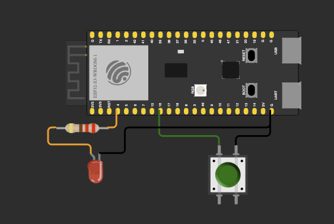
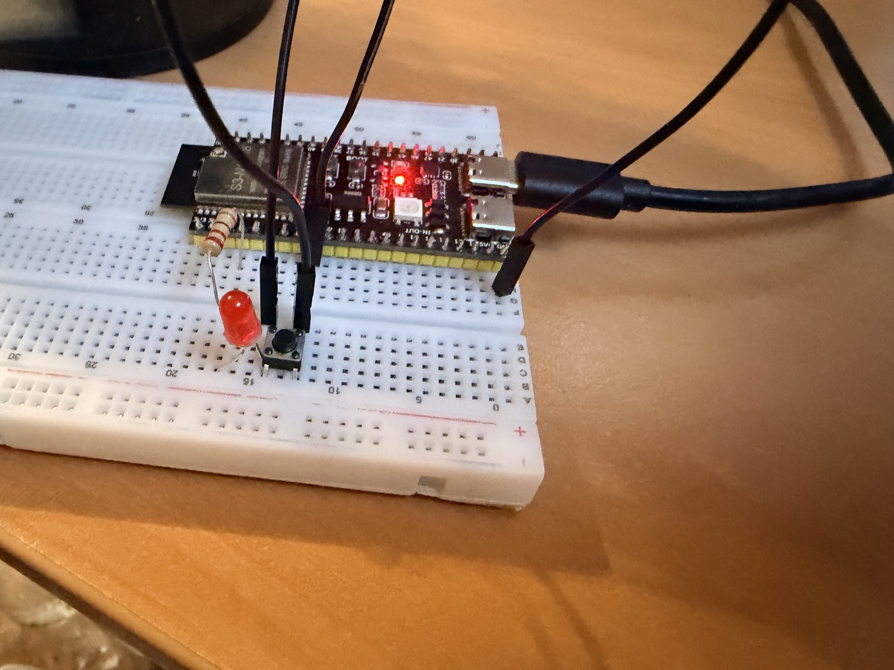

# ДЗ 6.4 — safe_fsm (STATE MACHINE)

Прошивка для **ESP32-S3-DevKitC-1**. Прошивка відкриває електронний сейф, коли користувач вводить пароль однією кнопкою: коротке, коротке, довге натискання.

| Задача | Роль з умови | Що робить |
|---|---|---|
| `button` | Producer | автомат кнопки: опитує GPIO 16 кожні 10 мс і кладе в чергу події `PRESS`, `SHORT`, `LONG` |
| `safe` | Consumer | автомат сейфа: читає чергу, перемикає стан і керує світлодіодом |

Автомати не знають один про одного. Між ними є тільки черга FreeRTOS на 8 подій.

## Підключення

| Компонент | Пін ESP32-S3 | Примітка |
|---|---|---|
| тактова кнопка | GPIO 16 | другий контакт на GND, внутрішня підтяжка до живлення |
| світлодіод | GPIO 4 | через резистор 220 Ом, катод на GND |

Світлодіод світиться, поки сейф відкритий.

| Схема (Wokwi) | Зібрана плата |
|---|---|
|  |  |

## Як працює код

Файли: [`main/main.c`](main/main.c) і спільні автомати в [`../common`](../common/). Діаграми станів, таблицю переходів, таймаут і тести на ПК описує [README спільних автоматів](../common/).

`main.c` містить тільки периферію, чергу, задачі й лог:
- `button_task` кожні 10 мс читає GPIO 16 і викликає `button_poll()`. Період задає `vTaskDelayUntil`.
- `queue_send` кладе подію в чергу через `xQueueSend` з таймаутом 0. Якщо черга повна, функція виводить `queue full` і повертає `false`. Тоді `button_poll()` надішле `OVERFLOW`.
- `safe_task` чекає в `xQueueReceive` стільки, скільки повернула `safe_wait_ms()`. Подію або `EVENT_TIMEOUT` задача передає в `safe_handle()`.
- Після переходу `safe_task` вмикає або вимикає світлодіод. Рядок для логу дає `safe_describe()`, рівень `W` іде в `ESP_LOGW`, рівень `I` іде в `ESP_LOGI`.

| Параметр | Значення | Причина |
|---|---|---|
| черга | 8 подій | `button` не чекає місця в черзі |
| пріоритет `button` | 5 | опитування не залежить від `safe` |
| пріоритет `safe` | 4 | |
| ядро обох задач | 1 | |
| стек задачі | 3072 байти | |
| тік | 1 мс | `CONFIG_FREERTOS_HZ=1000` у [`sdkconfig.defaults`](sdkconfig.defaults) |

## Лог плати

Плата записала 2 логи, кнопку натискала людина. Логи записала перша версія прошивки на C++, до перенесення автоматів у `common`. Ця версія мала ті самі автомати, переходи й формат логу. Після переробки симулятор дав лог, ідентичний до мілісекунди.

| Лог | Натискання | Результат |
|---|---|---|
| [`serial.log`](serial.log) | випадки 1–5 з таблиці симулятора | 15 натискань дали 15 `PRESS`, 10 `SHORT`, 5 `LONG`, кожен випадок дав очікуваний стан |
| [`serial_hold.log`](serial_hold.log) | 5 разів `S S`, пауза, `L`, `S` | 5 відкриттів і 5 закриттів |

Короткі натискання тривали від 100 до 170 мс. Брязкіт кнопки не дав жодної зайвої події.

У `serial.log` пауза випадку 5 тривала 2,0 с. Тому `LONG` прийшов через 2970 мс після `SHORT`, і цей випадок не перевіряє таймаут. Тому плата записала другий лог. Інтервал від останнього `SHORT` до `LONG` у 5 спробах:

| Спроба | Пауза до `PRESS` | Від `SHORT` до `LONG` | Результат |
|---|---|---|---|
| 1 | 450 мс | 1420 мс | `OPEN` |
| 2 | 1440 мс | 2410 мс | `OPEN` |
| 3 | 1730 мс | 2700 мс | `OPEN` |
| 4 | 2400 мс | 3370 мс | `OPEN` |
| 5 | 1880 мс | 2850 мс | `OPEN` |

Спроба 4 з [`serial_hold.log`](serial_hold.log):

```
I (68342) safe: SHORT    150 ms  SHORT_1 -> SHORT_2
I (70742) safe: PRESS            SHORT_2, timer restarted
I (71712) safe: LONG    1000 ms  SHORT_2 -> OPEN, safe is open
```

У спробі 4 `LONG` прийшов через 3370 мс після `SHORT`, тобто пізніше за таймаут 3000 мс. Сейф відкрився, бо `PRESS` перезапустив таймаут на 70742 мс.

## Результати в симуляторі

Прошивку перевірено в Wokwi через `wokwi-cli` до і після перенесення автоматів у `common`. Обидва прогони дали однакові події, переходи й час кожного рядка. Сценарій [`scenario.yaml`](scenario.yaml) натискає кнопку 15 разів у 5 випадках. Кнопка Wokwi має брязкіт. Повний лог: [`wokwi.log`](wokwi.log).

| Випадок | Натискання | Результат |
|---|---|---|
| 1 | `S S L`, потім 6 с паузи | `OPEN`, через 5000 мс `LOCKED` |
| 2 | `S L` | `LONG` у `SHORT_1`: `wrong input` |
| 3 | `S S S L` | третій `SHORT`: `wrong input`, потім `LONG` у `LOCKED`: `wrong input` |
| 4 | `S`, пауза 3,5 с, `L` | `TIMEOUT` через 3000 мс, потім `LONG` у `LOCKED`: `wrong input` |
| 5 | `S S`, пауза 2,5 с, утримання 1,6 с, `S` | `OPEN`, потім `SHORT` закриває сейф |

Фрагмент лога, випадок 5:

```
I (24502) safe: SHORT     200 ms  LOCKED -> SHORT_1
I (24902) safe: PRESS             SHORT_1, timer restarted
I (25102) safe: SHORT     200 ms  SHORT_1 -> SHORT_2
I (27602) safe: PRESS             SHORT_2, timer restarted
I (28572) safe: LONG     1000 ms  SHORT_2 -> OPEN, safe is open
I (29802) safe: PRESS             OPEN, timer restarted
I (30002) safe: SHORT     200 ms  OPEN -> LOCKED, safe is closed
```

Лог показує такі факти:
- 15 натискань дали 15 подій `PRESS`, 10 `SHORT` і 5 `LONG`. Брязкіт не дав жодної зайвої події.
- `PRESS` приходить через 30 мс після натискання, бо debounce чекає 30 мс.
- У випадку 5 `LONG` прийшов через 3470 мс після останнього `SHORT`. Сейф відкрився, бо `PRESS` перезапустив таймаут.
- Успішне відкриття має рівень `I`. Помилка і таймаут мають рівень `W`.

## Запуск

### На платі, нативний ESP-IDF 5.5.5

1. Підключіть кнопку і світлодіод за таблицею підключення.
2. Підключіть плату через USB.
3. Запустіть з кореня репо:
   ```sh
   ./tools/idf.sh "dz6.4 (STATE MACHINE)/safe_fsm" flash monitor
   ```

### На платі, PlatformIO

1. Прошийте плату:
   ```sh
   pio run -e idf_safe_fsm -t upload
   ```
2. Відкрийте монітор порту:
   ```sh
   pio device monitor -e idf_safe_fsm
   ```

### У симуляторі (Wokwi for VS Code)

1. Зберіть прошивку: `pio run -e idf_safe_fsm`.
2. Виконайте `Wokwi: Select Config File` і виберіть [`wokwi.toml`](wokwi.toml).
3. Відкрийте [`diagram.json`](diagram.json).
4. Виконайте `Wokwi: Start Simulator`.

Щоб записати лог без VS Code, запустіть з папки прошивки:

```sh
~/.wokwi/bin/wokwi-cli . --scenario scenario.yaml --timeout 36000 \
  --serial-log-file wokwi.log
```

Для `wokwi-cli` потрібен токен у змінній `WOKWI_CLI_TOKEN`.

## Файли

| Файл | Опис |
|---|---|
| [`main/main.c`](main/main.c) | прошивка: периферія, черга, задачі, лог |
| [`../common`](../common/) | автомати кнопки й сейфа, тести на ПК |
| [`CMakeLists.txt`](CMakeLists.txt) | проєкт ESP-IDF, додає `../common` як компонент |
| [`schema.png`](schema.png) | схема у Wokwi |
| [`photo.jpeg`](photo.jpeg) | фото зібраної схеми |
| [`sdkconfig.defaults`](sdkconfig.defaults) | налаштування ESP-IDF |
| [`diagram.json`](diagram.json) | схема для Wokwi |
| [`wokwi.toml`](wokwi.toml) | конфіг симулятора |
| [`scenario.yaml`](scenario.yaml) | сценарій `wokwi-cli`: 15 натискань у 5 випадках |
| [`serial.log`](serial.log) | лог плати, випадки 1–5 |
| [`serial_hold.log`](serial_hold.log) | лог плати, 5 спроб з паузою перед `LONG` |
| [`wokwi.log`](wokwi.log) | лог симулятора |
