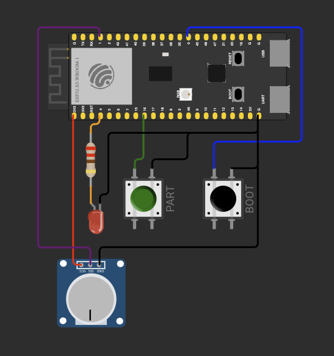
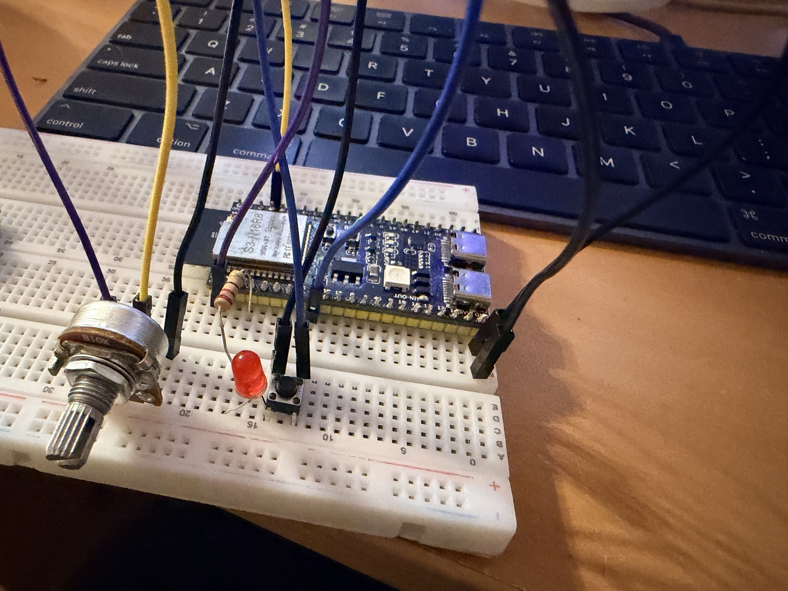
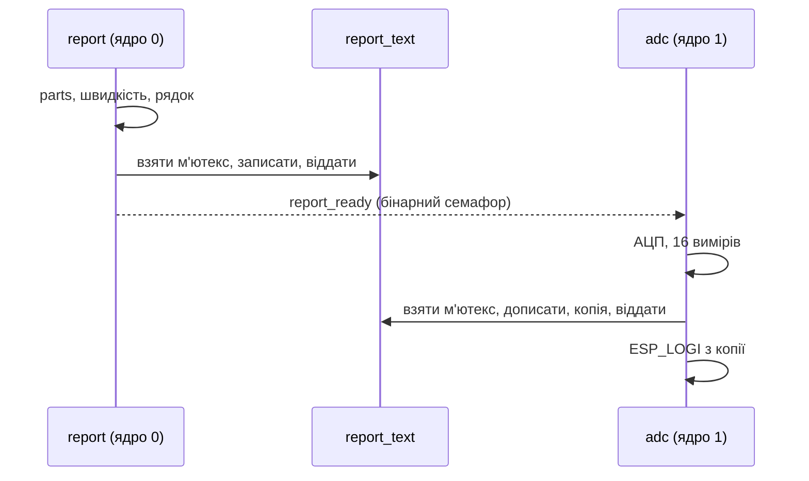

# ДЗ 6.5 — conveyor (MUTEX SEMAPHORE)

Прошивка для **ESP32-S3-DevKitC-1**. Прошивка лічить деталі на конвеєрі, раз на секунду складає звіт з двох ядер і зупиняє конвеєр кнопкою аварійної зупинки.

| Виконавець | Ядро | Пріоритет | Що робить |
|---|---|---|---|
| `part_isr` | 0 | ISR | датчик деталі: додає 1 до лічильника `parts` |
| `stop_isr` | 0 | ISR | аварійна зупинка: дає семафор `stop_signal` |
| `report` (Task 1) | 0 | 5 | раз на секунду читає `parts`, рахує швидкість і пише початок звіту |
| `adc` (Task 2) | 1 | 5 | читає АЦП і дописує напругу в той самий буфер звіту |
| `estop` (Task 3) | 0 | 10 | чекає на `stop_signal`, потім зупиняє конвеєр |

## Підключення

| Компонент | Пін ESP32-S3 | Примітка |
|---|---|---|
| тактова кнопка, датчик деталі | GPIO 16 | другий контакт на GND, внутрішня підтяжка до живлення |
| кнопка BOOT, аварійна зупинка | GPIO 0 | кнопка на платі, підключати нічого не треба |
| світлодіод тривоги | GPIO 4 | через резистор 220 Ом, катод на GND |
| потенціометр, повзунок | GPIO 1 (ADC1, канал 0) | крайні виводи на 3V3 і GND |

Кнопка і світлодіод стоять так само, як у ДЗ 6.4. Потенціометр стоїть так само, як у ДЗ 6.3. Кнопка-датчик замінює оптичний датчик з умови.

| Схема (Wokwi) | Зібрана плата |
|---|---|
|  |  |

## Як працює код

Файл: [`main/main.cpp`](main/main.cpp)

### Спільні дані

| Дані | Хто пише | Хто читає | Захист |
|---|---|---|---|
| `parts` | `part_isr` | `report`, `estop` | спінлок `parts_lock` |
| `report_text` | `report`, `adc`, `estop` | `adc`, `estop` | м'ютекс `report_mutex` |
| `halted` | `estop`, один раз | `report`, `adc` | читання під `report_mutex` |

`report` і `adc` працюють на різних ядрах. Тому обидві задачі можуть звернутися до `report_text` в одну мікросекунду. М'ютекс пропускає до буфера тільки одну задачу.

### Лічильник деталей

`part_isr` спрацьовує на обох фронтах GPIO 16. ISR додає деталь, якщо перед фронтом лінія мовчала 30 мс і стояла в стані «відпущено». Брязкіт дає фронти частіше за 30 мс. Тому брязкіт при натисканні і при відпусканні не додає другу деталь.

`parts = parts + 1` має три кроки: прочитати, додати, записати. ISR робить ці кроки під спінлоком `parts_lock`, задачі читають `parts` теж під ним. Взяти м'ютекс в ISR не можна, бо ISR не може чекати.

Рівень піна ISR читає функцією `gpio_get_level()`. Опція `CONFIG_GPIO_CTRL_FUNC_IN_IRAM=y` у [`sdkconfig.defaults`](sdkconfig.defaults) кладе цю функцію в IRAM.

### Буфер звіту



`report` пише рядок з початку буфера, а `adc` дописує в кінець. Порядок важливий. Якщо `adc` допише раніше, наступний запис `report` зітре дописане. Бінарний семафор `report_ready` задає порядок, а м'ютекс захищає байти буфера.

Обидві задачі тримають м'ютекс якомога коротше. АЦП, `snprintf` і вивід у консоль задачі виконують поза критичною секцією. Усередині є тільки `memcpy`.

Швидкість задача `report` рахує за останні 10 с: деталі за 10 с, помножені на 6. У перші 10 с після старту вікно коротше, від 1 до 9 с.

### Аварійна зупинка

`estop` чекає на `stop_signal` з `portMAX_DELAY`. Без події задача не має роботи, тому вона не займає процесор. `stop_isr` дає семафор і викликає `portYIELD_FROM_ISR`. Тому `estop` починає роботу одразу після виходу з ISR, а не на наступному тіку.

`estop` виконує дії в такому порядку:

1. Вмикає світлодіод.
2. Вимикає переривання датчика і BOOT. Датчик більше не лічить деталі.
3. Задає `halted = true`.
4. Бере `report_mutex` і пише `SYSTEM HALTED!` у буфер.

Перші три кроки не залежать від м'ютекса. Конвеєр зупиниться, навіть якщо м'ютекс не віддали за 100 мс.

`report` і `adc` перевіряють `halted` під м'ютексом, у тій самій критичній секції, що й запис. Без цього можливий стан гонки. `report` прочитав би `halted = false`, `estop` записав би `SYSTEM HALTED!`, а `report` переписав би його звітом. Після зупинки обидві задачі пишуть у лог `task stopped` і видаляють себе.

Якщо м'ютекс тримає `report` або `adc`, FreeRTOS піднімає її пріоритет до 10. Так працює успадкування пріоритету. В ESP-IDF воно ввімкнене для кожного м'ютекса.

### Параметри

| Параметр | Значення | Причина |
|---|---|---|
| debounce датчика | 30 мс тиші | брязкіт кнопки триває близько 2 мс |
| період звіту | 1000 мс | з умови |
| вікно швидкості | 10 с | |
| таймаут м'ютекса | 100 мс | не `portMAX_DELAY`: зависання видно в лозі |
| таймаут `report_ready` | 1500 мс | довший за період звіту |
| буфер звіту | 64 байти | рядок звіту займає до 50 байтів |
| пріоритет `report` і `adc` | 5 | |
| пріоритет `estop` | 10 | найвищий з умови |
| ядро `estop` | 0 | там працює сервіс переривань GPIO, тому `portYIELD_FROM_ISR` перемикає це ядро |
| тік | 1 мс | `CONFIG_FREERTOS_HZ=1000` у [`sdkconfig.defaults`](sdkconfig.defaults) |

## Лог плати

Прошивку зібрав нативний ESP-IDF 5.5.5. Кнопки натискала людина: 10 натискань повільно, 20 натискань швидко, потім BOOT. Між серіями людина повернула потенціометр від краю до краю. Повний лог: [`serial.log`](serial.log).

| Показник | Результат |
|---|---|
| натискань кнопки-датчика до BOOT | 30 |
| `parts` в останньому звіті | 30 |
| найбільша швидкість | 120,0 деталей/хв |
| напруга потенціометра | від 0 до 3147 мВ |
| від ISR до `estop` | 21 мкс |
| `estop` чекав на м'ютекс і писав буфер | 15 мкс |
| `report` зупинилась після BOOT | через 928 мс, на своєму наступному звіті |
| `adc` зупинилась після BOOT | через 1430 мс, після таймауту `report_ready` |

Брязкіт кнопки не додав жодної зайвої деталі. Фрагмент лога, кінець другої серії і BOOT:

```
I (347284) report: parts 29, rate 114.0/min; pot 0 mV
I (348284) report: parts 30, rate 120.0/min; pot 0 mV
I (352284) report: parts 30, rate 96.0/min; pot 0 mV
E (352356) report: SYSTEM HALTED!
W (352356) estop: parts 30, ISR -> estop 21 us, mutex 15 us
W (353284) report: conveyor halted, task stopped
W (353786) adc: conveyor halted, task stopped
```

## Результати в симуляторі

Прошивку перевірено в Wokwi через `wokwi-cli`. Сценарій [`scenario.yaml`](scenario.yaml) натискає кнопку-датчик 20 разів, повертає потенціометр і натискає BOOT. Кнопка Wokwi має брязкіт. Повний лог: [`wokwi.log`](wokwi.log).

| Показник | Результат |
|---|---|
| натискань кнопки-датчика | 20: 10 з періодом 500 мс, 10 з періодом 250 мс |
| `parts` в останньому звіті | 20 |
| від ISR до `estop` | 16 мкс |
| `estop` чекав на м'ютекс і писав буфер | 48 мкс |

## Запуск

### На платі, нативний ESP-IDF 5.5.5

1. Підключіть кнопку, світлодіод і потенціометр за таблицею підключення.
2. Підключіть плату через USB.
3. Запустіть з кореня репо:
   ```sh
   ./tools/idf.sh "dz6.5 (MUTEX SEMAPHORE)/conveyor" flash monitor
   ```

### На платі, PlatformIO

1. Прошийте плату:
   ```sh
   pio run -e idf_conveyor -t upload
   ```
2. Відкрийте монітор порту:
   ```sh
   pio device monitor -e idf_conveyor
   ```

### У симуляторі (Wokwi for VS Code)

1. Зберіть прошивку: `pio run -e idf_conveyor`.
2. Виконайте `Wokwi: Select Config File` і виберіть [`wokwi.toml`](wokwi.toml).
3. Відкрийте [`diagram.json`](diagram.json).
4. Виконайте `Wokwi: Start Simulator`.

Щоб записати лог без VS Code, запустіть з папки прошивки:

```sh
~/.wokwi/bin/wokwi-cli . --scenario scenario.yaml --timeout 30000 \
  --serial-log-file wokwi.log
```

Для `wokwi-cli` потрібен токен у змінній `WOKWI_CLI_TOKEN`.

## Файли

| Файл | Опис |
|---|---|
| [`main/main.cpp`](main/main.cpp) | прошивка |
| [`schema.png`](schema.png) | схема у Wokwi |
| [`photo.jpeg`](photo.jpeg) | фото зібраної схеми |
| [`sdkconfig.defaults`](sdkconfig.defaults) | налаштування ESP-IDF |
| [`diagram.json`](diagram.json) | схема для Wokwi |
| [`wokwi.toml`](wokwi.toml) | конфіг симулятора |
| [`scenario.yaml`](scenario.yaml) | сценарій `wokwi-cli`: 20 деталей і BOOT |
| [`serial.log`](serial.log) | лог плати |
| [`wokwi.log`](wokwi.log) | лог симулятора |
